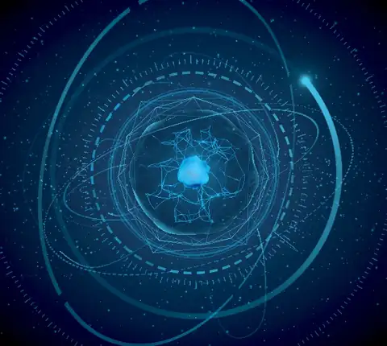
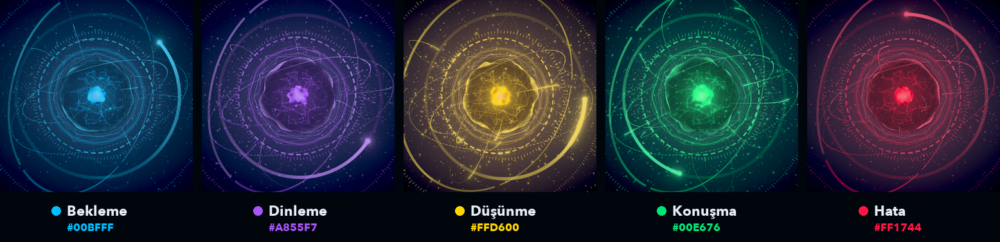
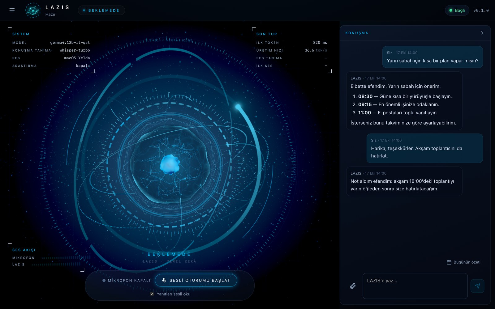
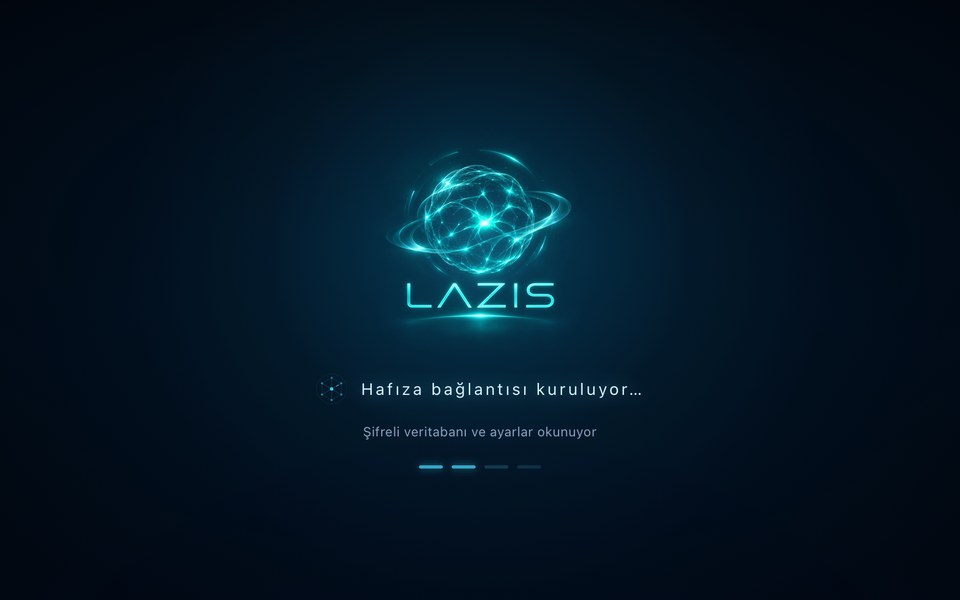
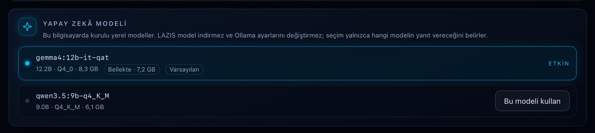
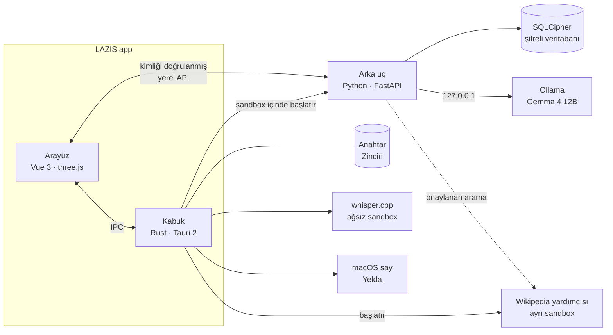
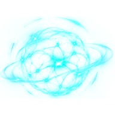

<p align="center">
  
</p>

<h3 align="center">Mac'inizde yaşayan, Türkçe konuşan kişisel yapay zekâ asistanı</h3>

<p align="center">
  <b>Tamamen yerel.</b> Bulut yok · telemetri yok · konuşmalarınız yalnızca bu bilgisayarda
</p>

<p align="center">
  
  
  
  
  
  
</p>

---

## Yaşayan çekirdek

<p align="center">
  
</p>

LAZIS'in merkezinde, o an ne yaptığını gösteren üç boyutlu bir enerji çekirdeği var:
- **Sinir ağı:** 130 düğümlü bir ağ; bağlantılarında kendi hızlarında ilerleyen enerji paketleri dolaşıyor.
- **Derinlik:** Cam bir zar ve ışığı soğuran koyu bir gövde çekirdeğe derinlik veriyor.
- **Ses:** Dinlerken mikrofona, konuşurken Yelda'nın sesine gerçek ölçülen seviyeyle tepki veriyor.
- **Dürüstlük:** Sahte bir "düşünüyor" animasyonu yok; her renk gerçek bir durumu gösteriyor.

<p align="center">
  
</p>

## Arayüz

<p align="center">
  
</p>

<table>
  <tr>
    <td width="46%"></td>
    <td></td>
  </tr>
  <tr>
    <td><sub><b>Açılış</b> · Her mesaj gerçek bir başlatma aşamasına bağlı; sahte ilerleme yok.</sub></td>
    <td><sub><b>Yapay Zekâ Modeli</b> · Bilgisayardaki yerel modeller arasından seçim; LAZIS model indirmez.</sub></td>
  </tr>
</table>

## Neler yapar

| | |
|---|---|
| **Tek, kesintisiz asistan** | Sohbet listesi yok, tek bir zaman çizelgesi var. Yanıtlar akış hâlinde gelir; durdurulabilir; yarıda kalan yanıt kurtarılır. Uzun konuşmalar, kaynağıyla denetlenen özetlerle sıkıştırılır. |
| **Kişisel hafıza** | "Bunu hatırla" dediğinizde kaydeder, istediğinizde unutur. Kişileri, projeleri ve aralarındaki ilişkileri bilir; aynı adı taşıyan kişileri karıştırmaz. Gerçekten kaydetmediği bir şeye "not aldım" demez. Otomatik öğrenme kapalıdır. |
| **Türkçe sesli oturum** | Whisper ile konuşma tanıma, Yelda ile sesli yanıt. Pencere gizlendiğinde ya da ekran kilitlendiğinde mikrofon kapanır. |
| **Belgeler** | TXT, PDF ve DOCX dosyaları (10 MB'a kadar) hakkında soru sorabilirsiniz. Belge yalnızca o oturumun belleğinde tutulur. |
| **Wikipedia araştırması** | Varsayılan olarak kapalıdır. Her arama gönderilmeden önce size gösterilir ve onayınızı bekler. |
| **Kişilik ve üslup** | "Siz" ya da "sen" diye hitap ve yanıt uzunluğu sizin seçiminiz. Dürüst bir asistan; gerektiğinde itiraz eder. |
| **Masaüstüne yerleşik** | Menü çubuğu simgesi, çöken arka ucu otomatik yeniden başlatma, uyku ve uyanmayı izleme, konuşma içeriği içermeyen tanılama ekranı. |

## Gizlilik ve güvenlik

- **Şifreleme:** Veritabanı SQLCipher ile şifreli. Anahtar macOS Anahtar Zinciri'nde; bir kurtarma koduyla geri yüklenebilir.
- **Sandbox:** Her süreç kendi macOS sandbox profilinde çalışır:
  - Arka uç yalnızca yerel Ollama'ya ulaşabilir.
  - Konuşma tanımanın ağ erişimi yoktur.
  - Wikipedia'ya ayrı bir yardımcı süreç gider.
- **İz bırakmama:** Telemetri yok; günlüklere konuşma içeriği yazılmaz.

## Mimari



| Katman | Teknoloji |
|---|---|
| Masaüstü kabuğu | Rust, Tauri 2: menü çubuğu, tek örnek, arka ucun yaşam döngüsü |
| Arayüz | Vue 3, TypeScript, Pinia, vue-i18n, Vite |
| 3B çekirdek | three.js, özel GLSL gölgelendiriciler, bloom ve ton koruyan son işlem |
| Arka uç | Python 3.13, FastAPI, Uvicorn, Pydantic |
| Veri | SQLCipher, macOS Anahtar Zinciri |
| Ses | whisper.cpp, macOS `say`, Web Audio |
| Güvenlik | Süreç başına macOS sandbox profilleri (`sandbox-exec`) |

## Modeller

| Görev | Model | Not |
|---|---|---|
| Sohbet (varsayılan) | **Gemma 4 12B** · `gemma4:12b-it-qat` | Hafızaya yazmaya yetkili tek model |
| Yedek | Qwen 3.5 9B · `qwen3.5:9b-q4_K_M` | Ayarlar → Yapay Zekâ Modeli'nden seçilir |
| Konuşma tanıma | Whisper large-v3-turbo (q5_0, ~574 MB) | Ağ erişimi olmayan sandbox'ta |
| Ses | macOS **Yelda** | Türkçe, cihazda |

## Hızlı başlangıç

Gerekenler: Apple Silicon bir Mac, Xcode Command Line Tools, [uv](https://docs.astral.sh/uv/), pnpm (Node 24+), Rust (stable) ve [Ollama](https://ollama.com).

```bash
make setup                      # Python, Node ve Rust bağımlılıkları
ollama pull gemma4:12b-it-qat   # varsayılan model
make dev                        # uygulamayı ayrı bir geliştirme profiliyle açar
make check                      # tüm denetimler ve testler
```

Sesli oturum için konuşma modeli: `make voice-model APPROVED=yes`. Ayrıntılar için [geliştirici kılavuzu](docs/DEVELOPER_GUIDE.md).

<sub>[Mimari](docs/ARCHITECTURE.md) · [Yol haritası](docs/DEVELOPMENT_ROADMAP.md) · [Mimari kararlar (ADR)](docs/adr) · [Güvenilirlik kayıtları](docs/RELIABILITY_ISSUES.md)</sub>

---

<p align="center">
  <br>
  <b>Geliştirici: Göktürk Doğan</b><br>
  <a href="https://github.com/gokturkdogan">github.com/gokturkdogan</a>
</p>
