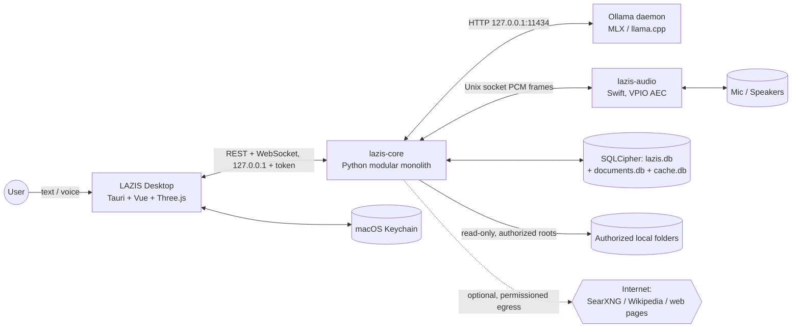
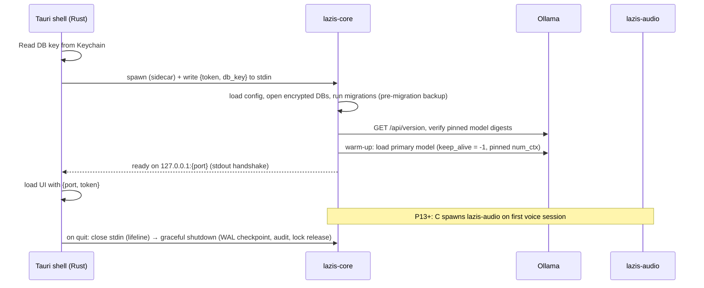
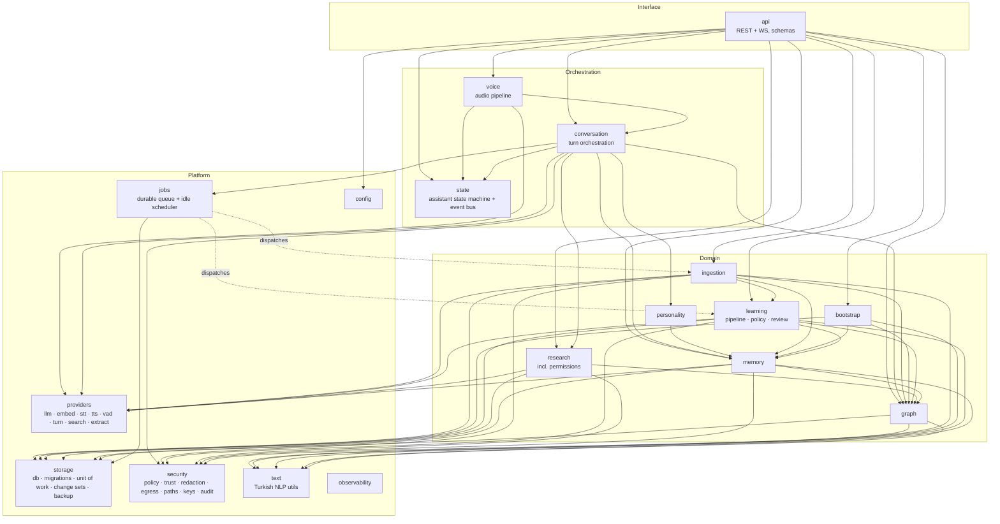
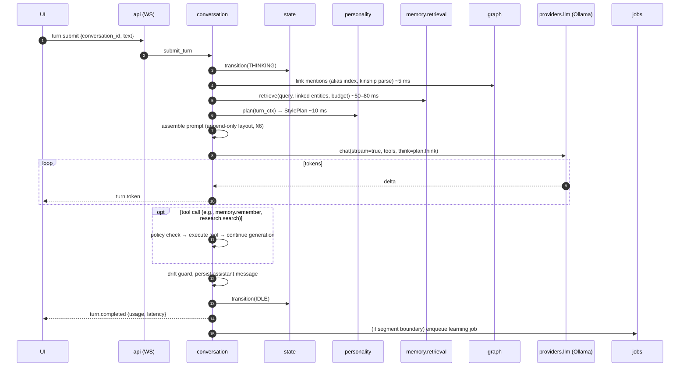
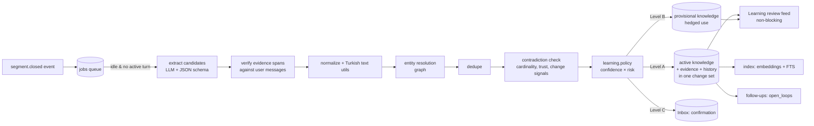
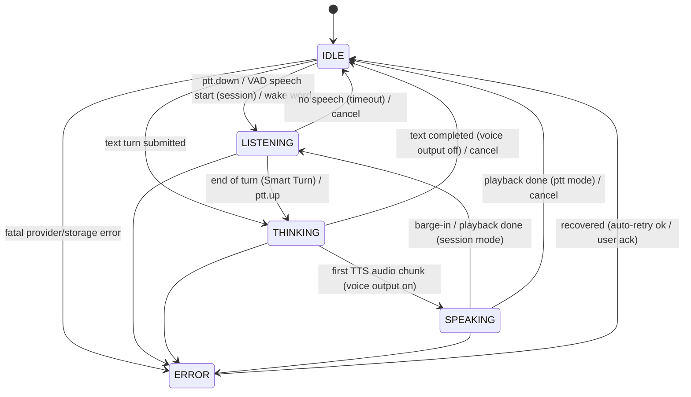

# LAZIS — System Architecture

> Status: Phase 0.1 (revised), updated with the Phase 1 implementation, Phase 1.1 hardening, Phase 2 local inference (§7.1, §8.1) and the Phase 3 conversation engine (§6.1, §8.1, §13.1) · Last updated: 2026-10-17
> Phase 1 as built: [PHASE_1_REPORT.md](PHASE_1_REPORT.md) (Turkish) and [DEVELOPER_GUIDE.md](DEVELOPER_GUIDE.md). Where this blueprint and the code differ, §3.1, §11.1, §12 and §13.1 describe the implemented state.
> Decisions referenced here are justified in [TECHNOLOGY_DECISIONS.md](TECHNOLOGY_DECISIONS.md). Phase numbers (P1–P15) follow [DEVELOPMENT_ROADMAP.md](DEVELOPMENT_ROADMAP.md). Coding rules: [ENGINEERING_STANDARDS.md](ENGINEERING_STANDARDS.md).

## 1. Architectural style

**Modular monolith.** All domain logic lives in one Python process, `lazis-core`, organized into modules with explicit public interfaces and enforced dependency rules. A few processes sit around it, each for a concrete technical reason, not for "microservices":

| Process | Why it is separate |
|---|---|
| **LAZIS Desktop** (Tauri 2 / Rust + WKWebView UI) | The native window, tray, global hotkeys, Keychain and process supervision belong in the shell. The UI runs in the WebView. |
| **lazis-core** (Python 3.13) | The domain monolith: conversation, personality, memory, graph, learning, ingestion, research, voice orchestration, storage, API. |
| **Ollama** (external daemon) | Owns LLM and embedding model lifecycle on the GPU: MLX runner for MLX-format tags, llama.cpp runner for GGUF tags (which one serves each tag is verified in P2). Crash isolation; swappable via the provider abstraction. |
| **lazis-audio** (Swift helper, P13) | Real-time audio I/O through macOS Voice-Processing I/O for system-grade echo cancellation. Python callbacks are not real-time safe. |
| **Document parser worker** (subprocess of lazis-core, P11) | Parses untrusted PDF/HTML/Markdown files under resource limits, isolated from the main process. |
| **SearXNG** (optional native install, P12; no Docker) | A self-hosted metasearch for privacy-preserving research. Entirely optional; the default providers need no extra service. |

Why not microservices: one user, one machine. Distributed state would add failure modes (network partitions, eventual consistency) and buy nothing.
Why not "everything in Rust/Tauri": the local-AI ecosystem (MLX, mlx-audio, mlx-whisper, ONNX models, trafilatura, sqlite-vec bindings) is strongest in Python, and development speed matters over a multi-year horizon. Rust stays a thin shell.

## 2. System context



## 3. Process topology and lifecycle



### 3.1 Implemented in P1

The desktop shell already exists in P1 (the Phase 1 brief required it), so the "core runs standalone with its own Keychain access" stage was dropped. **Only the Rust shell touches the Keychain**; `lazis-core` never does.

1. The shell resolves the **profile** (`default` for release builds, `dev` for debug builds; `LAZIS_PROFILE` overrides): separate data dir, logs, config, desktop state and Keychain item per profile.
2. **Key resolution:** Keychain item present → use it. Missing and no database → generate 32 bytes with `SecRandomCopyBytes`, store, read back, and only then start the backend (a database can never be created with a key that was not persisted). Missing but a database exists → `needs_recovery` (no new key). Keychain denied → `keychain_denied`.
3. **Spawn:** `/usr/bin/sandbox-exec -p <sandbox/backend.sb> core/.venv/bin/python -I -m lazis serve --stdin-secrets --require-os-sandbox --environment … --data-dir … --log-dir … --config …` with a cleared environment (HOME, TMPDIR, LANG, a fixed PATH). `sandbox-exec` applies the OS network sandbox (no connection to another host, no DNS — [SECURITY_MODEL.md §5.3](SECURITY_MODEL.md)) and execs Python in the same process. The backend closes descriptors inherited from the shell, verifies the sandbox itself and refuses to start without it. The session token (per launch) and the key are written to stdin as one JSON line; **stdin then stays open as a lifeline**. The shell also reads FileVault's state (`fdesetup isactive`) for the privacy card.
4. **Handshake:** stdout `LAZIS_READY {protocol, port, pid, api_version, …}` or `LAZIS_FATAL {code}` (exit 3). Timeout 30 s. `database_key_invalid` → `needs_recovery`.
5. **Shutdown:** the shell closes stdin → the backend stops gracefully (checkpoint, audit `app.stopped`, lock release); escalation SIGTERM (after 7 s) → SIGKILL (after 3 s more); the child is always reaped. If the shell dies (even SIGKILL), the kernel closes the pipe and the backend exits by itself (measured: 0.35 s). A parent-PID watcher is a second guard.
6. **Duplicates and ports:** the Tauri single-instance plugin focuses the existing window; the backend holds a per-profile `flock` on the data directory for as long as the database is open (`instance_already_running`; since P1.1 owned by `storage` so restores respect it too); the port is chosen by the OS (`port=0`) and reported in the handshake, so there are no port conflicts and no port metadata is written to disk.
7. **Supervision in P1:** an unexpected backend exit is detected (stdout EOF) and shown as `backend_exited` with a retry action. Automatic restart with backoff stays in P4.
8. **Restore (P1.1, no UI yet):** `storage.backup.restore_snapshot` takes the same lock, validates, stages, moves the current files aside, installs, verifies and commits by atomically marking its durable journal `committed`; the old files then move to `backups/pre-restore-<stamp>/`. `open_storage` first finishes or rolls back any restore interrupted by a crash ([SECURITY_MODEL.md §5.1](SECURITY_MODEL.md)).

- **Supervision:** Tauri restarts `lazis-core` with backoff if it crashes (max 3 in 60 s, then ERROR state with diagnostics). `lazis-core` restarts `lazis-audio` the same way.
- **Ollama:** treated as an external dependency. If it is unreachable, the system enters ERROR with a recoverable reason (`llm_unavailable`) and retries. LAZIS sets the required environment (`OLLAMA_NO_CLOUD=1`, `OLLAMA_HOST=127.0.0.1`) through a launch agent created by the setup script.
- **Development mode:** `make dev` (`pnpm tauri dev`) runs the shell with the `dev` profile and the Vite dev server; the backend then allows the extra origin `http://localhost:1420`. The backend can also be started alone for tests (`python -m lazis serve --stdin-secrets`).

## 4. Module map (lazis-core)



Within the Domain layer, dependencies are also acyclic: `personality → memory → graph`; `learning → memory, graph`; `ingestion → learning`; `bootstrap → memory, graph`; `research → graph` (entity visibility only).

**Dependency rules (enforced by `import-linter` contracts in CI):**
1. Arrows point toward lower layers only: Interface → Orchestration → Domain → Platform. There are no upward imports and no cycles.
2. Domain modules depend on **ports** (Protocols in `providers/ports.py`), never on concrete providers. Concrete providers are wired in `app/container.py`.
3. `conversation` never calls `learning` directly. It publishes `segment.closed` events, and `jobs` dispatches learning work. This decouples foreground latency from background work.
4. `graph` owns the entity and relationship tables, and `memory` references entity IDs. Only `graph` writes entity, alias and relationship tables, and the entity-reference tables `entity_mentions` and `memory_entity_links` (so merges, splits and identity corrections stay inside one module). Its entity core exists from P6, holding the user entity; the full graph arrives in P7.
5. Only `security.egress` may open **non-loopback** network connections. Local inference adapters (Ollama) may connect only to loopback. **All research traffic goes through the gateway, including calls to the local SearXNG container**, because SearXNG forwards queries to the internet. A CI test asserts this by blocking `socket.connect` outside these rules.
6. **Every knowledge write passes `learning.policy`**, except direct user edits and review actions (which are T5 by definition). Conversation extraction, document ingestion, bootstrap free-text processing and inference all use the same policy.
7. **Every write runs inside one change set** (`storage.UnitOfWork`), which records history and makes the write explainable and reversible.

### 4.1 Module responsibilities

| Module | Responsibilities | Key public interface (indicative) |
|---|---|---|
| `api` | FastAPI app, REST routes, WebSocket session hub, auth token + origin checks, OpenAPI export, DTO ↔ domain mapping | `create_app(container)` |
| `state` | Assistant state machine (IDLE/LISTENING/THINKING/SPEAKING/ERROR), in-process event bus (typed events), turn IDs | `StateManager.transition(event)`, `EventBus.publish/subscribe` |
| `conversation` | Sessions, messages, turn lifecycle, prompt assembly, context window management (append-only + compaction), tool loop, streaming, cancellation, language-drift guard | `ConversationEngine.submit_turn(...) -> AsyncIterator[TurnEvent]` |
| `personality` | The five layers ([PERSONALITY_ENGINE.md](PERSONALITY_ENGINE.md)): safety-policy rendering, core persona, preferences (`PreferenceSource`), per-turn StylePlan, memory-context rendering, relationship brief, anti-repetition, follow-up surfacing, post-generation guards (incl. the memory-claim guard) | `PersonalityEngine.plan(turn_ctx) -> StylePlan`, `render_blocks()`, `guard(output, ctx)` |
| `memory` | Memory CRUD, lifecycle (provisional/active/pending/…), explicit commands, hybrid retrieval (incl. documents channel and path results), deletion semantics, embeddings indexing, profile summary cache | `MemoryService`, `RetrievalService.retrieve(query) -> MemoryContext` |
| `graph` | Entities, aliases, relationships, mentions, entity resolution, kinship/role parsing, relational path queries, merge/unmerge/split, distinctions, identity clarifications, visibility | `GraphService`, `EntityResolver.resolve(mention, ctx)`, `PathQuery.answer(path)` |
| `learning` | Segment processing (extraction, evidence verification, normalization, dedupe, contradictions, persistence, follow-ups); **`learning.policy`** (confidence, risk, A/B/C decision); review feed and actions; inbox resolution; correction propagation | `LearningPipeline.process(source)`, `LearningPolicy.decide()`, `ReviewService` |
| `ingestion` | Sources, discovery, sandboxed extraction, chunking and indexing (`documents.db`), document claims, sync, revocation ([LOCAL_INGESTION_ARCHITECTURE.md](LOCAL_INGESTION_ARCHITECTURE.md)) | `SourceService`, `IngestionPipeline.process(file)` |
| `bootstrap` | Bootstrap file parsing, schema validation, diff planning, preview, apply, rollback, re-import | `ImportService.validate/plan/apply/rollback` |
| `research` | Intent detection support, **permission engine** (modes, query classes, rules), query scrubbing, search/fetch/extract, quarantine reading, verification, credibility, citation, cache | `ResearchEngine.research(question, ctx) -> ResearchResult`, `ResearchPermissions.decide(query)` |
| `voice` | Session control, audio stream handling from lazis-audio, VAD + turn detection, STT, sentence chunking, streaming TTS, barge-in, level metering | `VoiceEngine.start_session()`, events |
| `providers` | Ports and adapters: `LLMProvider`, `EmbeddingProvider`, `STTProvider`, `TTSProvider`, `VADProvider`, `TurnDetector`, `SearchProvider`, `ContentFetcher`, `ContentExtractor` | see §7 |
| `storage` | Connection factory (SQLCipher, WAL, FKs, extensions) for `lazis.db`, `documents.db` and `cache.db`; one migration track per DB; repositories; **unit of work + change sets + history**; backup/restore | `Database`, `migrate()`, `UnitOfWork`, `ChangeSetService`, `BackupService` |
| `security` | Trust classes, sensitivity classification, restricted-data detectors, tool permission matrix, taint tracking, log redaction, egress gateway, PathGuard, `KeyProvider`, audit log | `PolicyService`, `EgressGateway`, `PathGuard`, `KeyProvider`, `AuditLog` |
| `jobs` | Durable SQLite-backed queue, priorities, idle-aware scheduler with preemption, retries | `JobQueue.enqueue`, `Scheduler` |
| `text` | Turkish casefold/fold, tokenization, Snowball stemming, suffix stripping for proper nouns, kinship lexicon, number/date parsing | pure functions |
| `config` | Layered config (defaults → user TOML → env → settings table), schema validation, change notifications | `Config`, `Settings` |
| `observability` | Structured JSON logging with redaction, metrics (latencies, token counts, memory), local diagnostics bundle | `get_logger`, `metrics` |

## 5. Data flows

### 5.1 Text turn



### 5.2 Voice turn

```mermaid
sequenceDiagram
    autonumber
    participant MIC as lazis-audio (VPIO)
    participant VE as voice
    participant ST as state
    participant CE as conversation
    participant TTS as providers.tts
    MIC-->>VE: 16 kHz PCM frames (AEC applied) + levels
    VE->>VE: Silero VAD: speech start
    VE->>ST: LISTENING (UI: purple, mic-reactive)
    VE->>VE: VAD silence ≥ 200 ms → Smart Turn v3.2: complete?
    VE->>VE: STT (Whisper turbo, MLX) on buffered utterance
    VE->>ST: THINKING
    VE->>CE: submit_turn(transcript, mode=voice)
    CE-->>VE: token stream
    VE->>VE: sentence/clause chunker
    VE->>TTS: synthesize(chunk 1) (streaming)
    TTS-->>MIC: PCM playback (same VPIO unit = AEC reference)
    VE->>ST: SPEAKING (UI: green, TTS-envelope-reactive)
    alt user speaks during playback (barge-in)
      MIC-->>VE: VAD speech start (post-AEC) ≥ 250 ms
      VE->>MIC: stop playback (flush)
      VE->>CE: cancel generation; record spoken_text only
      VE->>ST: LISTENING
    else playback ends
      VE->>ST: LISTENING (session mode) or IDLE (push-to-talk)
    end
```

### 5.3 Background learning


Preemption: when a user turn starts, the scheduler cancels the in-flight background LLM request (closes the stream), marks the job `retry`, and resumes it after the system is idle again. See [MEMORY_ARCHITECTURE.md §16](MEMORY_ARCHITECTURE.md).

### 5.4 Research (summary)
Intent detected → `research.mode` (offline by default) → query built → **classified** (public / mixed / private / sensitive / ambiguous / restricted) → **scrubbed** (private context removed, public names kept) → **permission decision** (automatic for public queries in `auto_public`; ask or deny otherwise) → egress gateway → search → fetch → extract → **quarantined** reading (no tools) → quote verification → credibility and cross-source scoring → cited answer. Every decision goes to the audit log. Nothing is written to personal memory automatically. Details: [RESEARCH_ARCHITECTURE.md](RESEARCH_ARCHITECTURE.md).

### 5.5 Bootstrap import (summary)
Upload YAML → schema validation → normalization → match by `import_key`, then entity resolution → diff plan → preview UI (acceptance = confirmation) → pre-import snapshot → atomic apply as **one change set** → index. Rollback reverts the change set. Details: [KNOWLEDGE_GRAPH_DESIGN.md §10](KNOWLEDGE_GRAPH_DESIGN.md).

### 5.6 Local document ingestion (summary)
User authorizes a folder or file (with a source class) → discovery under PathGuard → sandboxed extraction → normalization and classification → chunking and indexing into `documents.db` → mention detection → candidate extraction (eligible classes only) → dedupe and entity resolution (document-origin entities) → `learning.policy` with trust caps → knowledge or `document_claims` → incremental sync and revocation. Details: [LOCAL_INGESTION_ARCHITECTURE.md](LOCAL_INGESTION_ARCHITECTURE.md).

## 6. Prompt assembly (cache-aware)

Prefill (prompt processing) is expected to be the dominant latency cost on Apple Silicon. The planning estimate is 300–700 tokens/s for a 9–12B model on an M4 Pro, which is **unmeasured** and low-confidence for the hybrid Qwen3.5 architecture ([TECHNOLOGY_DECISIONS.md §1.6](TECHNOLOGY_DECISIONS.md)). Qwen3.5's Gated-DeltaNet layers also keep a **recurrent state** that can only be cheaply *extended*, not rewound. The context is therefore **append-only within a session**:

```
[S0] Safety & privacy policy block (static, versioned)    ┐
[S1] Core persona (static, versioned)                     │
[S2] Tool definitions (static, canonical order)           │ stable prefix → cacheable
[S3] User core profile + relationship brief (session)     │ (no timestamps, no retrieval here)
[H ] Session history: user/assistant turns, each user     │
     turn carrying its own "context note" (retrieved      │
     memories, path results, style plan, current time)    ┘
[N ] NEW: context note for this turn + user message      ← only new tokens should be prefilled
```

Rules (the reasons are in [TECHNOLOGY_DECISIONS.md §2.1](TECHNOLOGY_DECISIONS.md)):
- **Stable prefix:** S0–S3 contain no time, retrieval or per-turn content. Serialization is canonical (sorted keys, fixed tool order), and the prefix is hash-checked per turn so accidental changes are detected.
- **Retrieval attaches to the turn**, not to the system prompt, and stays in history. Memories already injected earlier in the session are referenced by short ID instead of being repeated.
- **One constant `num_ctx`** (initially 16K) for every request type (chat, extraction, research reading, compaction), so the model is never reloaded. Voice and text differ only in *memory budgets*: ≤ 500 tokens of memory context in voice, ≤ 1,200 in text.
- **Token accounting in the core:** the core counts tokens with the model's own tokenizer and never relies on engine truncation. It compacts at 75% of budget during idle time and synchronously at 90% (rare, with a visible status).
- **Compaction** is the only planned prefix rewrite. It runs during idle time and is followed by a **pre-warm** request. S3 changes (profile updates) take effect at the next compaction or session.
- **Cache telemetry:** `cache_reuse_ratio` is computed per turn from `prompt_eval_count` and shown in diagnostics. Sustained misses raise a warning.
- **Background work** may evict the conversation's cache on a single-slot engine. This is mitigated by a second slot or by an idle-time re-warm, decided by benchmark B3e.
- Whether reuse actually happens on each runner is **unverified** until SPK-03 / gate G4 in P2 ([BENCHMARK_PLAN.md §6](BENCHMARK_PLAN.md)).

### 6.1 Implemented in P3

Built as described above, with these Phase 3 specifics ([ADR-0010](adr/0010-conversation-persistence-and-context.md)). Since [ADR-0011](adr/0011-single-assistant-timeline.md), the context engine works on the **active technical session** of the single assistant; the user-visible timeline spans all sessions, but only the active one is sent to the model:

- **Layout.** The system message holds S0 (policy), S1 (persona v0) and the conversation summary. S2 (tools) and S3 (profile) are empty until their phases. The verbatim window follows; each user turn carries its stored time note.
- **Prefix stability.** The prefix hash covers the prompt version, model, `num_ctx` and system text. History is append-only within a `context_version`. Compaction, a fallback trim or a model change increments the version.
- **Token accounting.**
  - Ollama has no tokenize endpoint, so budgets are anchored on the runtime's `prompt_eval_count` / `eval_count`.
  - Text the runtime has not counted is estimated conservatively (2.2 characters per token).
  - **Hard limit:** `num_ctx` − 1024 reply tokens − 10 %.
  - **Idle compaction:** starts above 6,144 tokens (instead of "75 % of budget").
  - **Synchronous compaction:** at the hard limit (instead of "90 %"), shown to the user as a stage.
- **Summaries.** JSON items each cite messages. A code-level evidence check validates them against the originals; failing items are dropped.
- **Cache telemetry and pre-warming.**
  - A single-slot scheduler tracks which conversation the runtime's cache holds.
  - Pre-warm runs on open, on focus, on typing (throttled) and after compaction.
  - A second runtime slot (`OLLAMA_NUM_PARALLEL=2`) was not needed: background work is preempted by turns and followed by a pre-warm.

## 7. Provider ports (contracts)

```python
# providers/ports.py (indicative; strict typing, Pydantic models for payloads)
class LLMProvider(Protocol):
    id: str
    def capabilities(self) -> LLMCapabilities: ...  # tools, json_schema, thinking, vision, max_ctx
    async def chat(self, req: ChatRequest) -> ChatResponse: ...
    def stream_chat(self, req: ChatRequest) -> AsyncIterator[ChatChunk]: ...  # cancellable
    async def health(self) -> ProviderHealth: ...

class EmbeddingProvider(Protocol):
    model_id: str; dim: int
    async def embed(self, texts: Sequence[str], kind: Literal["query", "document"]) -> list[Vector]: ...

class STTProvider(Protocol):
    async def transcribe(self, pcm: AudioBuffer, lang: str = "tr") -> Transcript: ...

class TTSProvider(Protocol):
    def synthesize_stream(self, text: str, voice: VoiceProfile) -> AsyncIterator[PcmChunk]: ...

class VADProvider(Protocol):
    def process(self, frame: PcmFrame) -> VadEvent | None: ...

class TurnDetector(Protocol):
    def is_turn_complete(self, audio_tail: AudioBuffer) -> float: ...  # probability

class SearchProvider(Protocol):
    async def search(self, q: ScrubbedQuery, k: int) -> list[SearchHit]: ...

class ContentExtractor(Protocol):            # runs inside the sandboxed parser worker (P11)
    def extract(self, path: SafePath, limits: ExtractLimits) -> ExtractedDocument: ...

class KeyProvider(Protocol):                 # security; Keychain-backed implementations
    def get_db_key(self, version: str) -> SecretBytes: ...
```

`ChatRequest` carries: messages, tools, `response_format` (JSON Schema), `think: bool | None`, sampling options, `keep_alive`, a cancellation token, and a `purpose` tag (`foreground` / `background`) used by the scheduler and the metrics.

Implementations planned: `OllamaLLMProvider` (primary), `OpenAICompatLLMProvider` (mlx-lm server, llama.cpp `llama-server`, LM Studio), `FakeLLMProvider` (deterministic tests, recorded fixtures).

### 7.1 Implemented in P2

- `core/src/lazis/providers/llm/ports.py` — runtime-neutral types and the `LLMProvider` protocol: `health`, `list_models`, `loaded_models`, `stream` (content/thinking deltas + final metrics), `generate`, `cancel(request_id)`, `load(num_ctx, keep_alive)`, `unload`, `aclose`. Options: named context size (`num_ctx`), max tokens, sampling overrides, seed, `think`, `keep_alive`, `response_format` (JSON or JSON Schema).
- `core/src/lazis/providers/llm/ollama.py` — the Ollama implementation: endpoint allowlist (`version`, `tags`, `ps`, `show`, `chat`), installed-models-only, cloud/registry names refused, `httpx` with `trust_env=False` and no redirects, first-token / idle / total timeouts, cancellation that closes the HTTP stream (Ollama then stops), error mapping to stable codes (`llm_unavailable`, `llm_model_not_found`, `llm_out_of_memory`, `llm_load_failed`, `llm_timeout`, `llm_invalid_response`, `llm_cancelled`). Metrics: TTFT, load, prefill/decode tokens and durations.
- Only `lazis.providers` may import an HTTP client (import-linter); the OS sandbox lets the backend reach only `127.0.0.1:11434`.
- MLX is reachable through the same adapter: Ollama 0.40 runs MLX-format tags with its MLX runner. A separate `mlx_lm` adapter was not built (see PHASE_2_REPORT §G).
- Evaluation tooling lives outside the shipped package in `evals/` (datasets, runners, reports) and uses the production adapter.

## 8. External API (UI ↔ core)

Transport: HTTP/1.1 REST + one WebSocket on `127.0.0.1:{random port}`. Auth: a per-launch 256-bit token in the `Authorization` header (REST) or the first WS message. Origin must be the Tauri origin. Types: Pydantic → OpenAPI → `openapi-typescript`, with drift checked in CI.

### 8.1 REST (prefix `/api/v1`)

| Area | Endpoints |
|---|---|
| System | `GET /health`, `GET /system/status` (models, memory, state, network), `GET /system/metrics` |
| Conversations | `GET/POST /conversations`, `GET /conversations/{id}`, `GET /conversations/{id}/messages`, `DELETE /conversations/{id}`, `POST /conversations/{id}/off-record` |
| Memories | `GET /memories?q=&kind=&entity=&status=&sensitivity=&source=`, `POST /memories`, `GET/PATCH/DELETE /memories/{id}`, `GET /memories/{id}/history`, `POST /memories/{id}/revert/{version}`, `GET /memories/{id}/evidence` |
| Entities | `GET /entities?q=&type=&domain=&status=`, `GET/PATCH /entities/{id}`, `GET /entities/{id}/graph?depth=`, `GET /entities/{id}/mentions`, `POST /entities/{id}/merge {other_id}`, `POST /entities/{id}/split {mention_assignments}`, `POST /entities/{a}/distinct/{b}`, `DELETE /entities/{id}?cascade=forget` |
| Relationships | `GET /relationships?entity=&type=&status=`, `PATCH /relationships/{id}`, `GET /relationships/{id}/history` |
| Learning review | `GET /learning/review?level=&source=&entity=&since=`, `POST /learning/review/{target_type}/{id} {action: approve\|correct\|reject\|delete\|mark_uncertain, payload}`, `GET /learning/runs`, `GET /learning/policy` |
| Change sets | `GET /change-sets?kind=&since=`, `GET /change-sets/{id}`, `POST /change-sets/{id}/revert {conflict_choices}` (replaces Phase 0's `/merges/{id}/revert`) |
| Inbox | `GET /inbox?status=open`, `POST /inbox/{id}/resolve {choice, payload}` |
| Import | `POST /imports` (upload → validate), `GET /imports/{id}/plan`, `POST /imports/{id}/apply {accepted_items}` (rollback via change sets) |
| Sources | `GET/POST /sources`, `GET/PATCH/DELETE /sources/{id}`, `POST /sources/{id}/reindex`, `GET /sources/{id}/files?status=`, `POST /sources/{id}/files/{fid}/retry` |
| Research | `GET /research/log`, `POST /research/sessions/{id}/decision {approve}`, `DELETE /research/cache` (mode and rules live in settings) |
| Audit | `GET /audit?category=&since=`, `POST /audit/export` |
| Settings | `GET /settings`, `PATCH /settings` (validated, versioned; permission-relevant changes are audited) |
| Backup | `GET/POST /backups`, `POST /backups/{id}/restore`, `POST /backups/purge` |
| Voice | `GET /voice/devices`, `POST /voice/session {mode}`, `DELETE /voice/session` |

**Implemented in P1** (all require the bearer token; OpenAPI snapshot in `apps/desktop/ui/src/api/openapi.json`, drift-tested): `GET /health`, `GET /app/info`, `GET /system/status` (backend, database encryption/integrity, privacy flags, AI placeholder, platform), `GET /settings` (effective non-secret settings, read-only). Every request passes `LocalApiGuard` in this order: rate limit (token bucket) → `Host` must be `127.0.0.1:{port}` (DNS-rebinding defense) → `Origin` allowlist (`tauri://localhost`; plus `http://localhost:1420` in development) → CORS preflight answered without a token → bearer token (constant-time compare) → body limit 64 KiB. Interactive docs and `/openapi.json` are disabled. Errors are `{error: {code, message (Turkish), recoverable, request_id}}` with no stack traces; denials are written to the audit log.

**Added in P2:** `GET /llm/status` (runtime availability/version, loaded models, `cloud_inference: "disabled"`), `GET /llm/models` (installed local models only), `POST /chat/stream` (body: `model`, `request_id`, `messages[]` of `user`/`assistant` turns — no client system prompt, ≤ 40 turns, ≤ 48 000 characters —, `options.context` = `short|normal|long`, optional `temperature`/`max_tokens`; response: NDJSON events `start` → `delta`… → `done{metrics}` or `error{code,message}`), `POST /chat/cancel` (`request_id`). One generation at a time (`llm_busy`). Nothing is stored or logged; a client disconnect cancels the generation.

**Added in P3** (all behind the same guard). The conversation model is one assistant with one timeline and hidden technical sessions ([ADR-0011](adr/0011-single-assistant-timeline.md), superseding the multi-conversation routes of ADR-0010):

| Endpoint | Purpose |
|---|---|
| `GET /assistant` | The active technical session (null before the first message), its context state (strategy, window, summary, estimated tokens, cache warm/cold, background job), timeline size, and `active_from_timeline_seq` (where the model's current context starts in the timeline) |
| `GET /timeline?before=&limit=` | One timeline over all sessions, keyset-paged on the unique `timeline_seq`, returned oldest first |
| `POST /turns` | `{client_id, content, model}`: always goes to the active session (created with the first message); the client never names a session. NDJSON `start` → `status{stage}`… → `delta`… → `done` / `cancelled` / `error`. Stages: `waiting`, `compacting`, `context_trimmed`, `loading_model`, `processing_context{context_tokens, cache}` |
| `POST /turns/cancel` | `{client_id}` |
| `POST /chat/prepare` | `{model}`: pre-warm the active session |
| `GET /chat/activity` | Turn and background job state |

There is deliberately **no** route to list, rename, switch or delete conversations or sessions (ADR-0011 §7).
Busy, duplicate, missing model, unavailable runtime and an oversized message are refused before anything is stored. The WebSocket hub of §8.2 was not built: upgrades are still refused, and NDJSON over HTTP carries the streams.

API versioning: the `/api/v1` prefix; additive changes within v1; a breaking change means `/api/v2` with a deprecation window. Event payloads carry `schema_version` ([ENGINEERING_STANDARDS.md §6](ENGINEERING_STANDARDS.md)).

### 8.2 WebSocket events

Server → client (JSON, `{type, schema_version, ts, turn_id?, payload}`):
`state.changed` · `turn.started` · `turn.token` · `turn.tool_call` · `turn.completed {usage, latency, cache_reuse_ratio}` · `turn.cancelled` · `transcript.partial` · `transcript.final` · `audio.level {source: mic|tts, rms, bands[8]}` (30 Hz) · `memory.saved {level}` · `memory.forgotten` · `learning.item {target, level}` · `inbox.item` · `ingestion.progress` · `research.pending_approval` · `research.activity` · `error {code, message_key, recoverable}`

Client → server: `turn.submit` · `turn.cancel` · `voice.ptt {down|up}` · `voice.session {start|stop}` · `research.decision {session_id, approve}` · `ping`

Every turn-scoped event carries a `turn_id`. Clients drop events whose `turn_id` is older than the current turn, which avoids stale-stream races after cancellation.

## 9. Assistant state machine



- The backend is authoritative. The UI only renders `state.changed`.
- **Sub-statuses** (no new colors): `THINKING.retrieving`, `THINKING.researching`, `THINKING.reasoning` (thinking tokens), and `ERROR.recoverable` vs `ERROR.fatal`. These drive subtle visual variations and status text.
- Background learning and ingestion are **not** states. They are shown as a small activity indicator, so the core is never "busy" because of housekeeping.
- The voice session's finer states (Listening, UserSpeaking, Endpointing, Processing, AssistantSpeaking, Interrupting, Cancelling, Recovering) map onto these five global states. The mapping is in [VOICE_ARCHITECTURE.md §4.1](VOICE_ARCHITECTURE.md).
- Transition guards: e.g., `THINKING → SPEAKING` only if `turn_id` matches the active turn. All transitions are logged with reason codes for diagnosis.

## 10. Error handling

| Class | Examples | Behavior |
|---|---|---|
| `ProviderUnavailable` | Ollama down, model not loaded | ERROR.recoverable, exponential backoff (1→30 s), UI shows recovery hint; text input disabled until healthy |
| `ProviderTimeout` | No first token in 20 s | Cancel, retry once, then report and return to IDLE |
| `StructuredOutputInvalid` | JSON schema violation | One repair attempt (validator error in prompt), then degrade (skip extraction, record metric) |
| `PolicyDenied` | Tool not permitted, restricted data | Explain to the user in Turkish; never silently drop |
| `StorageError` | Disk full, corruption | Enter **read-only safe mode**, stop learning, prompt backup restore |
| `AudioDeviceError` | Device unplugged | Switch to default device, notify; fall back to text |
| `ExternalContentError` | Fetch failed, injection detected | Skip the source, continue with the others, mention reduced confidence |

**Degradation matrix:** embeddings down → FTS-only retrieval · TTS down → fallback Piper voice, then text-only · STT down → text input · research down → offline answer with caveat · learning or ingestion failing → conversation unaffected, System-view notice · document parser crash → file marked failed, core unaffected.

Error messages to the user are Turkish message keys (`errors.llm_unavailable`), never raw stack traces. Diagnostics go to redacted logs.

## 11. Configuration management

Layers (later overrides earlier), all validated by Pydantic models:
1. Defaults (P1: in the Pydantic models in `core/src/lazis/config/model.py`; a versioned `config/defaults.toml` arrives when model IDs and budgets exist, P2+).
2. `~/Library/Application Support/LAZIS/config.toml`: user/machine overrides.
3. Environment variables `LAZIS_*`: development and testing.
4. `settings` table in `lazis.db`: UI-editable preferences (voice, privacy toggles, persona preferences), versioned and backed up with the data.

Content-like configuration lives in versioned files under `config/`:
- policy: `policy/safety.tr.yaml`, `learning_policy.yaml`;
- persona: `persona/lazis.core.tr.yaml`, `persona/style_rules.yaml`;
- registries: `predicates.yaml`, `relationships.yaml`;
- lexicons: `lexicons/kinship.tr.yaml`, `roles.tr.yaml`, `memory_commands.tr.yaml`, `banned_phrases.tr.yaml`, `hedges.tr.yaml`;
- research: `research/domain_categories.yaml`.

### 11.1 Implemented in P1

- Sections: `app`, `backend`, `storage`, `logging`, `network`, `research`, `models`, `voice`. Unknown keys are rejected (`extra="forbid"`); all models are frozen.
- Safety-relevant values are **type-locked**, not just defaulted: `network.egress_enabled: Literal[False]`, `voice.enabled: Literal[False]`, `voice.microphone_always_on: Literal[False]`. `research.mode` defaults to `offline_only` and any other value is rejected before P12. `backend.host` and `models.endpoint` must be loopback.
- Precedence: user TOML (`<profile root>/config.toml`) → environment `LAZIS_SECTION__FIELD` (JSON values) → command-line overrides from the shell (`--data-dir`, `--log-dir`, `--environment`). The shell starts the backend with a cleared environment, so `LAZIS_*` variables apply only to standalone/test runs.
- Errors return field paths and messages only, never the offending values (`config_invalid`).

These files are loaded at startup and hash-stamped into every decision and extraction record (`prompt_version`, `policy_version`), so any behavior change can be traced.

User-adjustable policy settings (validated, audited when permission-relevant):
- `research.mode` and `research.rules` ([RESEARCH_ARCHITECTURE.md §1.3](RESEARCH_ARCHITECTURE.md));
- `learning.review_mode` and `learning.overrides` (which can only tighten the policy; [MEMORY_ARCHITECTURE.md §7.7](MEMORY_ARCHITECTURE.md));
- network kill switch and voice modes.

## 12. Data locations

| Path | Contents |
|---|---|
| `~/Library/Application Support/LAZIS/data.noindex/lazis.db` | Personal data (SQLCipher): memories, graph, conversations, change sets and history, settings, jobs, audit log, sources registry (WAL mode) |
| `~/Library/Application Support/LAZIS/data.noindex/documents.db` | Rebuildable document index (SQLCipher): chunks, vectors, FTS |
| `~/Library/Application Support/LAZIS/data.noindex/cache.db` | Disposable (SQLCipher): research cache, embedding cache, metrics rollups |
| `~/Library/Application Support/LAZIS/data.noindex/backups/` | Rotated encrypted snapshots (lazis.db; documents.db optional) |
| `~/Library/Application Support/LAZIS/voices/` | Voice reference clips and voice profiles |
| `~/Library/Application Support/LAZIS/evals-private/` | The user's own evaluation recordings and ratings (never in the repository) |
| `~/Library/Logs/LAZIS/` | Redacted rotating logs |
| Ollama model store (default `~/.ollama/models`) | LLM and embedding weights (pinned digests) |
| `~/Library/Application Support/LAZIS/models/` | STT/TTS/VAD weights (hash-verified) |

P1 adds, per profile (the `dev` profile lives under `…/LAZIS/dev/` and `~/Library/Logs/LAZIS/dev/`):

| Path | Contents |
|---|---|
| `…/data.noindex/.lazis-core.lock` | Data-directory lock (`flock`): held while the database is open; restores take it too |
| `…/data.noindex/.restore/` | Only during a restore (staged copy, files moved aside); a leftover is rolled back at the next start |
| `…/data.noindex/backups/pre-restore-<stamp>/` | The database (with its WAL) that a restore replaced; last 3 kept |
| `…/LAZIS/desktop-state.json` | Non-secret shell state: whether the recovery code was acknowledged (0600) |
| `…/LAZIS/config.toml` | Optional user config (not created automatically) |
| `~/Library/Logs/LAZIS/{core,desktop}.log` | Backend JSON log / shell log, rotated, secrets redacted |
| Keychain: service `com.lazis.app`, account `database-key-v1` (`-dev`, `-<profile>`) | The 32-byte database key (login keychain, not synchronizable) |

Directories are `0700` and files `0600`. Data files are kept out of Spotlight: they live in a `data.noindex/` subfolder, and the exclusion mechanism must be verified on macOS 27. They can optionally be excluded from Time Machine (`tmutil addexclusion`), since LAZIS manages its own encrypted backups.

## 13. Recommended repository structure

```
lazis/
├── README.md
├── justfile                       # dev tasks: setup, core, ui, test, eval, bench, lint
├── docs/                          # this blueprint + future ADRs (docs/adr/NNNN-*.md)
├── config/
│   ├── defaults.toml
│   ├── learning_policy.yaml       # thresholds, review mode defaults, overrides (tighten-only)
│   ├── predicates.yaml            # memory predicate registry (cardinality, temporal, sensitivity, impact)
│   ├── relationships.yaml         # relationship type registry (same policy fields)
│   ├── policy/safety.tr.yaml      # L0 safety & privacy policy block
│   ├── persona/{lazis.core.tr.yaml,style_rules.yaml}
│   ├── research/domain_categories.yaml
│   └── lexicons/{kinship,roles,memory_commands,banned_phrases,hedges}.tr.yaml
├── schemas/
│   ├── bootstrap.v1.schema.json   # personal bootstrap import schema
│   └── events.v1.schema.json      # exported WS event schema
├── core/                          # lazis-core (Python 3.13, uv)
│   ├── pyproject.toml · uv.lock
│   ├── migrations/{lazis,documents,cache}/   # one forward-only track per DB (0001_system.sql …, checksums)
│   ├── src/lazis/
│   │   ├── app/                   # bootstrap, DI container, lifecycle, CLI (lazis chat/import/bench)
│   │   ├── api/  state/  conversation/  personality/  memory/  graph/
│   │   ├── learning/  ingestion/  bootstrap/  research/  voice/
│   │   ├── providers/{llm,embedding,stt,tts,vad,turn,search,extract}/ + ports.py
│   │   ├── storage/  security/  jobs/  text/  config/  observability/
│   └── tests/{unit,integration,contract,security,perf}/
├── apps/desktop/
│   ├── src-tauri/                 # Rust shell: main.rs, sidecar.rs, keychain.rs, capabilities/
│   └── ui/                        # Vue 3 + TS + Vite
│       └── src/{app,api,stores,features/{conversation,diagnostics,memory,people,inbox,import,review,sources,research,settings,system},
│                state-visual/ (P4), neural-core/{scene,shaders,state-visuals} (P14), components, locales}
├── native/lazis-audio/            # Swift package (P13): VPIO capture/playback over UDS
├── evals/
│   ├── datasets/                  # Turkish eval sets (synthetic/fictional personas only)
│   ├── runners/                   # model bake-off, extraction, ER, retrieval, persona, voice
│   └── reports/                   # dated results (committed), used by ADRs
└── scripts/                       # setup.sh, pull-and-verify-models, launch agent install
```

### 13.1 Implemented in P1

```
lazis/
├── Makefile                       # make help · setup · dev · build · check · test · lint · audit
├── core/
│   ├── pyproject.toml · uv.lock · .python-version
│   ├── src/lazis/
│   │   ├── app/        cli.py · server.py (lifecycle, lock, lifeline) · handshake.py
│   │   ├── api/        app_factory.py · security.py (LocalApiGuard) · schemas.py
│   │   ├── config/     model.py · loader.py
│   │   ├── observability/ logging.py · redaction.py
│   │   ├── security/   secrets.py (stdin protocol) · network_guard.py (audit hook, sandbox probe, fd cleanup) · recovery.py (LZR1)
│   │   ├── storage/    driver.py (only sqlcipher3 import) · database.py · lock.py · unit_of_work.py ·
│   │   │               repositories.py · backup.py (snapshots, crash-safe restore) ·
│   │   │               migrations/{__init__.py, lazis/0001_system.sql, lazis/0002_conversations.sql}
│   │   ├── providers/  llm/ports.py (LLMProvider) · llm/ollama.py (P2)
│   │   ├── api/chat.py (P2: model status, ephemeral streamed chat) · api/conversations.py (P3)
│   │   ├── conversation/ (P3) models.py · repository.py (SQL) · prompts.py (S0/S1, summary schema) ·
│   │   │               context.py (assembler, budget) · compaction.py (evidence-checked summaries) ·
│   │   │               scheduler.py (single runtime slot) · engine.py (turn lifecycle, pre-warm, maintenance)
│   │   └── errors.py · i18n.py · ids.py · fsutil.py
│   ├── tests/{unit,integration,security}/ · fixtures/recovery_vectors.json (shared with Rust)
│   ├── spikes/spk05_storage.py · spikes/results/
│   └── typings/sqlcipher3/        # type stubs for pyright strict
├── apps/desktop/
│   ├── package.json · pnpm-lock.yaml · vite/vitest/tsconfig
│   ├── src-tauri/
│   │   ├── src/ lib.rs (commands, plugins) · controller.rs (lifecycle, recovery) · backend.rs (process)
│   │   │        keystore.rs (Keychain) · secrets.rs · recovery.rs · paths.rs (profiles) · state_file.rs · system.rs (FileVault) · errors.rs
│   │   ├── sandbox/backend.sb     # OS network sandbox profile (shared with the Python tests)
│   │   ├── tests/lifecycle.rs     # shell ↔ real backend
│   │   ├── capabilities/main.json · permissions/autogenerated/ · tauri.conf.json · icons/
│   └── ui/src/ api/ (client, openapi.json, schema.d.ts) · platform/tauri.ts · stores/{connection,conversations}.ts ·
│              components/ (ConversationSidebar, ConversationThread, …) · views/{Conversation,Overview,Settings,Diagnostics} ·
│              i18n/tr.ts · styles/theme.css
├── evals/        datasets/ (synthetic Turkish suites) · runners/ (perf, quality, blind, p3_conversation, p3_context_eval) · reports/phase2/ · reports/phase3/
└── scripts/      make_icon.py · ollama-agent.sh · model-pull.sh · approved-models.txt
```

Differences from the target tree above: migrations live inside the package (`importlib.resources`, so they ship with the wheel); there is no `config/` or `schemas/` directory yet (P2/P3); `jobs/`, `state/`, the event bus and the DI container were not needed by P3: the engine's in-process scheduler and maintenance loop cover compaction and pre-warm, and compaction state lives in the database, so interrupted work is simply redone (ADR-0010); the task runner is `make` (no extra tool) instead of `just`.

## 14. Cross-cutting concerns

- **Concurrency:** `lazis-core` runs a single asyncio event loop. CPU/GPU-heavy work (STT, TTS, embeddings in-process, extraction validation) runs in dedicated worker threads with bounded queues. MLX releases the GIL during compute. If contention is measured, the voice inference workers can move to a subprocess behind the same ports without touching domain code.
- **Time:** all timestamps are stored as UTC ISO-8601 with the user's timezone kept separately. Domain "valid time" carries precision (`day`, `month`, `year`, `approx`).
- **IDs:** ULIDs (sortable, generated locally).
- **Internationalization:** Turkish is the primary language for prompts, UI and errors. The code and docs are in English.
- **Observability:** per-turn trace (retrieval ms, prompt tokens, `prompt_eval_count`, `cache_reuse_ratio`, TTFT, tok/s, per-stage voice timings) stored in `cache.db` metrics and visible in the diagnostics panel (P4) and the System view.
- **Testing:** see [TESTING_STRATEGY.md](TESTING_STRATEGY.md).
