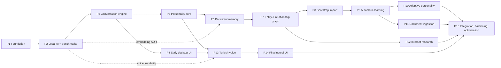

# LAZIS — Development Roadmap

> Status: Phase 0.1 (revised; supersedes the 11-phase Phase 0 roadmap). P1 implemented and hardened (P1.1) 2026-10-17 ([PHASE_1_REPORT.md](PHASE_1_REPORT.md), [PHASE_1_1_REPORT.md](PHASE_1_1_REPORT.md)). P2 implemented 2026-10-17; model decision accepted ([PHASE_2_REPORT.md](PHASE_2_REPORT.md), [ADR-0001](adr/0001-primary-model.md)). **P3 implemented 2026-10-17, with the single-assistant addendum 2026-10-18 ([ADR-0011](adr/0011-single-assistant-timeline.md)); awaiting the owner's approval** ([PHASE_3_REPORT.md](PHASE_3_REPORT.md), [ADR-0010](adr/0010-conversation-persistence-and-context.md)). P4 implemented and accepted by the owner ([PHASE_4_REPORT.md](PHASE_4_REPORT.md), [ADR-0012](adr/0012-desktop-experience-and-resilience.md)). **P5 implemented 2026-10-20; awaiting the owner's approval** ([PHASE_5_REPORT.md](PHASE_5_REPORT.md), [ADR-0013](adr/0013-persona-v1-and-instruction-hierarchy.md)). **P6 implemented 2026-10-20** ([PHASE_6_REPORT.md](PHASE_6_REPORT.md), [ADR-0014](adr/0014-personal-memory-store.md), [ADR-0015](adr/0015-learning-recall-and-model-trust.md)); the owner's Phase 7 brief was taken as the go-ahead (the P6 acceptance test result was not stated). **P7 implemented 2026-10-20** ([PHASE_7_REPORT.md](PHASE_7_REPORT.md), [ADR-0016](adr/0016-entity-relationship-graph.md)); the owner's Phase 7.1 brief followed it. P7.1 (truthful memory claims) implemented and accepted ([PHASE_7_1_REPORT.md](PHASE_7_1_REPORT.md), [ADR-0017](adr/0017-truthful-memory-claims.md)). **P7.2 (namesakes, explicit requests, internal labels) implemented 2026-10-21; awaiting the owner's acceptance test and approval** ([PHASE_7_2_REPORT.md](PHASE_7_2_REPORT.md), [ADR-0018](adr/0018-namesakes-and-explicit-requests.md)); the owner's Phase 8 brief stated Phases 0–7.2 as complete. P8 (personal knowledge bootstrap) implemented 2026-10-21 and accepted (the owner's Phase 9 brief: "Faz 0–8 tamamlandı ve kabul edildi") ([PHASE_8_REPORT.md](PHASE_8_REPORT.md), [ADR-0019](adr/0019-personal-knowledge-bootstrap.md)). P9 (advanced automatic learning) implemented 2026-10-28, with the final corrections and P9.1 (memory operation consistency, namesakes) 2026-10-30/31; **P9 and P9.1 accepted by the owner 2026-10-31**, with open issues kept in [PHASE_9_REPORT.md §22](PHASE_9_REPORT.md) ([ADR-0020](adr/0020-advanced-learning.md)). P10 approved by the owner 2026-10-31 in four sub-phases, each gated; **P10A (memory and preference reliability) implemented 2026-10-31; awaiting the owner's approval** ([PHASE_10_REPORT.md](PHASE_10_REPORT.md), [ADR-0021](adr/0021-memory-and-preference-reliability.md)); P10B–P10D not started · Last updated: 2026-10-31
> Rules:
> - One phase at a time. Each phase must produce a **testable result**. No phase is complete because code was written: it is complete when its exit conditions are met, its tests were **executed and reported truthfully**, the docs and ADRs are updated, and **the user explicitly approves** the next phase.
> - Size: S (≈ 1–2 focused weeks), M (≈ 2–4), L (≈ 4–6). These are rough planning sizes, not commitments.
> - Engineering rules for every phase: [ENGINEERING_STANDARDS.md](ENGINEERING_STANDARDS.md). Acceptance IDs: [ACCEPTANCE_CRITERIA.md](ACCEPTANCE_CRITERIA.md).

## 0. Phase structure and dependencies

| # | Phase | Size | Hard prerequisites |
|---|---|---|---|
| P1 | Project foundation | M | Phase 0.1 approval |
| P2 | Local AI integration and benchmarking | M | P1 |
| P3 | Conversation engine | M | P2 |
| P4 | Minimal functional desktop interface | M | P3 |
| P5 | Personality engine (core) | M | P3 (P4 for convenient evaluation) |
| P6 | Persistent memory | L | P5, P2 (embedding ADR) |
| P7 | Entity and relationship graph | L | P6 |
| P8 | Personal knowledge bootstrap | M | P7 |
| P9 | Automatic learning (risk-based) + learning review | L | P8 (P7, P5) |
| P10 | Adaptive personality and proactive follow-ups | M | P9 |
| P11 | Authorized local document ingestion | L | P9 (P7, P4) |
| P12 | Internet research | M | P7 (entity visibility), P5, P3, P1 (egress skeleton) |
| P13 | Turkish voice communication | L | P5, P4, P3; P2 voice feasibility smoke |
| P14 | Final neural interface | M | P13 (audio reactivity), P4 |
| P15 | Integration, security hardening and optimization | M | P1–P14 |

The phases run **sequentially in numeric order**. The graph shows true dependencies, so a later reordering (e.g., research before ingestion) stays possible without breaking prerequisites.

### 0.1 Why this order (and what changed since Phase 0)

- **Benchmarking is its own phase (P2)**, separate from the foundation. Every prompt, latency budget and memory budget depends on its results.
- **The early desktop interface (P4) comes right after the conversation engine.** The app is usable and testable from then on. The cinematic interface (P14) waits until conversation, state and voice are stable. Phase 0 had combined the two.
- **Personality (P5) comes before memory (P6).** The persona and its policy layer shape every later evaluation. User preferences start as settings and move to learned memory in P10 behind the same interface.
- **Bootstrap (P8) comes before automatic learning (P9).** It needs no LLM extraction, it seeds the graph with real people, and automatic learning is then tuned against realistic data. Free-text bootstrap notes are stored verbatim in P8 and processed by P9.
- **Document ingestion is its own phase (P11).** Phase 0 had folded it into "security hardening". It depends on the learning policy and the domain-aware entity resolver.
- **Encryption is in P1, not at the end.** Personal data appears from P3 on and is never stored unencrypted. P15 is an audit and hardening pass.
- **Dependencies Phase 0 missed:**
  - The voice stack's memory footprint constrains the LLM choice → voice feasibility smoke in P2 (SPK-07).
  - The learning policy is needed by explicit memory commands → `learning.policy` v1 is built in P6.
  - Entity visibility is needed by research privacy → P12 depends on P7.
  - Background jobs can evict the conversation cache → decided in P2 (ADR-0004), used in P9.

## P1 — Project foundation (M)

- **Objective:** a runnable, tested, secure skeleton. No AI and no personal data.
- **Prerequisites:** Phase 0.1 approved; decisions in [PHASE_0_FINAL_REVIEW.md §N](PHASE_0_FINAL_REVIEW.md) answered or defaults accepted; `uv` installed; `git init`.
- **Scope:**
  - Monorepo layout ([ARCHITECTURE.md §13](ARCHITECTURE.md)); toolchains (uv/Python 3.13, pnpm, cargo); ruff, pyright strict, `import-linter` contracts, pytest, vitest; `justfile` with `just ci`.
  - `lazis-core` skeleton: layered config + validation, structured logging with redaction, error taxonomy, event bus, DI container, `/health`, per-launch token, Origin checks.
  - Storage: SQLCipher connection factory, `KeyProvider` (Keychain via the `security` tool), migration runner (per-DB tracks, checksums, pre-migration backup), `UnitOfWork` + change sets + history, audit-log writer, encrypted backup/restore.
  - Durable job queue + scheduler skeleton.
  - Egress gateway skeleton in deny-all mode + socket-guard test.
  - Spikes **SPK-04** (driver/extension loading) and **SPK-05** (SQLCipher + sqlite-vec + FTS5, encrypted KNN/FTS performance, Keychain item path).
- **Exclusions:** LLM providers, conversations, UI, any personal data.
- **Modules affected:** `app`, `api` (health only), `config`, `observability`, `storage`, `security` (keys, redaction, egress skeleton, audit), `jobs`, `state` (skeleton).
- **Expected files/components:** `core/pyproject.toml`, `uv.lock`, `core/src/lazis/{app,api,config,observability,storage,security,jobs,state}/…`, `core/migrations/lazis/0001_system.sql`, `core/migrations/cache/0001_metrics.sql`, `config/defaults.toml`, `justfile`, `docs/adr/0003-storage-driver-and-encryption.md`.
- **Database changes:** `lazis.db` 0001_system (`schema_migrations`, `settings`, `jobs`, `change_sets`, `history`, `audit_log`); `cache.db` 0001 (metrics). All encrypted.
- **Required tests:**
  - unit: config layering, redaction, error mapping, migration checksums;
  - integration: migrate from empty; encrypted open / wrong key / no key; backup → restore round trip; change-set write → revert on a test table; job crash recovery;
  - security: token and Origin checks, socket guard, key never in argv/env/logs;
  - perf: SPK-05 on a synthetic 50k-row database.
- **Acceptance criteria:** SEC-01, SEC-02, SEC-05 (infrastructure), SEC-06, SEC-07 (skeleton), SEC-10, SEC-12, SEC-14 (infrastructure), ENG-01…ENG-09, BST-06.
- **Deliverables:** running core with health/auth; ADR-0003; spike reports; test report.
- **Risks:** R23 (SQLCipher + sqlite-vec incompatibility), R15 (native-extension packaging).
- **Testable result:** `just ci` runs green on a clean checkout. An encrypted DB is created, migrated, backed up and restored by tests.
- **Exit conditions:** all tests executed and reported; encryption proven, **or** the SPK-05 fallback decision recorded by the user in ADR-0003.

### P1 as implemented (2026-10-17)

The Phase 1 brief widened and narrowed this plan. Differences, all documented in [PHASE_1_REPORT.md](PHASE_1_REPORT.md):

| Planned above | Implemented | Why |
|---|---|---|
| No UI; core reads the Keychain via `KeyProvider` (`security` tool) | **Tauri 2 shell + basic Turkish status UI** (identity, backend/DB status, version, system info, conversation placeholder, read-only settings, diagnostics, recovery flows). **Only the Rust shell touches the Keychain**; key + token reach the core over stdin | The brief required a desktop bootstrap in P1. The CLI-only key stage became unnecessary |
| Durable job queue + scheduler, event bus, DI container, `state` skeleton, `cache.db` | **Deferred to P3** (with their first consumers) | No consumer exists in P1; empty skeletons would be untested scaffolding |
| Egress gateway skeleton | **Process-wide network guard** (PEP 578 audit hook, deny-all except loopback/AF_UNIX) + `network.egress_enabled: Literal[False]` | Same guarantee with less code; the policy gateway arrives in P12 |
| `core/migrations/…`, `config/defaults.toml` | Migrations inside the package (`lazis/storage/migrations/lazis/0001_system.sql`); defaults in the Pydantic models | Migrations ship with the package; no model/budget values exist yet |
| `0001_system`: `schema_migrations`, `settings`, `jobs`, `change_sets`, `history`, `audit_log` | `schema_migrations` (runner), `app_meta`, `settings`, `change_sets`, `history`, `audit_log`; no `jobs` | Jobs deferred (above) |
| `justfile` / `just ci` | `Makefile` / `make check` | No extra tool to install |

Exit evidence: backend 100 tests, UI 19 unit + 3 integration (against a real backend), shell 18 unit + 7 lifecycle (against a real backend) + 1 opt-in real-Keychain test — all executed and passing; ruff, pyright strict, import-linter, vue-tsc, rustfmt, clippy `-D warnings` clean; SPK-04/05 passed ([ADR-0003](adr/0003-storage-driver-and-encryption.md)); release `LAZIS.app` built, launched, measured and shut down cleanly.

## P2 — Local AI integration and benchmarking (M)

- **Objective:** a provider abstraction and an **evidence-based model decision** for this Mac.
- **Prerequisites:** P1; permission to download the bake-off model set (≈ 30–40 GB); AC power for runs.
- **Scope:**
  - Providers: `LLMProvider` port; `OllamaLLMProvider` (streaming, tools, JSON schema, `think`, `keep_alive`, pinned `num_ctx`, cancellation, `prompt_eval_count` metrics); `OpenAICompatLLMProvider`; `FakeLLMProvider` + recorded fixtures; `EmbeddingProvider` (Ollama); provider contract suite.
  - Model management: pinning by digest with startup verification; setup scripts (model pull + verify; Ollama launch-agent environment with `OLLAMA_NO_CLOUD=1` and loopback); tokenizer service with count-parity check.
  - Measurement: eval and bench harnesses + datasets v1; run [BENCHMARK_PLAN.md](BENCHMARK_PLAN.md) B1–B10 and spikes SPK-01/02/03/06/07/08.
- **Exclusions:** conversation persistence, persona, memory, UI.
- **Modules affected:** `providers/{llm,embedding}`, `app` (CLI `lazis bench`, `lazis eval`), `text` (tokenizer), `evals/`, `scripts/`.
- **Expected files/components:** `providers/ports.py`, `providers/llm/{ollama,openai_compat,fake}.py`, `providers/embedding/ollama.py`, `evals/{datasets,runners,reports}/`, `scripts/{pull-and-verify-models,install-ollama-env}.sh`, `docs/adr/0001-primary-model.md`, `0002-embedding-model.md`, `0004-ollama-operating-parameters.md`.
- **Database changes:** none in `lazis.db` (benchmark results are files; metrics in `cache.db`).
- **Required tests:** contract suite (always vs. Fake; opt-in vs. live Ollama); unit (request mapping, cancellation, schema validation + repair loop, digest verification, reload detection); integration against a fake Ollama HTTP server (errors, timeouts); live benchmarks and evals per the plan (reported, not part of blocking CI).
- **Acceptance criteria:** AIE-01…AIE-04, AIE-06…AIE-08, PLT-02, PLT-03, PLT-06 (measured budget), gates G1–G8.
- **Deliverables:** dated bench and eval reports; voice feasibility smoke report; ADR-0001/0002/0004.
- **Risks:** R1, R2, R7, R16, R24.
- **Testable result:** `lazis bench` and `lazis eval` reproduce the reports; the chosen model streams Turkish through the provider contract.
- **Exit conditions:** a model and variant chosen by the declared rules, or the gaps presented to and decided by the user; reports and ADRs committed.
- **As built (2026-10-17):** the Phase 2 brief changed the scope. It added a minimal ephemeral Turkish chat in the desktop app and confined the backend sandbox to Ollama's port (ADR-0009 Amendment 1).
  - **Built:**
    - `LLMProvider` port plus the Ollama adapter (streaming, cancellation, timeouts, JSON schema, `think`, `keep_alive`, endpoint allowlist, installed-only models);
    - fake provider and fake Ollama HTTP server;
    - `scripts/ollama-agent.sh` and `scripts/model-pull.sh`;
    - `evals/` harnesses and datasets v1;
    - B1–B4, the long-context and `num_ctx` sweeps, quality, think-mode and extraction suites on 5 tags;
    - SPK-01 (without tools), SPK-03 (G4 inconclusive), SPK-08;
    - ADR-0001 (Accepted, with the G2-r1 revision record);
    - G2-r1 context-length measurement (`evals/runners/g2_context.py`).
  - **Deferred:**
    - `OpenAICompatLLMProvider`;
    - `EmbeddingProvider` and SPK-06/ADR-0002 (before P6);
    - digest pinning with startup verification and the tokenizer service (P3);
    - B7 tools and B8 soak (P3);
    - SPK-07/B10 voice smoke (before P13);
    - SPK-02 schema-violation stress test;
    - ADR-0004 (its operating parameters live in ADR-0001);
    - CLI `lazis bench`/`lazis eval` (provided by `make bench` / `make eval`).

## P3 — Conversation engine (M)

- **Objective:** streaming multi-turn Turkish text conversation through API and CLI, with append-only context management.
- **Prerequisites:** P2 (ADR-0001, ADR-0004).
- **Scope:**
  - *Moved here from P1:* in-process event bus, DI container (`app/container.py`), `state` package, durable job queue + scheduler, `cache.db` (metrics) — introduced together with their first consumers (turn events, compaction jobs, per-turn telemetry).
  - Persistence and lifecycle: conversations/messages/segments; `ConversationEngine` (turn lifecycle, streaming, cancellation, turn IDs).
  - Context: prompt assembler (S0–S3 + history + context note, canonical serialization, prefix hash check); token accounting; idle compaction + pre-warm; overflow guard; current date/time context.
  - Placeholder **persona v0** (a short neutral Turkish block, replaced in P5); language-drift guard; tool-loop framework (registry, capability checks, taint flag) with no tools enabled.
  - State machine (IDLE/THINKING/ERROR); REST conversation endpoints + WebSocket hub (event schema v1); `lazis chat` CLI; off-record mode; per-turn cache telemetry.
- **Exclusions:** memory, the personality engine beyond v0, UI.
- **Modules affected:** `conversation`, `state`, `api`, `providers` (use), `observability`.
- **Expected files/components:** `conversation/{engine,prompt,context,compaction,tools}.py`, `state/{machine,events}.py`, `api/routes/conversations.py`, `api/ws.py`, `schemas/events.v1.schema.json`, `app/cli.py`.
- **Database changes:** `0002_conversations`.
- **Required tests:**
  - unit: prompt snapshot, prefix stability hash, token budget, compaction triggers, state transitions and guards, drift detector;
  - integration: WebSocket streaming with Fake, cancellation races, overflow handling, off-record not persisted;
  - contract: event schema → TypeScript generation drift check;
  - live: G2/G4 re-check with the real assembler; B8-style 300-turn soak.
- **Acceptance criteria:** CNV-01…CNV-08, AIE-07, AIE-08, SEC-08 (framework).
- **Deliverables:** CLI chat, conversation API, test and soak reports.
- **Risks:** R2, R24.
- **Testable result:** a natural Turkish multi-turn chat in the terminal with streaming, cancel and visible per-turn metrics.
- **Exit conditions:** soak completes without context errors; G2/G4 hold with the real assembler; tests executed.
- **As built (2026-10-17):** the Phase 3 brief changed the scope. It added the desktop conversation UI (moved forward from P4) and required persistence, crash safety, deletion and cold-cache handling ([ADR-0010](adr/0010-conversation-persistence-and-context.md)).
  - **Built:**
    - `0002_conversations`;
    - `conversation/` (engine, assembler, budget, compaction, scheduler, repository);
    - persona v0 (S1) and S0 policy, with the current date/time stored as a per-turn note;
    - REST plus NDJSON turn streaming;
    - cancellation and turn ids (`client_id`);
    - idle and over-budget compaction with an evidence-checked summary;
    - pre-warm;
    - an announced fallback trim;
    - a 300-turn soak with the scripted model (CI);
    - live measurements on Gemma 4 12B (PHASE_3_REPORT §7).
  - **Not built (deferred, with reasons in the report):**
    - **WebSocket hub and event schema v1:** the backend refuses WebSocket upgrades (P1.1); NDJSON over HTTP is used.
    - **Durable job queue, event bus, DI container, `state` package, `cache.db`:** an in-process scheduler suffices, and compaction state lives in the database.
    - **`lazis chat` CLI.**
    - **Off-record mode (CNV-08):** the Phase 2 ephemeral endpoint `/chat/stream` still exists, but there is no UI for it.
    - **Tool-loop framework (SEC-08):** no tools exist yet.
    - **Language-drift guard.**
    - **`segments` table:** moves to P9 with the learning pipeline.
    - **Live 300-turn soak** on the real model.
    - **Conversation search (CNV-04 "searched").**
  - **Addendum (2026-10-18, ADR-0011):** one assistant with one continuous timeline. Hidden technical sessions (one active), `0003_assistant_timeline` (`timeline_seq`, `channel`; existing conversations kept as closed sessions), the `/assistant` and `/timeline` API. The routes to list, rename and delete conversations were removed. CNV-04 ("listed, deleted in the UI") no longer applies in that form: history management is a later, deliberate feature.

## P4 — Minimal functional desktop interface (M)

- **As built (2026-10-18):** the Phase 4 brief focused on desktop experience, system management and resilience: assistant states, diagnostics, bounded automatic restart, Ollama reconnect, sleep/wake, menu bar, safe Markdown, scroll behaviour, preferences and lower idle cost ([ADR-0012](adr/0012-desktop-experience-and-resilience.md)). Not built in P4: router, Playwright E2E, WebSocket support (the turn stream carries the events; it returns with P13), launch at login, notifications.

- **Objective:** a usable desktop app for testing conversations, viewing state and diagnostics, and monitoring errors ([UI_ARCHITECTURE.md §0](UI_ARCHITECTURE.md)).
- **Note (2026-10-17):** P3 already delivered the basic Conversation view: list, thread, streaming, stop, rename, delete and paging. P4 keeps the remaining items (PulseIndicator, Diagnostics panel, router, Playwright E2E, tray, restart policy).
- **Prerequisites:** P3.
- **Scope:**
  - Tauri shell: *done in P1* — backend spawn, stdin token + key handoff with lifeline, Keychain key management and recovery-code flows, single instance, minimal capabilities (app command ACL), strict CSP, unexpected-exit detection with manual retry. *Remaining for P4:* automatic restart with backoff (max 3 in 60 s), tray with state color, WebSocket support in the CSP/client.
  - Vue app: router, `tr` i18n, Pinia, generated API types, WebSocket client (turn filtering, reconnect).
  - Views: Conversation; `PulseIndicator` (2D, five state colors); Diagnostics panel (per-turn trace, cache reuse, model/runner status, memory, error console, prompt inspector in dev mode); basic Settings; System view; privacy HUD.
- **Exclusions:** Three.js core, memory UI (P6), voice (P13).
- **Modules affected:** `apps/desktop/src-tauri`, `apps/desktop/ui`, `api` (system endpoints).
- **Expected files/components:** existing `src-tauri/src/{lib,controller,backend,keystore}.rs` and `capabilities/main.json` extended, `ui/src/{app,api,stores,features/{conversation,diagnostics,settings,system},state-visual/PulseIndicator.vue}`.
- **Database changes:** settings keys only.
- **Required tests:** Vitest (stores, WebSocket client); Playwright WebKit E2E (chat, cancel, diagnostics values, core-down and Ollama-down errors, state colors); Rust unit tests (restart policy; key never logged); manual Tauri smoke checklist; CSP and capabilities review.
- **Acceptance criteria:** UI-01, UI-05, UI-07, UI-08, PLT-07, SEC-06.
- **Deliverables:** a runnable development app; E2E report; smoke checklist results.
- **Risks:** R15, R20.
- **Testable result:** the user chats with LAZIS in a desktop window and sees the state, metrics and errors.
- **Exit conditions:** a user acceptance session passes (a scripted 30-minute session plus free use, no blocking defects); tests executed.

## P5 — Personality engine, core (M)

- **As built (2026-10-20):** persona v1 as versioned code in `lazis.personality` (identity, behavior rules incl. instruction hierarchy, style, two preferences), the summary as a marked information block, and a live evaluation of categories A–G against Gemma and Qwen ([ADR-0013](adr/0013-persona-v1-and-instruction-hierarchy.md)). Not built: YAML persona files, turn classifier and StylePlan, anti-repetition store, post-generation guards, `0003_personality`, blind A/B by the owner (proposed as a user test in the report). Also fixed: the turn after a reply re-processed the whole reply (TTFT ≈ 5 s after long replies); the reply is now pre-warmed after each turn.

- **Objective:** a consistent LAZIS character with layered separation, precedence and guards ([PERSONALITY_ENGINE.md](PERSONALITY_ENGINE.md)).
- **Prerequisites:** P3 (P4 for evaluation convenience).
- **Scope:**
  - Layers: L0 safety policy block; L1 core persona v1 (few-shot examples, banned phrases); L2 explicit preferences through `PreferenceSource` (settings); L3 StylePlan rules + turn classifier v1; precedence handling.
  - Supporting machinery: anti-repetition store; post-generation guards (drift, banned phrases, emotion claims; the memory-claim guard interface, activated in P6); thinking-mode selection.
- **Exclusions:** learned preferences, follow-ups and the relationship brief (P10); memory context (P6).
- **Modules affected:** `personality`, `conversation` (integration).
- **Expected files/components:** `config/policy/safety.tr.yaml`, `config/persona/{lazis.core.tr.yaml,style_rules.yaml}`, `config/lexicons/banned_phrases.tr.yaml`, `personality/{engine,layers,style,classifier,guards,repetition}.py`.
- **Database changes:** `0003_personality` (`response_openers`).
- **Required tests:** unit (layer order, StylePlan tables, precedence scenarios, guards); live persona evals (banned phrases, emotion claims, pushback, distinct openers, dependency guard, adaptation-vs-policy probes); blind A/B by the user against persona v0.
- **Acceptance criteria:** PER-01…PER-05, PER-07 (structure), PER-09, PER-10.
- **Deliverables:** persona v1 + policy block; eval report.
- **Risks:** R1, R12.
- **Testable result:** a measurably more natural and honest LAZIS in the app, with guard metrics in diagnostics.
- **Exit conditions:** persona thresholds met; the user's review passes.

## P6 — Persistent memory (L)

- **Objective:** explicit memory with lifecycle, provenance, Turkish-aware hybrid retrieval, correct deletion and no fabrication ([MEMORY_ARCHITECTURE.md](MEMORY_ARCHITECTURE.md)).
- **Prerequisites:** P5, ADR-0002 (embeddings), P1 storage.
- **Scope:**
  - Schema and text: `0004_memory` (entity core with the user entity; memories, evidence, vectors, FTS, suppressions); `lazis.text` (casefold, fold, stem, suffixes, relative dates, hedges).
  - Write side: **`learning.policy` v1** (pure decision function + config; used by explicit commands); `MemoryService` (remember/forget/correct/search/history/revert) inside change sets; explicit command router.
  - Read side: `RetrievalService` (vector + FTS + RRF + gates + status rendering + in-context dedupe); user core profile; memory-claim guard activated.
  - Deletion semantics (redaction, suppression); scheduled backups; Memory inspector in the early UI; memory API. Non-user subjects are kept as `subject_text` until P7.
- **Exclusions:** graph and entity resolution (P7); automatic extraction (P9).
- **Modules affected:** `memory`, `text`, `learning.policy`, `graph` (entity core only), `personality` (L4), `api`, `ui`.
- **Expected files/components:** `memory/{service,retrieval,commands,deletion,profile}.py`, `learning/policy.py`, `text/{casefold,fold,stem,suffix,dates,hedges}.py`, `graph/entities_core.py`, `config/{predicates.yaml,learning_policy.yaml}`, `config/lexicons/{memory_commands,hedges}.tr.yaml`, UI `features/memory`.
- **Database changes:** `0004_memory`.
- **Required tests:**
  - text: Turkish normalization property tests;
  - retrieval: eval (recall@10, diacritic-less subsets) and perf (50k, encrypted);
  - write side: policy unit tables (explicit-intent paths, restricted refusal); command recognition eval (200 utterances);
  - deletion and history: deletion completeness; history/revert and change-set revert;
  - honesty and durability: false-memory probes; backup round trip on the real schema; memory-view E2E.
- **Acceptance criteria:** MEM-01, MEM-02, MEM-04, MEM-05, MEM-08…MEM-12, MEM-19, SEC-03, SEC-04, PER-11.
- **Deliverables:** working explicit memory in the app; eval and perf reports.
- **Risks:** R4, R10, R23 (encrypted KNN performance).
- **Testable result:** "Bunu hatırla: …" in one session is recalled correctly in a new session; "unut" removes it everywhere; asked about something never told, LAZIS says it does not know.
- **Exit conditions:** retrieval and deletion gates met; false-memory probes pass; tests executed.

## P7 — Entity and relationship graph (L)

- **Objective:** a coherent understanding of people, organizations, projects, events and their relationships across conversations ([KNOWLEDGE_GRAPH_DESIGN.md](KNOWLEDGE_GRAPH_DESIGN.md)).
- **Prerequisites:** P6.
- **Scope:**
  - Schema and recognition: `0005_graph`; kinship and qualified-role lexicons; possessive/role parser; mention detection.
  - Identity: `EntityResolver` (features, decision policy, tentative → linked → confirmed, low-friction confirmation); relationships with lifecycle, evidence and temporal validity; merge, unmerge, split and distinctions; identity-correction propagation; resolution of pre-P7 `subject_text`.
  - Answers: relational path queries with answer rules; graph-aware retrieval.
  - Confirmation and UI: Inbox (Level C identity items) with inline confirmation; People view and entity editor; explicit relationship statements via commands.
- **Exclusions:** automatic segment extraction (P9); document-origin entities (P11).
- **Modules affected:** `graph`, `memory` (links, retrieval), `learning.policy` (identity risk factors), `api`, `ui`.
- **Expected files/components:** `graph/{resolver,mentions,parser,relationships,paths,operations,inbox}.py`, `config/relationships.yaml`, `config/lexicons/{kinship,roles}.tr.yaml`, UI `features/{people,inbox}`.
- **Database changes:** `0005_graph`.
- **Required tests:** ER suite (≥ 150 cases including the Ahmet/Mehmet scenario as a fixed regression test); kinship/role parser tables; path-query tests (unique / multiple / none / provisional); merge → unmerge and split round trips; correction-propagation tests (only grounded knowledge moves); distinction honoring; Inbox flows; People E2E.
- **Acceptance criteria:** KG-01…KG-12, MEM-16, MEM-17.
- **Deliverables:** graph features in the app; ER eval report.
- **Risks:** R5.
- **Testable result:** "Çocukluk arkadaşımın kardeşinin adı neydi?" is answered from the graph, with the right certainty.
- **Exit conditions:** ER hard gates met (zero name-only confirmed links; zero fabricated path answers); tests executed.

### P7 as implemented (2026-10-20)

Built on the Phase 6 store, not beside it. Details are in [MEMORY_ARCHITECTURE.md Part P7](MEMORY_ARCHITECTURE.md) and [PHASE_7_REPORT.md](PHASE_7_REPORT.md).

- **Schema.** `0005_graph`:
  - relationships, evidence, "different people" distinctions;
  - `memory_entities` rebuilt for event/group kinds and the fixed user row;
  - a safe foreign-keys-off rebuild mode in the migration runner.
- **Vocabulary.** 51 relationship types in code (`memory/relations.py`) instead of `config/relationships.yaml`, like the Phase 6 predicate registry. Kinship and role words are a Turkish lexicon in the same module.
- **Identity.**
  - Both ends are resolved with the Phase 6 resolver plus Phase 7 rules (namesake questions, appositives, restated relationships, holders).
  - 192 identity scenarios.
  - Not built: the tentative → linked → confirmed lifecycle, and mention-level grounding (`entity_mentions`).
- **Learning.**
  - Gemma's existing extraction call also proposes relationships, so automatic extraction of relationships moved forward from P9.
  - Deterministic validation rules keep the user's words in charge.
- **Answers.** Deterministic chains, paths and neighbours (`memory/graph.py`) with a Turkish question parser. The answer reaches the model as computed data.
- **UI.** Relationships in the person detail, the user's own relationships, add/edit/delete, evidence, a simple relation map, relationship and merge decisions in the inbox.
- **Deferred:**
  - unmerge (split covers the need);
  - placeholder entities for unnamed people;
  - identity-correction propagation beyond merge/split;
  - relationship import (P8).

### P7.1 — Truthful memory claims (implemented 2026-10-21)

A corrective step requested by the owner after P7: replies said "not aldım" before background learning had stored anything (5 of 9 statement replies in the P7 sessions). A deterministic streaming guard (`memory/claims.py`, [ADR-0017](adr/0017-truthful-memory-claims.md)) rewords claims that the turn's real memory outcome does not back, before any text reaches the user; shown and stored text are identical. Learning, the graph, the queue and the schema are unchanged. Report: [PHASE_7_1_REPORT.md](PHASE_7_1_REPORT.md). Accepted by the owner (Phase 7.2 brief).

### P7.2 — Namesakes, explicit requests, internal labels (implemented 2026-10-21)

A reliability step requested by the owner after P7.1, from the P7.1 real-model findings: two namesakes in one message became one person; "Lütfen şunu not al" saved nothing (and other explicit saves wrote wrong facts); a reply quoted an internal label. Fixed by planning namesakes from the user's words (`memory/namesakes.py`), answering "which one?" in chat, using the learning instruction for explicit saves, and removing labels from the persona ([ADR-0018](adr/0018-namesakes-and-explicit-requests.md)). No migration. Report: [PHASE_7_2_REPORT.md](PHASE_7_2_REPORT.md). Awaiting the owner's acceptance test and approval; P8 not started.

## P8 — Personal knowledge bootstrap (M)

- **Objective:** import the user's structured personal information safely and reversibly ([KNOWLEDGE_GRAPH_DESIGN.md §10](KNOWLEDGE_GRAPH_DESIGN.md)).
- **Prerequisites:** P7.
- **Scope:** JSON Schema v1 + a commented Turkish template file; validator (line/column errors in Turkish); normalizer; planner/diff; preview UI (acceptance = confirmation); apply with snapshot as one change set; rollback; idempotent re-import; precedence of in-app edits; free-text notes stored verbatim; the user's own import (user action).
- **Exclusions:** LLM processing of notes (P9); guided interview (P10).
- **Modules affected:** `bootstrap`, `graph`, `memory`, `api`, `ui`.
- **Expected files/components:** `schemas/bootstrap.v1.schema.json`, `docs/templates/bootstrap.tr.yaml`, `bootstrap/{validate,normalize,plan,apply}.py`, UI `features/import`.
- **Database changes:** `0006_bootstrap`.
- **Required tests:** validator fixtures (100% of invalid fixtures rejected with positions); idempotency; diff exactness; rollback exactness (snapshot comparison); conflict precedence; ER on import (no name-only person matches); import E2E.
- **Acceptance criteria:** BST-01…BST-06.
- **Deliverables:** import feature; template; test report.
- **Risks:** R5, R18.
- **Testable result:** the user's real bootstrap file is previewed, applied, inspected, and could be rolled back.
- **Exit conditions:** the user confirms the imported knowledge is correct; tests executed.
- **As built (2026-10-21):** the owner's Phase 8 brief widened the scope: Markdown and text files are read by Gemma section by section (not deferred to P9), JSON schema 1.0 is mapped deterministically; preview with per-item approve / reject / edit / hold and per-person create / link / keep unresolved / reject; conflicts resolved by the user; one-transaction apply; undo from a previewed plan; ambiguous people kept out of recall. Modules are `core/src/lazis/bootstrap/` (not `bootstrap/{validate,normalize,plan,apply}.py`); no YAML template (JSON schema documented in `bootstrap/profile.py`). Report: [PHASE_8_REPORT.md](PHASE_8_REPORT.md), [ADR-0019](adr/0019-personal-knowledge-bootstrap.md). Awaiting the owner's acceptance test and approval; P9 not started.

## P9 — Automatic learning, risk-based, with learning review (L)

- **Objective:** natural, autonomous learning from conversations that is risk-aware, reviewable and reversible ([MEMORY_ARCHITECTURE.md §7–§16](MEMORY_ARCHITECTURE.md)).
- **Prerequisites:** P8 (populated graph), P7, P5.
- **Scope:**
  - Extraction: segmenter; extraction prompt + schema v1; evidence verification; normalization (plans vs. facts, hedges); restricted-data detectors.
  - Policy: the full `learning.policy` (confidence, risk, matrix, tighten-only overrides); contradiction flow with `conflict_state`; dedupe and independent corroboration; provisional lifecycle (promotion, demotion, archival job); confirmation workflow (inline + Inbox + reminders).
  - Review and reversal: learning review feed + actions; learning-run rollback with suppression; `memory_dependencies` + re-evaluation of inferred knowledge.
  - Derived outputs and scheduling: open loops; episodes; idle scheduler with preemption and cache protection (per ADR-0004); processing of bootstrap notes; calibration review mode and a calibration report.
- **Exclusions:** learned communication preferences and follow-up surfacing (P10); documents (P11).
- **Modules affected:** `learning`, `memory`, `graph`, `jobs`, `personality` (inline confirmation phrasing), `api`, `ui`.
- **Expected files/components:** `learning/{segmenter,extract,verify,normalize,pipeline,policy,review,confirm,dependencies}.py`, `config/learning_policy.yaml` (v1 calibrated), UI `features/review`.
- **Database changes:** `0007_learning` (`learning_runs`, `open_loops`, `memory_dependencies`, review columns).
- **Required tests:**
  - extraction: gold set (precision/recall; 100% evidence validity);
  - policy: unit tests for every matrix cell and override; calibration reliability; contradiction scenarios; dedupe and independence;
  - lifecycle: "retrieval never promotes" (property test); suppression;
  - scheduling: preemption and foreground latency (LRN-05); job crash recovery;
  - review: review-action E2E; learning-run rollback.
- **Acceptance criteria:** MEM-03, MEM-06, MEM-07, MEM-13…MEM-15, MEM-18, LRN-01…LRN-06, AIE-05.
- **Deliverables:** autonomous learning with a review feed; calibration report; ADR-0005 (policy v1 thresholds).
- **Risks:** R4, R5, R24.
- **Testable result:** after a normal conversation, the review feed shows correctly leveled new knowledge with sources. High-risk items wait in the Inbox. One click undoes a learning run.
- **Exit conditions:** precision and calibration gates met; no foreground latency regression > 10%; tests executed.

- **As built (2026-10-28):** the owner's Phase 9 brief set the scope: whole lists (focused re-read of a partly read list, counts kept in the user's words), past / current / future from the user's words (history never replaces today's value, plans are plans), change only with words that say so, repetition as independent evidence (capped), corrections "X değil Y", computed importance tiers, prioritised quality suggestions, someone else's relatives, JSON salvage. Modules are `memory/{temporal,refine,lists,corrections,importance,quality}.py` (not a `learning/` package); migration `0007_quality` holds only dismissed suggestions (no `learning_runs` / `open_loops` / `memory_dependencies`); the learning review feed, open loops and calibration are not built. Report: [PHASE_9_REPORT.md](PHASE_9_REPORT.md), [ADR-0020](adr/0020-advanced-learning.md). P9.1 (memory operation consistency and namesakes, 2026-10-30/31) is in the same report, §21. **P9 and P9.1 accepted by the owner 2026-10-31.** Open issues stay in report §22, among them: the reply can speak with certainty about an ambiguous person, a deleted fact can be mentioned again from the chat history, and the same fact can be stored more than once. P10 not started.

## P10 — Adaptive personality and proactive follow-ups (M)

- **Objective:** learned communication style, natural follow-ups and a relationship brief, without sycophancy or nagging.
- **Prerequisites:** P9.
- **Scope:** `preference_signals` aggregation → learned preferences through the policy; relationship brief; open-loop surfacing policy; anti-repetition tuning; guided bootstrap interview mode; daily episode roll-ups; Settings → learned style (view/edit).
- **Exclusions:** voice-specific style (P13).
- **Modules affected:** `personality`, `learning`, `memory`, `bootstrap` (interview), `ui`.
- **Expected files/components:** `personality/{preferences,brief,followups}.py`, `bootstrap/interview.py`, UI `features/settings/style`.
- **Database changes:** `0008_adaptation` (`preference_signals`).
- **Required tests:** StylePlan with learned preferences; follow-up simulations (rate limits, dismissals); precedence (adaptation never overrides L0 or facts); persona A/B against P5.
- **Acceptance criteria:** PER-06, PER-07 (full), PER-08, PER-12.
- **Deliverables:** adaptive behavior; eval report.
- **Risks:** R12.
- **Testable result:** the user states a preference once and it holds; a dated plan is followed up once, naturally.
- **Exit conditions:** persona and follow-up targets met; the user's review passes.
- **As built (in progress):** the owner approved P10 on 2026-10-31 in four sub-phases. Each needs the owner's approval before the next one starts.
  - **P10A — memory and preference reliability (implemented 2026-10-31, awaiting approval):**
    - a people guard in the reply stream;
    - forgotten things checked by fingerprints (a new value mark);
    - one gate for what LAZIS raises unasked (`memory/proactive.py`);
    - preference signals counted per user message and session (`memory/signals.py`).
    No migration. Automatic preference learning is not enabled. Report: [PHASE_10_REPORT.md](PHASE_10_REPORT.md), [ADR-0021](adr/0021-memory-and-preference-reliability.md).
  - **P10B — adaptive personality:**
    - explicit preferences take effect at once and persist;
    - implicit preferences need ≥ 3 independent signals in ≥ 2 sessions;
    - each change is limited to ±0.1;
    - safety, accuracy and core persona cannot be changed by learned preferences;
    - acceptance: PER-06, PER-07, PER-12.
    `0008_adaptation` is tested on an isolated database first; it is applied to the real profile only with the owner's separate approval.
  - **P10C — continuity and proactive follow-ups:**
    - open loops and episodes;
    - at most one follow-up question per session;
    - never a topic the user declined, deleted or cancelled, or one that cannot be matched reliably;
    - relationship brief ≤ 250 tokens;
    - acceptance: PER-08.
  - **P10D:**
    - a guided intake interview (skip, pause, resume);
    - Settings → "LAZIS'in seninle konuşma tarzı" (view and edit learned preferences);
    - anti-repetition and daily episode summaries;
    - ≥ 40 blind pairs for PER-02, voted by the owner at the end.
  - Voice-specific style stays in P13.
- **Separate performance work (not in P10 scope):**
  - Under heavy load, turns sent while a background compaction runs start late: median 17.8 s, worst 61.8 s at 500 facts (PHASE_9_REPORT §12). The model's cache then holds the compaction prompt, so the turn re-processes the long conversation prefix.
  - First step: measure prefix processing on its own, then consider compacting in a separate model context or only while the conversation is idle.
  - Tracked in PHASE_10_REPORT §11.

## P11 — Authorized local document ingestion (L)

- **Objective:** learn from user-authorized local sources without confusing document content with personal facts ([LOCAL_INGESTION_ARCHITECTURE.md](LOCAL_INGESTION_ARCHITECTURE.md)).
- **Prerequisites:** P9 (policy + pipeline), P7 (domain-aware resolution), P4 (UI).
- **Scope:** sources and source classes; discovery under PathGuard; sandboxed parser worker; extractors (Markdown, text, PDF text layer, HTML); chunking and indexing in `documents.db`; document claims; trust caps; documents retrieval channel; incremental sync; revocation; Sources UI; spike SPK-13.
- **Exclusions:** OCR, email or messaging app integrations, archives.
- **Modules affected:** `ingestion`, `learning`, `graph`, `memory` (documents channel), `security` (PathGuard, sandbox), `api`, `ui`.
- **Expected files/components:** `ingestion/{sources,discovery,worker,extractors,chunking,claims,sync}.py`, `core/migrations/documents/0001_documents.sql`, UI `features/sources`.
- **Database changes:** `0009_sources` (`lazis.db`); `documents.db` 0001.
- **Required tests:** class/trust-cap tests (a project-doc person never becomes a friend; reference documents produce zero memories); incremental modify/delete/rename; revocation; PathGuard fuzzing; sandbox limits; injection inside documents; throughput and foreground latency.
- **Acceptance criteria:** ING-01…ING-12, SEC-09, KG-13.
- **Deliverables:** Sources feature; ingestion report.
- **Risks:** R25 (document trust contamination), R9.
- **Testable result:** adding a notes folder makes its content answerable with citations. Personal facts from the user's journal appear in the review feed at the right levels. Removing the folder removes what it contributed.
- **Exit conditions:** trust-cap and security gates met; tests executed.

## P12 — Internet research (M)

- **Objective:** optional, privacy-controlled, verified research ([RESEARCH_ARCHITECTURE.md](RESEARCH_ARCHITECTURE.md)).
- **Prerequisites:** P7 (entity visibility), P5, P3, P1 (egress skeleton).
- **Scope:**
  - Permissions: permission engine (four modes, query classes, rules); intent detection; query builder + classifier + scrubber.
  - Retrieval: egress hardening (SSRF, DNS rebinding, limits); providers (Wikipedia, ddgs; optional native SearXNG helper — no Docker); fetch + trafilatura.
  - Verification: quarantined reader; quote verification; injection screening; taint enforcement; credibility; cited synthesis.
  - Support: TTL cache and freshness; offline fallback; research audit; research log UI and indicators; `cache.db` research tables.
- **Exclusions:** JavaScript rendering, paid APIs, autonomous browsing.
- **Modules affected:** `research`, `security` (egress), `conversation` (tool), `api`, `ui`.
- **Expected files/components:** `research/{intent,permissions,classify,scrub,providers,fetch,reader,verify,synthesize,cache}.py`, `config/research/domain_categories.yaml`, `scripts/searxng-native.sh` (optional), UI `features/research`.
- **Database changes:** `0010_research` (audit fields); `cache.db` research tables.
- **Required tests:** classification confusion matrix (gate: no private query auto-sent); scrubber property tests; permission-matrix tables; egress integration (fake servers); injection corpus (≥ 100 pages); audit completeness; offline behavior; fixture E2E.
- **Acceptance criteria:** RES-01…RES-13, SEC-07, PLT-05.
- **Deliverables:** research feature; injection and privacy reports.
- **Risks:** R9, R11, R26 (public/private misclassification).
- **Testable result:** with `auto_public`, "Dün maç kaç kaç bitti?" is answered with citations, without a prompt. A question involving a family member asks first. Everything sent is visible in the log.
- **Exit conditions:** privacy and injection gates met; tests executed.

## P13 — Turkish voice communication (L)

- **Objective:** natural, low-latency Turkish voice conversation with a suitable male voice and barge-in ([VOICE_ARCHITECTURE.md](VOICE_ARCHITECTURE.md)).
- **Prerequisites:** P5, P4, P3; P2 voice feasibility smoke.
- **Scope:**
  - Decisions: spikes SPK-09 (AEC), SPK-10 (STT bake-off) and SPK-11 (TTS bake-off + voice identity); ADRs for STT, TTS and the voice.
  - Audio and pipeline: `lazis-audio` Swift helper; voice module (VAD, Smart Turn, speculative STT, chunker, TTS normalizer, streaming TTS, barge-in with ducking, FSM incl. continuation, cancellation and recovery).
  - Product: PTT and session modes; voice controls and level meter in the UI; resource load/unload policy; voice style rules.
- **Exclusions:** wake word; the cinematic visual (P14).
- **Modules affected:** `voice`, `providers/{stt,tts,vad,turn}`, `native/lazis-audio`, `state`, `personality` (voice style), `api`, `ui`.
- **Expected files/components:** `native/lazis-audio/` (Swift package), `voice/{session,fsm,vad,turn,stt,chunker,normalize,tts,bargein}.py`, `providers/{stt,tts,vad,turn}/…`, `docs/adr/0006-stt.md`, `0007-tts-and-voice.md`.
- **Database changes:** `0011_voice` (`voice_profiles`; `messages.interrupted`, `messages.spoken_text`).
- **Required tests:** V1–V5 suites ([BENCHMARK_PLAN.md §7](BENCHMARK_PLAN.md)); FSM transition tests; normalizer tables (≥ 300); chunker; XCTest for the helper; synthetic echo harness; 2 h soak.
- **Acceptance criteria:** VOC-01…VOC-13, UI-03 (2D level reactivity).
- **Deliverables:** voice conversations in the app; voice evaluation reports; ADRs.
- **Risks:** R3, R8, R6.
- **Testable result:** a hands-free Turkish conversation in which the user can interrupt LAZIS naturally.
- **Exit conditions:** voice gates met, or deviations approved by ADR; the user approves the voice.

## P14 — Final neural interface (M)

- **Objective:** the cinematic LAZIS interface on top of the stable stores and events ([UI_ARCHITECTURE.md §1–§5](UI_ARCHITECTURE.md)).
- **Prerequisites:** P13 (audio levels), P4.
- **Scope:** `NeuralCore` (scene, shaders, state mapping, OKLab transitions, audio reactivity, frame scheduler, dynamic resolution, reduced motion, low-power fallback to `PulseIndicator`); final layout; restyling of all views; research and learning indicators in the final style; visual regression tests.
- **Exclusions:** WebGPU renderer (later evaluation).
- **Modules affected:** `ui` (`neural-core`, layout, theming).
- **Expected files/components:** `ui/src/neural-core/{NeuralCore.vue,engine/*,shaders/*,state-visuals.ts,audio-reactive.ts}`.
- **Database changes:** none.
- **Required tests:** `StateVisual` contract tests (both implementations); state-color and transition tests; render perf run (gates); deterministic screenshots; reduced-motion and low-power checks.
- **Acceptance criteria:** UI-02, UI-03, UI-06, UI-09.
- **Deliverables:** the final interface; perf report.
- **Risks:** R17 (battery and thermals).
- **Testable result:** the neural core reflects all five states and audio smoothly within frame budgets, and pauses when hidden.
- **Exit conditions:** perf gates met; the user approves the look.

## P15 — Integration, security hardening and optimization (M)

- **Objective:** a robust, self-contained app ready for years of use.
- **Prerequisites:** P1–P14.
- **Scope:**
  - Security: threat-model review and audit (injection corpora re-run, PathGuard fuzzing, egress, logs, keys, backups, permissions).
  - Packaging and setup: app bundle with local signing; Python runtime strategy (ADR: uv-managed environment vs. frozen binary); first-run setup wizard (model pull and verification, key and recovery code, bootstrap, voice setup).
  - Performance and reliability: power profiles; memory-pressure handling; optimization pass (all benchmarks re-run); 7-day soak.
  - Long-term operation: upgrade playbooks (model, Ollama, schema, embeddings); user guide (Turkish) and operator runbook.
- **Exclusions:** distribution to other users; multi-device sync.
- **Modules affected:** all (no new domain features).
- **Expected files/components:** `docs/USER_GUIDE.tr.md`, `docs/RUNBOOK.md`, `docs/adr/0008-runtime-packaging.md`, setup wizard UI, `scripts/`.
- **Database changes:** none planned (migration-path tests only).
- **Required tests:** the full regression suite; a fresh-account install test; upgrade and rollback rehearsal; the 7-day soak; the security checklist.
- **Acceptance criteria:** PLT-08, all regression gates, SEC-* re-verified.
- **Deliverables:** a packaged app; security audit report; documentation.
- **Risks:** R15, R17.
- **Testable result:** a clean install on a fresh macOS user account works end to end, including restore from backup with the recovery code.
- **Exit conditions:** the audit has no open high findings; the soak has no data issues; upgrade and rollback rehearsed.

## Cross-phase practices
- **Tests in every phase** ([TESTING_STRATEGY.md](TESTING_STRATEGY.md)). Deterministic CI uses `FakeLLMProvider`. Live evaluations produce dated reports, and their thresholds are tracked over time.
- **Migrations:** every schema change is a numbered migration with up-from-every-previous-version tests and a pre-migration backup.
- **ADRs** (`docs/adr/`) for every decision that changes a technology, a schema principle or a policy.
- **Truthful reporting:** phase reports state exactly what was executed, with outputs. Skipped tests are listed as skipped.
- **Backlog parking lot:** wake word, WebGPU renderer, OCR, LoRA personalization, calendar integration, multi-device sync, English UI, email/message integrations.
