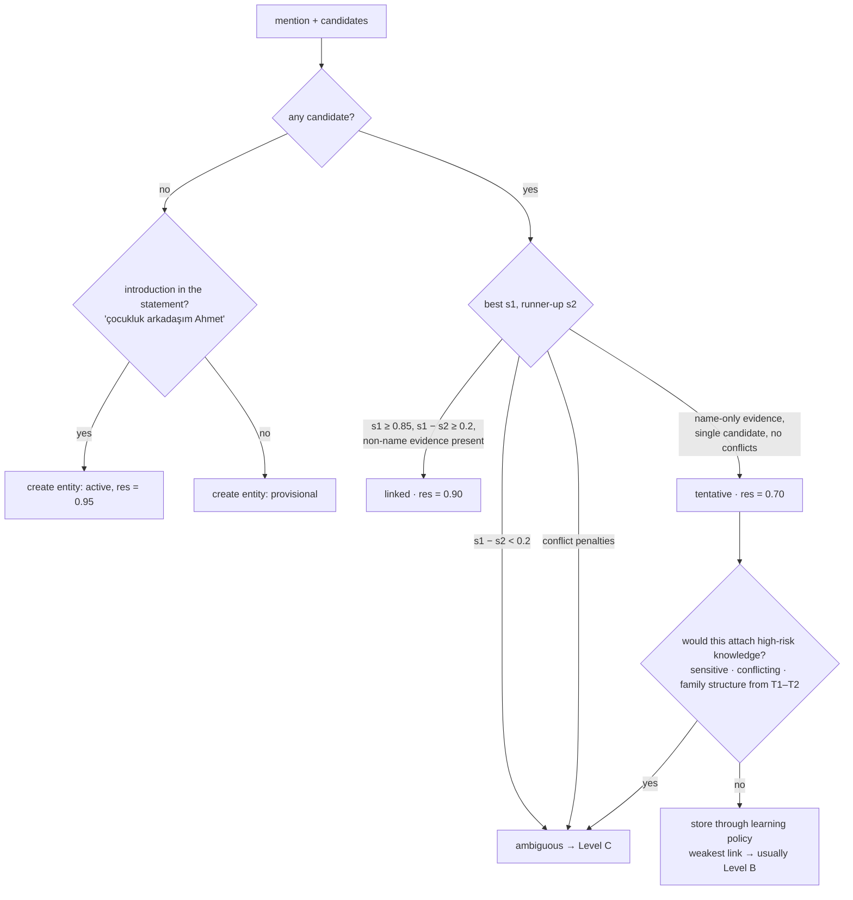
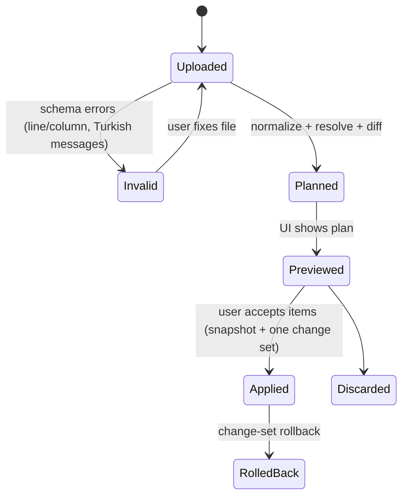

# LAZIS — Personal Knowledge Graph Design

> Status: Phase 0.1 (revised) · Last updated: 2026-10-17
> Delivered in: **P7** (entities, relationships, identity), **P8** (bootstrap import, §10). Learning policy and lifecycle are shared with memories: [MEMORY_ARCHITECTURE.md §7–§13](MEMORY_ARCHITECTURE.md).

## 1. Goals and principles

1. LAZIS must know **who** the user is talking about ("Ayşe", "annem", "eşimin annesi", "patronum", "çocukluk arkadaşım") and **how people, projects and organizations relate**.
2. **Identity is never assumed from a name alone.** A name match is weak evidence. Two mentions of "Ahmet" are not assumed to be the same person. Identity is established by context, existing relationships, known attributes, time and explicit user statements.
3. **Identity confidence grows only with evidence.** It grows with new, independent, non-name evidence. Repeated name-only mentions never upgrade a link (§6.4).
4. **Ask rather than guess** when it matters, and ask cheaply: one natural question beats a corrupted graph.
5. **Mention-level grounding.** Every relationship and memory records *which mention* resolved its entities, so a correction moves exactly the right knowledge and nothing else.
6. **Every structural operation is reversible.** Merges and splits are reversible, and a rejected merge is remembered ("these are different people").
7. **Temporal relationships.** Former colleagues, ex-partners and late relatives are represented, not deleted.
8. **Domain separation.** People found in documents are not the user's acquaintances until the user says so (§9).
9. Graph size is personal (hundreds to a few thousand nodes). Relational tables in SQLite plus recursive CTEs are sufficient ([TECHNOLOGY_DECISIONS.md §3](TECHNOLOGY_DECISIONS.md)).

## 2. Entity model

| Type | Examples | Notable attributes |
|---|---|---|
| `person` | user, spouse, friends, colleagues | gender (optional, user-stated), birth date (precision), deceased flag, `is_user` |
| `organization` | employer, school, club, a startup | kind (company, university, …), `visibility` |
| `place` | city, neighborhood, home, office | kind, parent place |
| `project` | LAZIS, a renovation, "Ahmet'in yeni şirketi" | status, started/ended, `confidentiality` |
| `event` | wedding, graduation, a meeting | date range, place |
| `pet` | the cat | species |
| `goal` | marathon | horizon, status |
| `object` / `concept` | car, a book | free |

Cross-cutting entity fields:
- `status`: `provisional` | `active` | `pending_confirmation` | `merged` | `deleted`. A person introduced unambiguously by the user is `active`. One created from weak context or from documents is `provisional`.
- `confidence`: confidence that the entity is a real, distinct individual or thing. This is not the same as the confidence of facts about it.
- `domain`: `personal` (the user's life) | `project` (work or project knowledge) | `reference` (general or document knowledge).
- `origin`: `conversation` | `import` | `document` | `user_edit`.
- `visibility`: `private` (default for people and personal projects) | `public` (public figures, public companies, products, places) | `unknown`. It drives research query privacy ([RESEARCH_ARCHITECTURE.md §3](RESEARCH_ARCHITECTURE.md)).
- `is_placeholder`: the entity is known only by a relationship path ("Elif'in annesi") until a name is learned.

The **user** is a single distinguished entity (`is_user = 1`), created at first run (P6). All first-person statements anchor to it.

## 3. Schema (indicative; migration `0005_graph`, P7)

```sql
-- entities: core columns exist from P6 (0004); P7 adds the graph columns
CREATE TABLE entities (
  id TEXT PRIMARY KEY, type TEXT NOT NULL,
  canonical_name TEXT NOT NULL, display_name TEXT NOT NULL,
  description TEXT,                    -- short Turkish description used for context similarity
  attributes_json TEXT NOT NULL DEFAULT '{}',
  is_user INTEGER NOT NULL DEFAULT 0, is_placeholder INTEGER NOT NULL DEFAULT 0,
  status TEXT NOT NULL,                -- provisional|active|pending_confirmation|merged|deleted
  merged_into_id TEXT REFERENCES entities(id),
  confidence REAL NOT NULL,
  domain TEXT NOT NULL DEFAULT 'personal',     -- personal|project|reference
  origin TEXT NOT NULL,                        -- conversation|import|document|user_edit
  visibility TEXT NOT NULL DEFAULT 'private',  -- private|public|unknown
  import_key TEXT UNIQUE,              -- stable key from bootstrap (e.g. '@esim')
  context_embedding BLOB,              -- embedding of description + salient facts (refreshed)
  created_change_set_id TEXT NOT NULL,
  created_at TEXT NOT NULL, updated_at TEXT NOT NULL
);

CREATE TABLE entity_aliases (
  id TEXT PRIMARY KEY, entity_id TEXT NOT NULL REFERENCES entities(id),
  alias TEXT NOT NULL, alias_norm TEXT NOT NULL, alias_fold TEXT NOT NULL,
  kind TEXT NOT NULL,                  -- full_name|given_name|nickname|role_ref|kinship_ref|title
  anchor_entity_id TEXT,               -- for role/kinship refs: relative to whom ('annem' → user)
  qualifier_json TEXT,                 -- e.g. {"context":"childhood"} for 'çocukluk arkadaşım'
  status TEXT NOT NULL, confidence REAL NOT NULL, created_change_set_id TEXT NOT NULL
);
CREATE INDEX ix_alias_fold ON entity_aliases(alias_fold);

CREATE TABLE relationship_types (      -- seeded from config/relationships.yaml (versioned)
  name TEXT PRIMARY KEY, inverse TEXT, symmetric INTEGER NOT NULL,
  category TEXT NOT NULL,              -- family|romantic|social|professional|project|location|membership|event
  cardinality TEXT NOT NULL,           -- single|multi (per source, at a time)
  impact TEXT NOT NULL,                -- low|medium|high (learning policy input)
  sensitivity TEXT NOT NULL,           -- normal|personal|sensitive
  label_tr TEXT NOT NULL, inverse_label_tr TEXT
);

CREATE TABLE relationships (
  id TEXT PRIMARY KEY,
  source_id TEXT NOT NULL REFERENCES entities(id),
  type TEXT NOT NULL REFERENCES relationship_types(name),
  target_id TEXT NOT NULL REFERENCES entities(id),
  attributes_json TEXT NOT NULL DEFAULT '{}',  -- {"context":"childhood"}, {"title":"Kıdemli Mühendis"}, {"role":"kurucu"}
  status TEXT NOT NULL,                -- provisional|active|pending_confirmation|ended|superseded|retracted
  confidence REAL NOT NULL, risk_level TEXT NOT NULL, trust_class INTEGER NOT NULL,
  origin TEXT NOT NULL, review_state TEXT NOT NULL DEFAULT 'unreviewed',
  conflict_state TEXT NOT NULL DEFAULT 'none', decision_json TEXT NOT NULL,
  valid_from TEXT, valid_to TEXT, time_precision TEXT,
  created_change_set_id TEXT NOT NULL,
  created_at TEXT NOT NULL, updated_at TEXT NOT NULL
);
-- provenance: evidence(target_type='relationship', …) — shared table, see MEMORY_ARCHITECTURE §5.3

CREATE TABLE entity_mentions (         -- every resolved or unresolved reference
  id TEXT PRIMARY KEY, entity_id TEXT,
  source_type TEXT NOT NULL,           -- message|document_chunk|import_item
  source_ref TEXT NOT NULL,
  surface TEXT NOT NULL, span_start INTEGER, span_end INTEGER,
  resolution TEXT NOT NULL,            -- self|confirmed|linked|tentative|ambiguous|new|unresolved
  resolution_score REAL, method TEXT,  -- alias|kinship|role|context|user|import
  candidates_json TEXT,                -- scored alternatives at decision time (for audits and splits)
  created_change_set_id TEXT NOT NULL
);

CREATE TABLE entity_operations (       -- merges and splits (reversible)
  id TEXT PRIMARY KEY, op TEXT NOT NULL,          -- merge|split
  change_set_id TEXT NOT NULL,
  primary_id TEXT NOT NULL,            -- merge: survivor · split: original
  secondary_id TEXT NOT NULL,          -- merge: merged-away entity · split: new entity
  reassignments_json TEXT NOT NULL,    -- every row id moved (mentions, aliases, relationships, links)
  snapshot_json TEXT NOT NULL,         -- pre-operation entity snapshot(s)
  reason TEXT, at TEXT NOT NULL, reverted_at TEXT
);

CREATE TABLE entity_distinctions (     -- "not the same" constraints
  entity_a TEXT NOT NULL, entity_b TEXT NOT NULL, source TEXT NOT NULL, at TEXT NOT NULL,
  PRIMARY KEY (entity_a, entity_b)     -- stored with entity_a < entity_b
);
```

Version history for entities, aliases and relationships lives in the shared `history` table, grouped by `change_sets` ([MEMORY_ARCHITECTURE.md §6](MEMORY_ARCHITECTURE.md)). Relationship rows are stored **once** (source → target). Inverse and symmetric views are derived from `relationship_types` through the view `relationships_bidir`, which avoids two-row drift.

## 4. Relationship types, kinship and qualified roles

### 4.1 Relationship registry (`config/relationships.yaml`, excerpt)

```yaml
spouse_of:         { inverse: spouse_of,   symmetric: true,  category: family,       cardinality: single, impact: high,   sensitivity: personal, label_tr: "eşi" }
parent_of:         { inverse: child_of,    symmetric: false, category: family,       cardinality: multi,  impact: high,   sensitivity: personal, label_tr: "ebeveyni" }
sibling_of:        { inverse: sibling_of,  symmetric: true,  category: family,       cardinality: multi,  impact: high,   sensitivity: personal, label_tr: "kardeşi" }
partner_of:        { inverse: partner_of,  symmetric: true,  category: romantic,     cardinality: single, impact: high,   sensitivity: sensitive, label_tr: "sevgilisi" }
friend_of:         { inverse: friend_of,   symmetric: true,  category: social,       cardinality: multi,  impact: medium, sensitivity: personal, label_tr: "arkadaşı" }
acquaintance_of:   { inverse: acquaintance_of, symmetric: true, category: social,    cardinality: multi,  impact: low,    sensitivity: personal, label_tr: "tanıdığı" }
colleague_of:      { inverse: colleague_of, symmetric: true, category: professional, cardinality: multi,  impact: medium, sensitivity: personal, label_tr: "iş arkadaşı" }
manages:           { inverse: managed_by,  symmetric: false, category: professional, cardinality: multi,  impact: medium, sensitivity: personal, label_tr: "yöneticisi" }
works_at:          { inverse: employs,     symmetric: false, category: professional, cardinality: multi,  impact: medium, sensitivity: personal, label_tr: "çalıştığı yer" }   # attrs: title, since
founded:           { inverse: founded_by,  symmetric: false, category: professional, cardinality: multi,  impact: medium, sensitivity: personal, label_tr: "kurduğu" }
member_of_project: { inverse: has_member,  symmetric: false, category: project,      cardinality: multi,  impact: medium, sensitivity: personal, label_tr: "projede" }        # attrs: role (sahip, ortak, müşteri…)
project_of:        { inverse: has_project, symmetric: false, category: project,      cardinality: multi,  impact: low,    sensitivity: personal, label_tr: "projesi" }        # project → organization
participated_in:   { inverse: had_participant, symmetric: false, category: event,    cardinality: multi,  impact: low,    sensitivity: personal, label_tr: "katıldı" }
held_at:           { inverse: venue_of,    symmetric: false, category: event,        cardinality: single, impact: low,    sensitivity: normal,   label_tr: "yapıldığı yer" }
lives_in:          { inverse: residence_of, symmetric: false, category: location,    cardinality: single, impact: medium, sensitivity: personal, label_tr: "yaşadığı yer" }
```

### 4.2 Turkish kinship (paths over primitives)

Turkish kinship is **more specific than English**. LAZIS models kinship terms as **paths** over primitive relations (`parent_of`, `child_of`, `sibling_of`, `spouse_of`) plus qualifiers (gender, relative age, maternal or paternal side). `config/lexicons/kinship.tr.yaml` (excerpt):

| Term | Path from anchor | Qualifiers |
|---|---|---|
| anne / baba | parent | female / male |
| eş, karım, kocam, hanımım, beyim | spouse | — |
| abi / abla | sibling | male / female, older |
| kardeş (erkek / kız kardeş) | sibling | younger by default, gender optional |
| oğul / kız (oğlum, kızım) | child | male / female (`kız` is ambiguous with girlfriend → context) |
| dayı / teyze | parent(female) → sibling | male / female (maternal side) |
| amca / hala | parent(male) → sibling | male / female (paternal side) |
| enişte | (teyze/hala/abla/kız kardeş) → spouse | male |
| yenge | (dayı/amca/abi/erkek kardeş) → spouse | female |
| anneanne / babaanne / dede | parent(female/male) → parent | female / female / male |
| kayınvalide (kaynana) / kayınpeder | spouse → parent | female / male |
| baldız / kayınbirader | spouse(wife) → sibling(female) / spouse → sibling(male) | |
| görümce | spouse(husband) → sibling(female) | |
| elti / bacanak | spouse → sibling → spouse (same-gender in-law pairs) | |
| yeğen | sibling → child | |
| kuzen | parent → sibling → child | |
| torun | child → child | |

### 4.3 Qualified role references (`config/lexicons/roles.tr.yaml`)

Role references are anchored like kinship terms, but they map to non-family relationship types with **qualifiers** stored as relationship attributes:

| Surface | Relationship + qualifier |
|---|---|
| arkadaşım · yakın arkadaşım · en yakın arkadaşım | `friend_of` · `{closeness: close}` · `{closeness: best}` |
| çocukluk arkadaşım · okul arkadaşım · üniversiteden arkadaşım · askerlik arkadaşım | `friend_of {context: childhood \| school \| university \| military}` |
| iş arkadaşım · eski iş arkadaşım | `colleague_of` · `colleague_of {status: ended}` |
| patronum · müdürüm · yöneticim | `managed_by` |
| ekibimdeki · çalışanım | `manages` |
| ortağım | `member_of_project {role: ortak}` or `founded` (context decides) |
| ev arkadaşım · komşum · doktorum | typed social relationships with attributes |

**`hocam` is excluded**: in Turkish it is often a generic form of address, not a role.

### 4.4 Possessive chain parsing

"eşimin annesi" = *eş* + 1sg possessive (-im) + genitive (-in) → *anne* + 3sg possessive (-si) → `user → spouse → parent(female)`.
"çocukluk arkadaşımın kardeşi" = *çocukluk arkadaşı* (qualified role) + -m + -ın → *kardeş* + -i → `user → friend_of{context: childhood} → sibling_of`.

The parser is a small, deterministic, suffix-aware grammar over the kinship and role lexicons. It handles 1sg/3sg/plural possessives and the genitive, with vowel harmony and buffer consonants. It yields a **path query**, resolved against the graph:
- Exactly one entity at the end of the path → strong evidence (path match feature = 1.0).
- None → **create a placeholder entity** (`is_placeholder=1`, path recorded) when a statement asserts something about it ("eşimin annesi yarın geliyor"). A name learned later fills it in.
- Several (e.g., "abilerimden biri", two childhood friends) → ambiguity → clarification or a listed answer (§6.5).

## 5. Entity recognition (mention detection)

Mentions are detected in user messages in the foreground (fast, for retrieval) and in the learning pipeline (thorough). They are also detected in document chunks during ingestion ([LOCAL_INGESTION_ARCHITECTURE.md](LOCAL_INGESTION_ARCHITECTURE.md)).

1. **Kinship and role references:** lexicons plus the possessive parser (deterministic).
2. **Known aliases:** an Aho-Corasick-style matcher over `alias_fold` with Turkish suffix tolerance ("Ayşe'ye", "Ayşeyle", "Ayşenin").
3. **New proper nouns:** in the learning pipeline, LLM extraction returns mentions with type and span. In the foreground, capitalization heuristics are a hint only, since sentence-initial capitals and all-lowercase typing are common.
4. **Pronoun and zero-anaphora:** Turkish often drops subjects ("Dün aradı"). LAZIS does not attempt general coreference. The extraction LLM resolves references within the segment, and the result must be consistent with an explicit mention in the same segment. Otherwise the claim is discarded.

Every mention is persisted in `entity_mentions` with its resolution, score, method and scored alternatives. This is what makes corrections, splits and audits precise.

## 6. Entity resolution

### 6.1 Candidate generation
For a mention *m* with context *c* (segment text, co-mentioned entities, time, source domain):
- alias exact match (normalized and folded) · fuzzy alias match (Jaro-Winkler ≥ 0.9 on folded forms, which catches "Aise"/"Ayşe") · kinship/role path result · embedding similarity between *c* and the `context_embedding` of persons of compatible type (top-5) · candidates restricted by domain (§9).

### 6.2 Features and score

| Feature | Weight (initial; tuned on the ER suite) |
|---|---|
| `name_sim`: exact full name 1.0, given name only 0.6, fuzzy 0.4 | 0.30 |
| `path_match`: unique kinship/role path result 1.0 | 0.30 |
| `attribute_match`: stated attributes or relationships consistent with the candidate (workplace, city, "çocukluk arkadaşım") | 0.15 |
| `cooccurrence`: shared co-mentioned entities or topic | 0.15 |
| `recency`: mentioned recently in this or the previous session | 0.10 |
| **Penalties:** type mismatch (−∞) · distinction constraint (−∞) · attribute conflict (gender, deceased, contradicting workplace or city) (−0.4) · "new person" cue (−0.5) · domain mismatch (document person vs. personal entity) (−0.3) | — |

"New person" cues: *"… diye biri"*, *"yeni tanıştığım"*, *"başka bir Ayşe"*, *"iş yerindeki yeni"*, *"bir arkadaşım var, adı …"*.

### 6.3 Decision policy



Because confidence takes the **weakest link** ([MEMORY_ARCHITECTURE.md §7.2](MEMORY_ARCHITECTURE.md)), knowledge attached through a tentative link is normally provisional (Level B). Conversation can use it, hedged, but it is never treated as established.

### 6.4 Identity evidence accumulation and low-friction confirmation

- A **tentative** link becomes **linked** only when a *user statement* contributes **non-name evidence** consistent with the candidate: a shared attribute ("Ahmet hâlâ Kadıköy'de oturuyor", where Kadıköy is known), a relationship ("çocukluk arkadaşım Ahmet"), or a co-mention pattern matching the candidate's known network. Repeated name-only mentions never upgrade a link.
- A link becomes **confirmed** only through explicit user confirmation.
- **Low-friction confirmation:** when a tentative link is about to carry a relationship edge or a second fact, LAZIS may weave a light check into its reply, at most once per reply and never in emotional moments: *"Çocukluk arkadaşın Ahmet mi? Şirket fikri güzelmiş."* An affirmative reply upgrades the link to confirmed (T5 evidence). A negative reply triggers resolution again or creates a new person. Silence changes nothing.
- When knowledge attached via tentative links later conflicts with the candidate's attributes, the link is downgraded to ambiguous, and a **split suggestion** may be raised (§7.3).

### 6.5 Relational question answering

Questions that follow relationships are answered **from the graph, deterministically**. The model is not left to infer them.

1. The question parser (the same possessive/role grammar) turns "Çocukluk arkadaşımın kardeşinin adı neydi?" into `user → friend_of{context: childhood} → sibling_of → .name`.
2. A graph query (`relationships_bidir`, recursive CTE) returns every matching path with each edge's status and confidence.
3. The result is passed to the model as a structured `path_result` in the turn's context note.

| Result | Answer behavior |
|---|---|
| One path, all edges `active` and links confirmed/linked | Plain answer: "Mehmet." |
| One path, any edge `provisional` or any link tentative | Answer with a light hedge and, if useful, the path: "Ahmet'in kardeşi Mehmet'ti, yanılmıyorsam." |
| Several paths (two childhood friends with siblings) | List them, or ask which friend is meant |
| No path | Say so, without guessing: "Çocukluk arkadaşının kardeşinden bahsettiğini hatırlamıyorum." Optionally offer to learn |

### 6.6 Worked example (the Ahmet/Mehmet scenario)

| Conversation | Extraction | Resolution | Policy | Stored |
|---|---|---|---|---|
| 1 · "Ahmet benim çocukluk arkadaşım." | relationship `friend_of(user, Ahmet){context: childhood}` + new person "Ahmet" | no candidate; introduction → new entity, res 0.95 | first-person statement (0.90) · social tie, medium impact → **Medium risk, c = 0.90 → A** | `Ahmet` (person, active); `friend_of` active; alias "çocukluk arkadaşım" (role_ref, anchor = user) |
| 2 · "Bugün Ahmet'le görüştüm. Yeni bir şirket kurmayı düşünüyor." | event (met today) → episode; `plan(Ahmet): yeni şirket kurmak` | one candidate, name-only → **tentative** (0.70) | about another person (0.80) → weakest link 0.70 · low risk → **B** | plan memory, provisional, linked tentatively to Ahmet; LAZIS may ask "Çocukluk arkadaşın Ahmet mi?" |
| 3 · "Ahmet'in kardeşi Mehmet de bizimle çalışacak." | new person "Mehmet"; `sibling_of(Ahmet, Mehmet)`; `plan(Mehmet): user ile çalışacak` | Ahmet: tentative (or confirmed if conv 2 was confirmed); Mehmet: introduced via path → new | family structure of a third party, stated directly (T3) → **Medium**; c = min(0.80, res(Ahmet)) | if tentative: `sibling_of` **B**; if confirmed: **A** |
| Later · "Çocukluk arkadaşımın kardeşinin adı neydi?" | relational question | path `user →friend_of{childhood}→ Ahmet →sibling_of→ Mehmet` | — | Answer "Mehmet", hedged if any edge or link is provisional |

If the user had two Ahmets, conversation 2 would be **ambiguous** (Level C: "Hangi Ahmet: çocukluk arkadaşın mı, iş yerindeki mi?"). Until that is answered, the plan would be stored as pending, attached to neither person.

## 7. Merge, unmerge, split, distinctions

### 7.1 Merge
User-initiated, or a suggestion accepted from the Inbox. Merges are always Level C for persons unless the user requested them explicitly and unambiguously. In one change set: move aliases, mentions, memory links and relationships from the secondary entity to the survivor. Record every moved row in `entity_operations.reassignments_json`, snapshot the secondary entity, and mark it `merged`. Resulting contradictions go through the memory contradiction flow.

**Merge suggestions** come from a periodic idle job: same type, high alias and context similarity, compatible attributes, no distinction. They are never auto-applied for persons.

### 7.2 Unmerge
Reverse the reassignments, restore the snapshot, and add an `entity_distinctions` row automatically. Rows created after the merge that reference the survivor through **mentions originally resolved to the secondary entity** are moved back automatically. Rows whose grounding is unclear are listed for the user to assign.

### 7.3 Split (one entity that is really two people)
- **Triggers:** the user ("Bunlar iki farklı Ahmet") or a **split suggestion** when contradictory attributes accumulate without a change signal (two workplaces, two ages, two cities, conflicting family links).
- **Procedure:** mentions of the entity are clustered by context (mention-context embeddings, co-mentioned entities, time, source). The user assigns clusters or individual mentions to "Ahmet (A)" or a new "Ahmet (B)". Every memory link, relationship and alias **grounded by the reassigned mentions** moves to B; the rest stays with A. A distinction constraint is added.
- One change set (`kind=split`), reversible like a merge.

### 7.4 Distinctions
Distinctions are hard constraints for resolution, merge suggestions and imports.

### 7.5 Correction propagation
Identity corrections ("o Ahmet değil, iş yerindeki Ahmet") reassign only the referenced mentions. Knowledge grounded by other mentions is untouched ([MEMORY_ARCHITECTURE.md §11](MEMORY_ARCHITECTURE.md)). Relationship corrections produce new versions. Relational answers are recomputed on demand, because nothing derived from paths is stored.

## 8. Temporal relationships
- `valid_from` / `valid_to` with precision. Ended relationships (`status=ended`) are kept: "eski iş arkadaşım", "eski sevgilim", and deceased relatives ("rahmetli dedem": entity attribute `deceased`; family relationships stay active as family facts).
- Single-cardinality types (`spouse_of`, `partner_of`, `lives_in`) follow the supersede flow when a change signal is present ("boşandık", "ayrıldık", "taşındım"). Since these are high impact, the change is confirmed when it conflicts with established knowledge ([MEMORY_ARCHITECTURE.md §10](MEMORY_ARCHITECTURE.md)).
- Queries default to *current* (`valid_to IS NULL`, status active or provisional). History is available explicitly ("Eskiden nerede çalışıyordum?").

## 9. Domains, documents and visibility

- **Document-origin entities:** people and organizations found in documents are created with `domain = project` or `reference`, `origin = document` and `status = provisional`. They are **not** connected to the user's social graph. "Ahmet appears in the project spec" does not mean "Ahmet is the user's friend".
- **Bridging a document person to a personal entity** (e.g., "Ahmet Kaya" in a spec = colleague Ahmet) requires either strong non-name evidence *plus* a user statement, or a Level C confirmation. It is suggested only when the document is relevant to the user's current activity, to avoid Inbox spam.
- **Personal relationships** (`friend_of user`, family, romantic) are created only from user statements (T3+), bootstrap (T4) or confirmation (T5). Never from documents (T1–T2) alone: that is high risk under the learning policy.
- **Visibility:** `private` by default for people and personal projects. `public` when the user marks it, the bootstrap declares it, or reference ingestion or a research flow identifies a public entity (public figures, listed companies, products, places). Research query privacy depends on it ([RESEARCH_ARCHITECTURE.md §3](RESEARCH_ARCHITECTURE.md)). Projects also carry `confidentiality` (`confidential` by default for the user's own projects).

## 10. Personal knowledge bootstrap import (P8)

### 10.1 Format
**YAML** (pleasant to write by hand, UTF-8 Turkish), validated against `schemas/bootstrap.v1.schema.json` (JSON Schema 2020-12). JSON is accepted too. All example data below is **fictional**.

```yaml
schema: lazis.bootstrap/v1
source_label: "ilk-kurulum"               # shown in provenance; re-import uses it to diff
identity:
  key: "@ben"
  full_name: "Deniz Yılmaz"
  preferred_name: "Deniz"
  address_form: sen                       # sen | siz
  birth_date: "1990-05-14"
  hometown: "İzmir"
  lives_in: { place: "Ankara", since: "2024-06" }
history:
  - { date: "2012", text: "ODTÜ Bilgisayar Mühendisliği'nden mezun oldum." }
  - { date: "2024-06", text: "Ankara'ya taşındım." }
family:
  - key: "@esim"
    name: "Elif Yılmaz"
    aliases: ["Elif"]
    relation: spouse
    since: "2019-09"
    facts: ["Mimar olarak çalışıyor.", "Kahveyi sütlü içer."]
  - key: "@annem"
    name: "Ayten Yılmaz"
    relation: mother
    facts: ["İzmir'de yaşıyor."]
friends:
  - key: "@can"
    name: "Can Demir"
    relation: friend
    qualifiers: { context: university, closeness: close }
    since: "2008"
colleagues:
  - key: "@mert"
    name: "Mert Kaya"
    relation: manager                      # → managed_by
    organization: "@sirket"
professional:
  organizations:
    - { key: "@sirket", name: "Örnek Teknoloji A.Ş.", type: company, visibility: public }
  positions:
    - { organization: "@sirket", title: "Kıdemli Yazılım Mühendisi", since: "2022-03" }
  skills: ["Python", "Vue", "sistem tasarımı"]
projects:
  - { key: "@lazis", name: "LAZIS", status: active, confidentiality: confidential,
      description: "Kişisel yapay zekâ asistanı", members: [{ ref: "@ben", role: sahip }] }
goals:
  - { text: "2027'de yarı maraton koşmak", horizon: "2027" }
dreams: ["Bir gün kendi şirketimi kurmak"]
interests: ["yapay zekâ", "astronomi"]
hobbies: ["koşu", "satranç"]
values: ["dürüstlük", "aile", "öğrenmek"]
personality:
  self_description: "İçe dönüğüm ama küçük gruplarda rahatım."
communication_preferences:
  - "Kısa ve net cevapları tercih ederim."
  - "Benimle fikir ayrılığına düşmekten çekinme."
notes:                                      # free text: stored verbatim as notes in P8, processed by the learning pipeline from P9
  - "Babamla ilişkim son yıllarda düzeldi."
sensitive:                                  # explicit tier; never volunteered proactively
  - { text: "…", category: health, proactive: false }
```

### 10.2 Pipeline



1. **Validate:** JSON Schema plus semantic checks (unknown `@key` references, impossible dates, duplicate keys). Restricted data, such as national ID numbers, is rejected with an explanation.
2. **Normalize:** names, dates (with precision), relations → relationship types/paths with qualifiers, structured `facts` → memory candidates (deterministic sentence split; no LLM in P8). Free-text `notes` are stored verbatim as `note` memories (T4). From P9 on, the learning pipeline can additionally extract structured knowledge from them, as a learning run with preview in the review feed.
3. **Resolve:** first by `import_key` (exact; re-import), then by entity resolution against existing entities. Person matches **require** more than the name (relation path, organization, other attributes). Otherwise the item becomes a plan line with an explicit "match to existing / create new" choice.
4. **Plan:** each item gets `create | update | unchanged | conflict | retire` (for items removed since the previous import of the same `source_label`), with a field-level diff.
5. **Preview (UI):** grouped by section, with per-item accept/reject/edit and counts ("12 kişi, 31 bilgi, 2 çakışma"). **Accepting an item in the preview is the user's confirmation**, so accepted items are stored at Level A (T4) even when they are high impact (spouse, parents).
6. **Apply:** automatic snapshot (`BackupService`), then **one change set** (`kind=import`) covering all rows, with history entries, then indexing.
7. **Rollback:** a change-set rollback ([MEMORY_ARCHITECTURE.md §13](MEMORY_ARCHITECTURE.md)). Rows changed after the import are presented as conflicts. The pre-import snapshot is the last resort, after a warning.

### 10.3 Re-import and corrections
- **Idempotent:** an unchanged file yields an all-`unchanged` plan.
- **Stable keys:** people, organizations and projects carry explicit `@keys`. List items get derived keys (`sha256(section + owner key + normalized text)`). Edited text therefore appears as `create` plus a suggested `retire` of the old item, shown side by side.
- **Precedence:** `user_edit` (T5) > `imported` (T4). If the user corrected something in the app, re-import flags a conflict and defaults to keeping the app version.
- **Removed items** are proposed for retirement, never auto-deleted.
- A **guided interview mode** (LAZIS asks bootstrap questions conversationally and builds the same plan structure) is planned for P10 as an alternative to writing YAML.

### 10.4 Import tables
`import_batches(id, source_label, file_sha256, schema_version, status, change_set_id, snapshot_backup_id, created_at, applied_at, rolled_back_at)` · `import_items(batch_id, item_key, section, action, target_table, target_id, diff_json, decision)`.

## 11. Example graph queries

```sql
-- Paths of length ≤ 3 from the user, current relationships, both directions
WITH RECURSIVE walk(entity_id, depth, path) AS (
  SELECT id, 0, '' FROM entities WHERE is_user = 1
  UNION ALL
  SELECT r.other_id, w.depth + 1, w.path || '/' || r.type_from_here
  FROM walk w JOIN relationships_bidir r ON r.this_id = w.entity_id
  WHERE w.depth < 3 AND r.status IN ('active','provisional') AND r.valid_to IS NULL
)
SELECT e.display_name, w.depth, w.path FROM walk w JOIN entities e ON e.id = w.entity_id
WHERE e.type = 'person' AND e.status IN ('active','provisional');
```

```sql
-- Typed path query compiled from "çocukluk arkadaşımın kardeşi"
SELECT s.display_name, r1.status AS edge1, r2.status AS edge2
FROM entities u
JOIN relationships_bidir r1 ON r1.this_id = u.id AND r1.type_from_here = 'friend_of'
     AND json_extract(r1.attributes_json, '$.context') = 'childhood'
JOIN relationships_bidir r2 ON r2.this_id = r1.other_id AND r2.type_from_here = 'sibling_of'
JOIN entities s ON s.id = r2.other_id
WHERE u.is_user = 1 AND r1.valid_to IS NULL AND r2.valid_to IS NULL;
```

`relationships_bidir` exposes each relationship from both endpoints (`this_id`, `other_id`, `type_from_here`), mapping inverse types through `relationship_types`.

## 12. UI touchpoints
- **People view (early UI in P7, cinematic graph later):** searchable list plus a lightweight graph centered on the user (SVG below ~300 nodes); filter by category, domain and status; click a node → profile card (aliases, facts, relationships with status and sources).
- **Inbox:** identity ambiguities, merge and split suggestions, contradictions, sensitive and high-impact confirmations; one-click resolution.
- **Learning review feed:** new and provisional entities and relationships alongside memories ([MEMORY_ARCHITECTURE.md §12](MEMORY_ARCHITECTURE.md)).
- **Entity editor:** rename, aliases, relationships with dates and qualifiers, merge, unmerge, **split** (mention assignment), "farklı kişiler", visibility, forget person.

## 13. Testing focus
An ER suite of ≥ 150 fictional cases: same-name different people; nicknames; diacritic-less typing; kinship and qualified-role chains; placeholders filled later; new-person cues; distinctions honored; tentative → linked only with non-name evidence; merge → unmerge round trip; split with mention reassignment; identity correction moving only grounded knowledge; document-origin persons kept out of the social graph; relational questions (unique, multiple, none, provisional edge). It includes the §6.6 scenario as a fixed regression test.
Hard gates (see [ACCEPTANCE_CRITERIA.md §6](ACCEPTANCE_CRITERIA.md)):
- **zero confirmed links of distinct persons based on name only**;
- **zero fabricated answers** to relational questions with no path.
