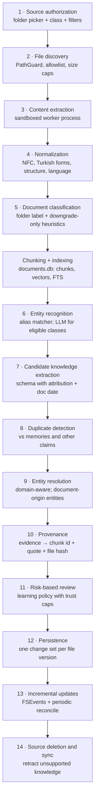

# LAZIS — Local Knowledge Ingestion Architecture

> Status: Phase 0.1 (new document) · Last updated: 2026-10-17 · Delivered in **P11**
> Prerequisites: P6 (memory), P7 (graph), P9 (learning policy and pipeline). Shared policy: [MEMORY_ARCHITECTURE.md §7](MEMORY_ARCHITECTURE.md). Domain rules: [KNOWLEDGE_GRAPH_DESIGN.md §9](KNOWLEDGE_GRAPH_DESIGN.md).

## 1. Principles

1. **Explicit authorization only.** LAZIS reads only folders and files the user has explicitly added. It never scans the computer, the home folder, Mail, Messages or Photos on its own.
2. **A document is not a statement by the user.** A project document that mentions "Ahmet" does not establish that Ahmet is the user's friend. Document content enters as *document knowledge*; it becomes *personal knowledge* only through the learning policy, with trust caps by source class.
3. **Four knowledge kinds are kept apart:** personal knowledge, project knowledge, general reference knowledge, and unverified document claims (§2).
4. **Read-only and reversible.** Source files are never modified. Every file version's contribution is one change set that can be rolled back, and removing a source removes what it contributed.
5. **Same machinery, lower trust.** The pipeline reuses the conversation learning components (extraction schema, evidence verification, entity resolution, policy), with document-specific trust classes and caps.
6. **Background and preemptible.** Ingestion never competes with a live conversation.

## 2. Source classes and knowledge domains

When adding a source, the user **must** choose its class. Per-file heuristics (frontmatter `type:`, first-person ratio, author metadata) may only **lower** trust relative to that label, never raise it.

| Source class | Examples | Default domain | Trust class | Automatic learning allowed |
|---|---|---|---|---|
| `personal_authored` | journal, personal notes, Obsidian daily notes written by the user | personal | **T2** | Facts about the user and their life, through the full policy. High-impact social or family facts are capped at **C** (confirmation) |
| `project_docs` | project specs, READMEs, meeting notes, plans | project | **T1** (T2 for user-authored sections) | Project entities, decisions, statuses and roles at most **B**. People mentioned become **document-origin entities** (provisional, project domain). **No personal relationships** |
| `reference` | manuals, articles, papers, books, saved web pages | reference | **T1** | **Nothing** becomes memory. Content is retrievable only as cited passages |
| `third_party` | messages or letters written by others, forwarded content, exported chats | personal (attributed) | **T1** | Claims are stored **attributed to their author** ("Ahmet'e göre …"), never as facts. Anything about the user → **C** |

**Unverified document claims** are every candidate extracted from a document that the policy did not promote. They live in `document_claims` (status `candidate`): searchable, citable, never presented as established personal knowledge.

## 3. Pipeline



| # | Step | Details | Failure handling |
|---|---|---|---|
| 1 | **Source authorization** | Native folder picker (Tauri) or drag-and-drop file import. The user sets the class (§2), recursion, include/exclude globs, file types and watch mode (live / manual). A `sources` row and an `audit_log` entry are written | — |
| 2 | **File discovery** | `os.scandir` walk under **PathGuard**: `realpath` must stay inside the root; symlinks out of the root are ignored; hidden and system files, `.git`, `node_modules`, `.obsidian/cache` and archives are skipped. A `source_files` row is kept per file (relpath, size, mtime, inode, content hash) | unreadable → `skipped` with a reason |
| 3 | **Content extraction** | Per-format extractors in a **separate worker process** with CPU/memory/time limits (untrusted parsers): Markdown (+ YAML frontmatter via safe loader, wiki-links), plain text, PDF text layer (`pypdf`, fallback `pdfminer.six`), saved HTML (`trafilatura`). No OCR in v1 | timeout or crash → `failed`, retried with backoff; encrypted or corrupt PDF → `skipped` |
| 4 | **Normalization** | Unicode NFC, de-hyphenation, whitespace, heading structure, language detection (tr/en/other), Turkish casefold/fold/stem copies for FTS | — |
| 5 | **Classification** | Source class from the folder label; per-file document type (journal, meeting notes, spec, article). Heuristics can only lower trust | ambiguous → keep the folder class |
| — | **Chunking + indexing** | Heading-aware chunks of ~400–800 tokens with ~15% overlap. Stable `chunk_id = sha256(source_id, relpath, normalized chunk text)`. Embeddings use the same model as memories, in `documents.db` (own vector and FTS tables). Restricted patterns (passwords, IBAN, TC Kimlik, card numbers) are **masked** in stored chunks | embedding failure → FTS-only, re-queued |
| 6 | **Entity recognition** | All classes: alias matcher (known entities). `personal_authored`, `project_docs`, `third_party`: LLM mention extraction. `reference`: no LLM (cost); only alias links to *public* entities | — |
| 7 | **Candidate extraction** | Same JSON schema as conversation extraction plus `asserted_by` (author/attribution) and `doc_date`. Runs only for eligible classes. The extraction call has **no tools**, and document text is wrapped as untrusted data | schema invalid → one repair, then the file is marked `partial` |
| 8 | **Duplicate detection** | Same subject/predicate/object, or cosine ≥ 0.92 with the same entities, against memories, relationships and existing claims. A match from a **different source type** counts as independent corroboration | — |
| 9 | **Entity resolution** | Domain-aware ([KG §9](KNOWLEDGE_GRAPH_DESIGN.md)): document persons default to new `origin=document` entities. Bridging to personal entities needs strong non-name evidence plus a user statement, or Level C | ambiguous → claim stays a `document_claim` |
| 10 | **Provenance** | `evidence` rows: `source_type=document_chunk`, `chunk_id`, verbatim quote, file relpath, file content hash, doc date, trust class | quote not found in chunk → candidate dropped |
| 11 | **Risk-based review** | The learning policy decides A/B/C/claim-only, with trust caps (§2). The review feed groups items by file ("Dokümanlardan öğrendiklerim") | — |
| 12 | **Persistence** | One change set per file version (`kind=document_ingest`). Promoted knowledge → memories/relationships; the rest → `document_claims` | transaction rollback, file → `failed` |
| 13 | **Incremental updates** | FSEvents watcher (`watchdog`) plus a periodic reconcile (mtime + size + hash). Changed file → re-extract, diff by `chunk_id`, re-run steps 6–12 only for new or changed chunks | missed events → caught by reconcile |
| 14 | **Deletion and sync** | See §6 | — |

## 4. Data model

`lazis.db` (migration `0009_sources`, P11):

```sql
CREATE TABLE sources (
  id TEXT PRIMARY KEY, kind TEXT NOT NULL,         -- folder|manual
  root_path TEXT, label TEXT NOT NULL,
  source_class TEXT NOT NULL,                      -- personal_authored|project_docs|reference|third_party
  recursive INTEGER NOT NULL DEFAULT 1, include_globs TEXT, exclude_globs TEXT,
  file_types TEXT NOT NULL, watch_mode TEXT NOT NULL,   -- live|manual
  status TEXT NOT NULL,                            -- active|paused|revoked
  created_at TEXT NOT NULL, last_synced_at TEXT
);
CREATE TABLE source_files (
  id TEXT PRIMARY KEY, source_id TEXT NOT NULL REFERENCES sources(id),
  relpath TEXT NOT NULL, size INTEGER, mtime TEXT, inode TEXT, content_sha256 TEXT,
  doc_type TEXT, language TEXT, status TEXT NOT NULL,   -- pending|extracting|indexed|partial|failed|skipped|removed
  last_error TEXT, last_change_set_id TEXT, indexed_at TEXT,
  UNIQUE (source_id, relpath)
);
CREATE TABLE document_claims (                     -- unverified document knowledge
  id TEXT PRIMARY KEY, source_file_id TEXT NOT NULL, chunk_id TEXT NOT NULL,
  claim_json TEXT NOT NULL,                        -- typed candidate incl. asserted_by, doc_date
  domain TEXT NOT NULL, status TEXT NOT NULL,      -- candidate|promoted|rejected|orphaned
  promoted_target TEXT, change_set_id TEXT NOT NULL, created_at TEXT NOT NULL
);
```

`documents.db` (own migration track; **rebuildable** from sources, encrypted with the same key, excluded from backups by default):

```sql
CREATE TABLE chunks (chunk_id TEXT PRIMARY KEY, source_file_id TEXT NOT NULL, ordinal INTEGER,
  heading_path TEXT, text TEXT NOT NULL, text_norm TEXT, text_fold TEXT, text_stem TEXT, token_count INTEGER);
CREATE VIRTUAL TABLE chunk_vec_v1 USING vec0(chunk_id TEXT PRIMARY KEY, embedding float[768], source_class TEXT);
CREATE VIRTUAL TABLE chunk_fts USING fts5(text_norm, text_fold, text_stem, content='', contentless_delete=1);
```

Cross-database references (`evidence.source_ref → chunks.chunk_id`) are not enforced by foreign keys. A reconciler job checks them, and stable content-derived chunk IDs keep them valid across a rebuild.

## 5. Retrieval of document knowledge

- A separate **documents channel** in `RetrievalService`, used when the turn concerns project or document content, or the user refers to notes ("notlarımda…", "proje dokümanında…").
- Hybrid search (vector + Turkish FTS) over chunks, rendered as **cited passages**, clearly distinct from personal memories: `[Belge: proje-planı.md › Takvim]`. Budget: ≤ 800 tokens per turn.
- Document passages never enter the stable prompt prefix.
- **Taint:** a turn whose context contains document text is *semi-trusted*. Instructions inside documents are data, never commands. Write tools are disabled for that turn unless the user's own message explicitly asks for a memory change ([SECURITY_MODEL.md §5.4](SECURITY_MODEL.md)).

## 6. Synchronization, removal and revocation

| Event | Effect on chunks | Effect on promoted knowledge |
|---|---|---|
| File modified | Changed chunks replaced; unchanged chunk IDs kept | Evidence from removed chunks is detached. Knowledge left **without any evidence** → retracted, unless it carries user-confirmation evidence (T5), in which case it is kept. The review feed notes each change |
| File deleted / moved out of root | Chunks removed | Same as above |
| File renamed within root | Detected via inode + hash, so it is re-pointed rather than re-ingested | none |
| Source paused | Watching stops; the index stays | none |
| Source removed (revoked) | All chunks and claims of the source deleted | A summary dialog shows the counts ("Bu kaynaktan 14 bilgi öğrenilmişti: 9 tanesi yalnızca bu kaynağa dayanıyor"). Choices: retract the source-only knowledge (default), or keep it as user-confirmed |
| Re-index | Full re-extraction from scratch | Idempotent through `chunk_id` and claim fingerprints; no duplicates |

## 7. Scheduling and resources

- Ingestion runs as **low-priority background jobs** through the same idle-aware, preemptible scheduler as conversation learning ([MEMORY_ARCHITECTURE.md §16.3](MEMORY_ARCHITECTURE.md)).
- Order: discovery and extraction (cheap, CPU) → embeddings (batched) → LLM extraction (expensive; eligible classes only, rate-limited, deferred on battery).
- Large first-time imports can take hours *(unmeasured; throughput is measured in P11)*. The UI shows progress, an estimate, pause/resume and per-file status. `ingestion.progress` events go over the WebSocket.

## 8. Security

- PathGuard, read-only access, a file-type allowlist, size caps (configurable; e.g., 50 MB PDF, 5 MB text), no archive extraction, no execution of anything.
- Parsers run in a **separate, resource-limited worker process**, because PDF and HTML parsers process untrusted input.
- Extraction calls have no tools. Document text is wrapped as untrusted data. Quotes are verified against the chunk.
- Restricted data is never extracted as claims and is masked in stored chunks. Original files are untouched.
- `documents.db` is encrypted with the same key as `lazis.db` ([SECURITY_MODEL.md §5.1](SECURITY_MODEL.md)).
- Every source authorization, revocation and re-index is written to `audit_log`.

## 9. Source management UI ("Kaynaklar")

- A list of sources with class, status, file counts (indexed / failed / skipped), last sync and errors.
- **Add folder** (picker → class → filters → preview of the file count before indexing). **Import files** (drag-and-drop into the "Manuel içe aktarmalar" source).
- Per source: pause/resume, re-index, remove (with the impact summary from §6), **import history** (per-file runs with counts, change sets and rollback), and an error list with retry.
- The review feed and the Memory view can filter by source.

## 10. Error recovery

- Per-file state machine: `pending → extracting → indexed | partial | failed | skipped`, plus `removed`.
- Crash-safe via durable jobs, and idempotent by content hash. Retries use exponential backoff (max 5); after that the file is dead-lettered with a visible reason.
- A change set per file version means a bad extraction can be rolled back for that file alone.

## 11. Testing

- **Fixtures:** fictional Turkish Markdown, PDF and HTML documents of each class (journal, project spec, article, third-party message).
- **Trust-cap tests:** "Ahmet in a project spec" never becomes `friend_of user`; reference documents produce zero memories; third-party claims are always attributed.
- **Incremental tests:** modify, delete, rename and move-out; revocation with source-only versus corroborated knowledge.
- **Security:** PathGuard fuzzing (symlinks, `..`, unicode tricks), oversized and malicious files in the sandbox, prompt-injection text inside documents (it must not trigger tools or memory writes).
- **Performance:** throughput on a synthetic 10k-file folder (measured in P11, with no target assumed in advance), plus foreground latency while ingestion runs (must stay within LRN-05).
