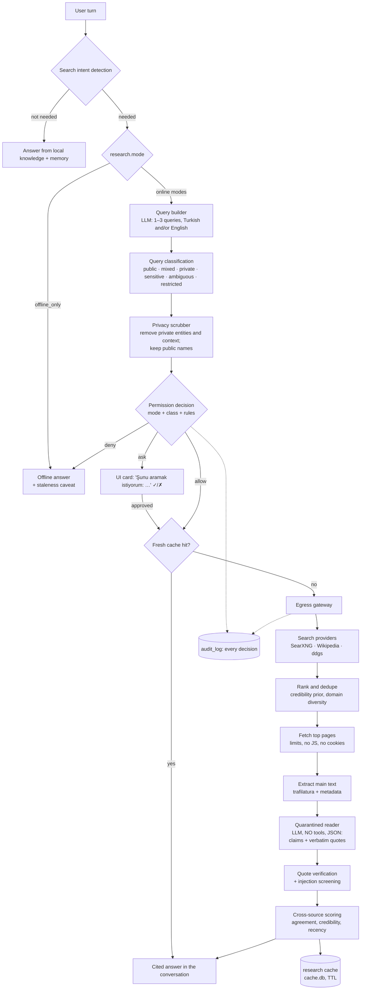

# LAZIS — Research Architecture

> Status: Phase 0.1 (revised), aligned with the Phase 1 requirements · Last updated: 2026-10-17 · Delivered in **P12**
> Owner requirements (Phase 1 brief): research is **Python-based, provider-agnostic, lightweight, Docker-free and privacy-controlled**, and internet access is **disabled by default**. LAZIS never requires Docker, for research or anything else.
> P1 status: only the configuration exists — `research.mode` defaults to `offline_only` and any other value is rejected until P12; the backend's network guard blocks every non-loopback connection.
> Principles: **the internet is an optional, controlled, visible capability.** Public information may be searched freely once the user enables it. Private information does not leave the device without an authorization policy. Web content never becomes trusted personal memory, and it never issues instructions.

## 1. Permission model

### 1.1 Modes (setting `research.mode`)

| Mode | Behavior | Default |
|---|---|---|
| `offline_only` | No network access at all. Research needs are answered from local knowledge, with a staleness caveat | **Yes, until the user enables research** |
| `ask_per_session` | LAZIS shows the planned queries once per **research session**, and the user approves or declines them as a group | — |
| `auto_public` | Ordinary **public-information** searches run automatically, with no confirmation. Queries that are private, sensitive or ambiguous still ask (§1.2) | Recommended once the user enables research |
| `custom` | Ordered user rules decide per query (§1.3) | — |

A **research session** is the set of queries and fetches generated to answer one user turn, plus explicit continuations ("biraz daha araştır", "kaynaklarına bak") within 10 minutes on the same topic. Approval in `ask_per_session` covers the whole session. Hard limits per session (configurable): 4 queries, 6 page fetches, 20 s of wall time.

### 1.2 Decision table by query class

| Query class (§3) | `offline_only` | `ask_per_session` | `auto_public` | `custom` |
|---|---|---|---|---|
| **public** (no private context) | none | ask once per session | **automatic** | rules |
| **mixed**: private context that can be removed (query rewritten without it) | none | ask | **automatic after scrubbing** (the sent query is shown) | rules |
| **private**: the information need *is* private (the user's own name, private persons, confidential projects) | none | ask | **ask** | rules (default ask) |
| **sensitive topic** (health, finances, legal, religion, politics, sexuality), even without names | none | ask | **ask** (configurable to allow) | rules |
| **ambiguous public/private name** (a public figure who shares a name with a private contact) | none | ask | **ask once to disambiguate** | rules |
| contains **restricted data** (IDs, IBAN, card numbers, credentials) | blocked | blocked | blocked | blocked (cannot be overridden) |

### 1.3 Configuration (`[research]` in the user config; editable in Settings → Gizlilik → Araştırma)

```toml
[research]
mode = "offline_only"               # offline_only | ask_per_session | auto_public | custom
sensitive_topics = "ask"            # ask | deny | allow
max_queries_per_session = 4
max_fetches_per_session = 6
session_timeout_s = 20
providers = ["wikipedia", "ddgs"]  # in priority order; "searxng" can be added if the user runs it natively
show_sent_queries = true            # always show the exact outbound query in the UI

[[research.rules]]                  # evaluated top-down, first match wins (custom mode; other modes use built-ins)
match  = { query_class = "public", topic = ["sports", "technology", "science", "software_docs"] }
action = "allow"
[[research.rules]]
match  = { query_class = "mixed" }
action = "allow_scrubbed"
[[research.rules]]
match  = { topic = ["health", "finance", "legal"] }
action = "ask"
[[research.rules]]
match  = { entity_visibility = "private" }
action = "ask"

[research.sources]                  # fetch-time domain policy (applies in every mode)
deny   = []                         # never fetch
prefer = ["*.gov.tr", "*.edu.tr", "tr.wikipedia.org", "docs.python.org"]
```

Rules can be added but cannot loosen the restricted-data block or the per-session hard limits.

## 2. Pipeline



## 3. Search intent detection and query classification

### 3.1 Intent detection
A hybrid detector:
1. **Explicit:** "araştır", "internete bak", "güncel durum ne", "kaynak göster".
2. **Temporal or volatile cues:** "bugün", "şu an", "son", "en yeni", "fiyatı", "kur", "maç sonucu", "hava durumu", "seçim", version numbers, dates after the model's knowledge.
3. **Model self-assessment:** the `research.search` tool is offered only in online modes. The model calls it when local knowledge is insufficient.
4. **Local-first:** if memory, document knowledge or a fresh cache entry answers the question, no request is made.

### 3.2 Query classification
Each generated query is classified before anything leaves the device. The classifier is deterministic first, with the LLM as a fallback:

| Signal | Source |
|---|---|
| Entity mentions in the query, resolved against the graph with their `visibility` (`private` / `public` / `unknown`) and project `confidentiality` | [KNOWLEDGE_GRAPH_DESIGN.md §9](KNOWLEDGE_GRAPH_DESIGN.md) |
| The user's own identifiers (name, email, phone, address, workplace + role combination) | profile + detectors |
| Topic category (sports, technology, science, software_docs, news, health, finance, legal, religion, politics, sexuality, other) | lexicon + embedding prototypes |
| Restricted-data patterns | `security` detectors |
| Unknown proper names: public figures, products and places versus private persons | the query builder's own label + absence from the private graph; ambiguous → `ambiguous` |

| Example user request | Class | What happens in `auto_public` |
|---|---|---|
| "Fenerbahçe dün kaç kaç bitti?" | public / sports | Automatic: "Fenerbahçe maç sonucu 16 Ekim 2026" |
| "Python 3.14'te neler değişti?" | public / software_docs | Automatic |
| "Ahmet'in kurmak istediği şirket için ne kadar sermaye gerekir?" | mixed | Automatic after scrubbing: "Türkiye limited şirket kuruluş sermayesi 2026" (the sent query is shown) |
| "Annemin kullandığı X ilacının yan etkileri" | mixed + sensitive topic | Scrubbed to "X ilacı yan etkileri", but health is sensitive → **asks** |
| "Ahmet Kaya'nın en bilinen şarkıları" (the user also has a colleague named Ahmet Kaya) | ambiguous | Asks once: "Şarkıcı Ahmet Kaya'yı mı soruyorsun?" On yes, it searches. No entity merge happens |
| "LAZIS projeme benzer açık kaynak projeler" (confidential project) | mixed | Project name removed: "yerel çalışan kişisel yapay zekâ asistanı açık kaynak" |
| "İnternette benim hakkımda ne var?" | private (user identity) | Always asks, and explains what would be sent |

### 3.3 Privacy scrubber
Deterministic and applied to every query in every mode:
- Removes or generalizes **private** entity names and aliases (all surface forms: folded, suffixed, capitalized), the user's identifiers, personal relationship words that reveal context ("annemin", "eşimin"), quoted personal text, and confidential project names.
- **Keeps** names of `public` entities, since they are necessary for the search.
- Never sends conversation text, memory content or document passages, and sends no referrer headers.
- If the scrubbed query loses the information need (e.g., "X kimdir?" about a private person), the query is reclassified as **private** and the permission decision applies.

## 4. Search providers (no mandatory paid APIs, no Docker)

Providers are plain Python adapters behind one `SearchProvider` port, so they can be added, removed or reordered without touching the research pipeline. Nothing in this list needs Docker, and none is required: research degrades to "no provider available" rather than failing the app.

| Provider | Setup | Privacy | Notes |
|---|---|---|---|
| **Wikipedia** (tr, en) | none (public API) | Low sensitivity | Reference and encyclopedic queries; strong source type |
| **ddgs** (fallback) | none (Python library) | Direct to DuckDuckGo endpoints | Scraping-based, so it can break; isolated behind `SearchProvider` |
| User-supplied key providers | optional, user's own free-tier key | per provider | Never required, never default |
| **SearXNG** (optional, advanced) | **Native** install in its own Python virtualenv (no Docker), bound to `127.0.0.1:8888`; P12 provides a helper script and docs. Treated like any other loopback service that forwards queries to the internet, so it still goes through the egress policy | Queries proxied with no user identity; engines configurable | AGPL; run as a separate, unmodified process, never linked into LAZIS. Not installed by default (it is a heavier dependency than the lightweight default set) |

Providers return normalized `SearchHit{url, title, snippet, provider, rank, published_at?}`. Ranking merges by reciprocal rank, dedupes by canonical URL, caps results per domain at 2 (diversity), and applies the credibility prior (§6).

## 5. Fetching and extraction
- Only through the **egress gateway** (`security.egress`): HTTPS only (HTTP upgraded or refused), connect/read timeouts of 5 s / 10 s, max 3 MB per response, allowed content types `text/html` and `text/plain` (PDF optional later), max 5 redirects with re-validation per hop, no cookies, generic User-Agent, no JavaScript.
- Private and loopback address ranges are blocked after DNS resolution (SSRF protection, including DNS-rebinding checks). `[research.sources].deny` is enforced here.
- **trafilatura** extracts the main content plus title, author, date and language. Pages yielding fewer than 200 characters of extracted text are skipped.
- Parallel fetch with concurrency 4, within the session limits.

## 6. Source credibility assessment

Credibility is a **ranking and phrasing signal, not a truth oracle**.

```
credibility(page) = prior(domain_category) × quality(page) × (1 − injection_penalty)
claim_confidence  = f(max/mean credibility of supporting pages, number of independent domains, recency fit)
```

| Domain category (`config/research/domain_categories.yaml`, user-editable) | Prior |
|---|---|
| Official / government / standards bodies | 0.90 |
| Vendor official documentation (for product and software questions) | 0.85 |
| Encyclopedic (Wikipedia) | 0.85 |
| News agencies and established news outlets | 0.80 |
| Academic publishers / preprints | 0.75 |
| Established specialist media | 0.70 |
| Unknown | 0.50 |
| Forums / Q&A | 0.50 |
| Social media | 0.35 |
| User-denied | excluded |

`quality(page)` rewards a publication date, an identifiable author or publisher, and clean extraction. It penalizes very short pages and content farms (heuristics). The answer phrases claims accordingly: "Resmî kaynağa göre…", "Tek bir kaynakta geçiyor, doğrulayamadım…".

## 7. Prompt-injection defenses (defense in depth)

1. **Quarantine:** web text is processed only by a *reader* LLM call that has **no tools**, a fixed task (extract claims relevant to the question) and strict JSON-schema output. Web text is wrapped in delimited data blocks and labeled untrusted.
2. **The main conversation never sees raw web text.** It sees only verified claims plus citations (the dual-LLM pattern).
3. **Quote verification:** every claim must include a verbatim quote present in the extracted page text. Unverifiable claims are dropped.
4. **Injection screening:** heuristics flag instruction-like patterns aimed at AI ("ignore previous instructions", "sistem talimatı", role tags, hidden-text tricks, tool-call syntax). Flagged sources are down-weighted or excluded and shown as "şüpheli kaynak".
5. **Taint tracking:** once research results enter a turn's context, the turn is `tainted`. Memory writes and all non-read-only tools are disabled, and memory commands require an explicit user request in a following turn.
6. **No autonomous chaining:** the reader cannot trigger more fetches. Only the query builder, working from the user's turn, creates queries, and every query passes classification, scrubbing and permission.
7. **Research content cannot change settings, permissions or modes.** Those change only through the UI or explicit user commands.

## 8. Verification, synthesis and freshness

- **Cross-source scoring:** claims are clustered by semantic similarity. Support from ≥ 2 independent domains gives high confidence; one source gives medium; conflicting sources give "kaynaklar çelişiyor", with both sides cited.
- **Freshness:** each answer states the date of its sources ("17 Ekim 2026 tarihli habere göre…"). Volatile topics prefer the newest dated sources. Cached results older than their TTL class are not used online. Offline, a stale cache entry may be used **only** with an explicit "şu kadar eski bir bilgi" caveat.
- **Answer format:** a Turkish answer with numbered citations [1][2]. Sources are listed with title, domain and date in text mode. In voice mode there is a short spoken attribution ("BBC Türkçe ve Reuters'a göre…") and the full list in the transcript panel.
- **Honesty:** if research fails, is denied or yields low-confidence results, LAZIS says so plainly.

## 9. Research cache (`cache.db`, own migration track)

```sql
CREATE TABLE research_queries (id TEXT PRIMARY KEY, query_norm TEXT NOT NULL, provider TEXT,
  created_at TEXT, ttl_class TEXT, expires_at TEXT, hit_urls_json TEXT);
CREATE TABLE research_pages (url_canonical TEXT PRIMARY KEY, fetched_at TEXT, title TEXT,
  published_at TEXT, domain_category TEXT, credibility REAL,
  content_text TEXT, content_sha256 TEXT, injection_flags_json TEXT);
CREATE TABLE research_claims (id TEXT PRIMARY KEY, query_id TEXT, url TEXT, claim TEXT,
  quote TEXT, support_count INTEGER, confidence REAL, created_at TEXT);
```
TTL classes: `volatile` (scores, prices, news, weather) 1 h · `recent` (tech news, releases) 24 h · `general` 7 d · `reference` (encyclopedic) 30 d. The cache is encrypted like the other databases, can be cleared from Settings, and is excluded from personal backups.

## 10. Research audit log

Every permission decision and outbound request is written to `audit_log` in `lazis.db` (category `research`), because the cache is disposable and the audit trail is not. Fields: `at`, mode, session id, query class, topic, matched rule, decision (auto / asked → approved|declined / denied), **the exact query text sent** (already scrubbed), provider, result count, fetched hosts (no paths), and number of scrubbed items.
Retention: query text 90 days, metadata 365 days (configurable). The log is visible in the "Araştırma günlüğü" view, exportable and deletable.

## 11. Relationship to personal memory
- Research results **never** create, update or supersede personal memories automatically (RES-07).
- The user may explicitly promote a researched fact ("Bunu hatırla"). That creates a memory with `origin=research_promoted`, the URL as evidence, and the user's confirmation as T5 evidence ([MEMORY_ARCHITECTURE.md §14](MEMORY_ARCHITECTURE.md)).
- If research contradicts a personal memory (e.g., a company's address), LAZIS mentions the discrepancy and asks. It never overwrites.

## 12. Offline fallback
With research disabled, offline mode on, a denied permission or no connectivity, LAZIS answers from model knowledge, memory and documents, and says the information may be outdated: *"Şu an internete bakamıyorum; bildiğim kadarıyla … ama bu bilgi güncel olmayabilir."* If the user agrees, the request is kept as an open loop to research later.

## 13. Tests
- **Classification:** a labeled set of ≥ 300 Turkish requests (public, mixed, private, sensitive, ambiguous, restricted), measured by confusion matrix. The gate is on *private → sent automatically* errors (must be 0).
- **Scrubber:** property tests (no private alias survives in any form: folded, suffixed, capitalized); public names preserved; a table of tricky cases.
- **Permission engine:** table-driven tests for every mode × class × rule combination; restricted always blocked.
- **Egress:** integration tests with a local fake web server (timeouts, size caps, redirects to private IPs, DNS-rebinding simulation, deny list).
- **Injection corpus:** ≥ 100 adversarial pages (Turkish and English). Gate: zero tool executions, memory writes or setting changes caused by page content; ≥ 95% of planted instructions not followed.
- **Audit:** every outbound request has exactly one audit row with the exact sent text.
- End-to-end with recorded fixtures (deterministic), plus an opt-in live smoke test.
