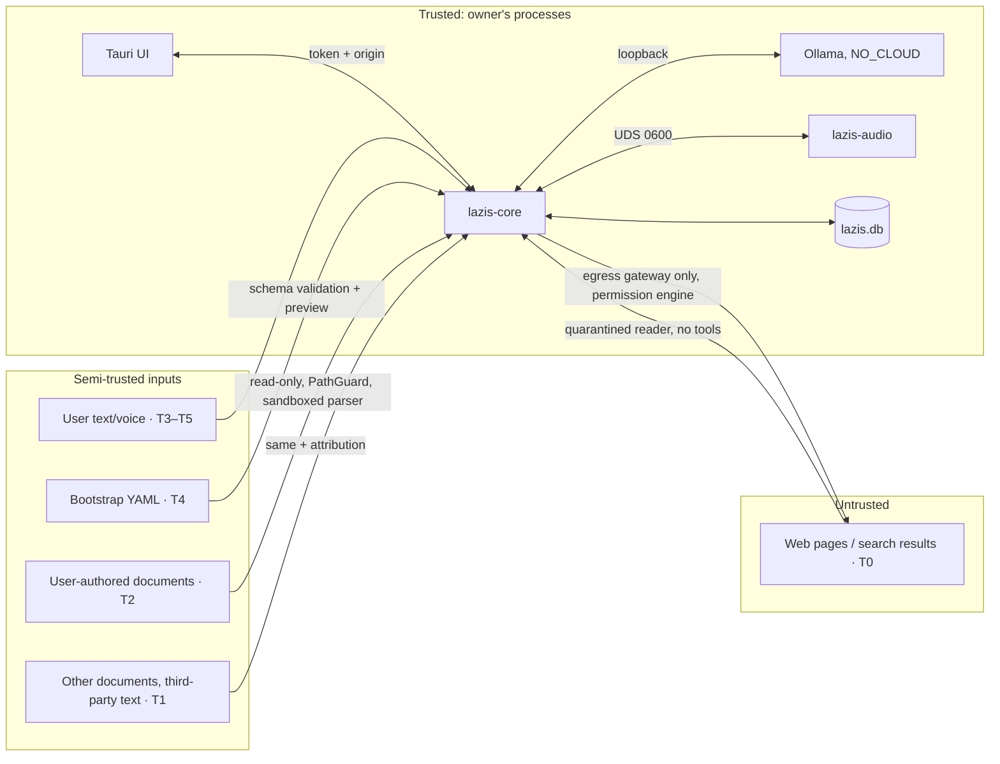

# LAZIS — Security and Privacy Model

> Status: Phase 0.1 (revised), updated with the Phase 1 implementation (§5.11) · Last updated: 2026-10-17
> LAZIS will hold one of the most sensitive datasets a person can have: their relationships, health, worries and plans. Security is a design constraint from **P1**, not a final-phase feature. P15 is an audit and hardening pass, not the point where protections are introduced.

## 1. Assets

| Asset | Sensitivity | Location |
|---|---|---|
| Personal memories, knowledge graph, conversations, change history | **Highest** | `lazis.db` (encrypted) |
| Audit log (incl. outbound research queries) | Medium–High | `lazis.db` (encrypted) |
| Document index (chunks of authorized files) | High | `documents.db` (encrypted, rebuildable) |
| Research cache, embedding cache, metrics | Medium | `cache.db` (encrypted, disposable) |
| Bootstrap files | Highest | user's file, imported into `lazis.db` |
| Voice reference clip / profile; the user's STT evaluation recordings | High (biometric-like) | `voices/`, private eval dir (never in the repository) |
| Logs | Low (by design) | `~/Library/Logs/LAZIS/` |
| Backups | Highest | `data.noindex/backups/` (encrypted) |
| Database key, recovery code, session token | Critical | Keychain / memory only / with the user |

## 2. Threat actors and assumptions

| Actor | In scope | Notes |
|---|---|---|
| Malicious web content (prompt injection, SSRF bait) | **Yes** | Primary active threat |
| Malicious or misleading content in authorized documents and third-party messages | **Yes** | Injection, false claims about people; trust caps + taint ([LOCAL_INGESTION_ARCHITECTURE.md](LOCAL_INGESTION_ARCHITECTURE.md)) |
| Local network attackers | **Yes** | Backend must be unreachable from the LAN |
| Other local macOS users / guest account | **Yes** | File permissions + database encryption |
| Device theft / lost laptop | **Yes** | FileVault (checked) + SQLCipher by default |
| Malware running as the user | Partial | Can't fully defend; encryption with a Keychain-held key raises the bar; no plaintext exports lying around |
| Model "misbehavior" (hallucinated memories, unsafe tool use) | **Yes** | Evidence verification, tool restrictions |
| Supply chain (malicious packages or model files) | **Yes** | Pinning, hashes, safetensors/GGUF only |
| Cloud/provider data collection | **Yes** | No cloud calls; `OLLAMA_NO_CLOUD=1`; egress gateway |
| Accidental disclosure by the user (sharing logs or screenshots) | Partial | Redacted logs, diagnostics bundle reviewed before export |

Assumptions: the owner's macOS account is trusted, macOS itself is not compromised, and the owner keeps FileVault enabled.

## 3. Trust boundaries

### 3.1 Trust classes for knowledge

Every piece of evidence carries a trust class. It drives the learning policy caps, contradiction tie-breaks and tool restrictions ([MEMORY_ARCHITECTURE.md §7](MEMORY_ARCHITECTURE.md)).

| Class | Source | May create personal knowledge? | Highest automatic level |
|---|---|---|---|
| **T5** | User edit, review approval, explicit confirmation of a question | Yes | A |
| **T4** | Explicit memory command; bootstrap items accepted in the preview | Yes | A (sensitive allowed, flagged) |
| **T3** | User statements in conversation (extracted) | Yes | A for low/medium risk; C for high risk |
| **T2** | Documents authored by the user (journal, personal notes) | Yes, capped | A for low risk; B for medium; C for high-impact social or family facts |
| **T1** | Other documents, third-party messages, LAZIS inferences | Project/reference knowledge only; personal claims → C | B (non-personal domain) |
| **T0** | Web research | **No** (separate cache; promotion only by explicit user action) | — |

Instructions found inside T0–T2 content are **data, never commands**. Only the user's own messages and the settings UI change LAZIS's behavior.

## 4. Data classification and policies

| Tier | Examples | Storage | Retrieval | Learning |
|---|---|---|---|---|
| `normal` | hobbies, food preferences, general facts | stored | normal | risk-based policy; usually automatic (Level A/B) |
| `personal` | family details, work, locations, routines | stored | normal; never sent to research unless the entity is public | risk-based policy (medium risk: A when confidence is high, else B) |
| `sensitive` | health, finances, religious or philosophical beliefs, political views, sexual life/orientation, legal or criminal matters, ethnicity, union/association membership, biometric data; intimate relationship details; third parties' sensitive info | stored with `sensitivity=sensitive` | only when topically relevant; never proactive unless allowed per item | **high risk → confirm first** (Level C), unless the user explicitly asked to remember it ([MEMORY_ARCHITECTURE.md §7](MEMORY_ARCHITECTURE.md)) |
| `restricted` | passwords, PINs, OTPs, national ID numbers (TC Kimlik No, checksum-validated), full card numbers (Luhn), IBANs, private keys, access tokens | **never stored**; detected and redacted in persisted messages | — | blocked + user is told why |

The sensitive categories mirror the "special categories of personal data" in Turkish data-protection law (KVKK Art. 6), used here as a sensible taxonomy. Purely personal and household processing by an individual is generally outside KVKK's scope, so this is a design reference, not a compliance claim.

**Third parties:** LAZIS stores information about people in the user's life. It keeps only what is relevant to the user's relationship with them, applies the same sensitivity tiers, and supports "forget everything about this person" with one action.

## 5. Controls by area

### 5.1 Storage and encryption

- Data under `~/Library/Application Support/LAZIS/` with directories `0700` and files `0600`. Permissions are verified at startup and fixed or warned about.
- **FileVault check** at startup (`fdesetup status`). If it is off, a persistent warning is shown. FileVault and database encryption are complementary.

**SQLite does not encrypt anything by itself.** Encryption requires **SQLCipher** (an SQLite fork with page-level AES-256 encryption), used through a Python binding (`sqlcipher3`) behind the storage connection factory.

| Topic | Design |
|---|---|
| **Default** | **Encrypted by default.** `lazis.db`, `documents.db`, `cache.db` and all backups are SQLCipher databases from the moment they are created |
| **When it is introduced** | **P1** builds the connection factory, key management and an encrypted `0001_system` database. No personal data exists before P3 (conversation persistence), so **real personal data is never stored unencrypted**. Development and test databases contain fictional data only |
| **Precondition** | Spike **SPK-05** (P1) must confirm that sqlite-vec and FTS5 load and work under SQLCipher, and measure the performance cost. **Result (2026-10-17): passed** — see [ADR-0003](adr/0003-storage-driver-and-encryption.md). The FileVault-only fallback below is therefore not used |
| **Migration from an unencrypted DB** (only for the SPK-05 fallback) | `ATTACH` a new encrypted DB with the key → `SELECT sqlcipher_export('encrypted')` → verify (integrity check, row counts, checksums) → atomic swap → delete the old file. On APFS/SSD, deleting a file does not guarantee the old blocks are erased (copy-on-write, wear levelling), so FileVault is what protects any plaintext remnants. The user is told this |
| **Key** | 256-bit random data key from `SecRandomCopyBytes`, generated at first run by the Rust shell, stored and **read back** before any database is created. Keychain generic password in the login keychain: service `com.lazis.app`, account `database-key-v1` (development profile `database-key-v1-dev`, other profiles `-<name>`; later key versions `-v2`, …), label "LAZIS database key", **not synchronizable** (never in iCloud Keychain). Never written to disk, argv, environment or logs; `Debug` output is redacted and buffers are zeroized on drop. *P1 limitation:* the "when unlocked, this device only" accessibility class belongs to the data-protection keychain, which needs a signed app with a keychain-access-group entitlement; it is adopted with Developer ID signing in the packaging phase (P15). Until then the item can move with a full user-account migration (Migration Assistant) |
| **Key access** | **Only the Rust shell** reads or writes the Keychain. It passes the key and the per-launch token to `lazis-core` over **stdin** (one JSON line; the pipe then stays open as a lifeline). `lazis-core` never touches the Keychain and accepts the key only from stdin (`--stdin-secrets` is mandatory). This replaces the earlier `KeyProvider`/`security`-tool plan (the CLI-only stage was dropped because the shell exists from P1). The Keychain ACL is bound to the app's code signature: the ad-hoc signed development builds may trigger one macOS prompt after each rebuild ("Always Allow" answers it); a stable Developer ID signature removes this (P15). Keychain errors are surfaced (`keychain_denied`, `keychain_unavailable`) and never bypassed |
| **Recovery code** | Format **`LZR1`**: payload = key (32 B) ‖ SHA-256("LAZIS-RECOVERY-v1" ‖ key)[0..4], encoded in Crockford base32 (58 symbols, groups of 5), e.g. `LZR1-XXXXX-…-XXX`. Input is case-insensitive; spaces/hyphens are ignored; O→0 and I/L→1 are accepted; the 32-bit checksum catches typos. Identical Python and Rust implementations share test vectors (`core/tests/fixtures/recovery_vectors.json`). First run shows a blocking dialog; the code appears **only on explicit request**, the user must tick "I saved it", and the acknowledgement is stored in `desktop-state.json`. Until acknowledged the dialog returns on every launch. After acknowledgement the code cannot be displayed again in P1 (re-display behind local authentication — Touch ID/password — is a later feature). The code is equivalent to the key: whoever holds it can open the data |
| **Key loss** | Keychain intact → automatic. Keychain item missing while a database exists → the app enters `needs_recovery`; **no new key is generated**. The user enters the recovery code; the shell decodes it, starts the backend with it, and only if the database opens (`LAZIS_READY`) stores the key in the Keychain again. A well-formed code for another database is refused (`recovery_code_wrong_database`) and nothing is stored. A Keychain key that does not open the database (`database_key_invalid`) also leads to `needs_recovery`. **Both key and code lost → the data is unrecoverable** (stated in the dialog). There is no backdoor and no master key |
| **New Mac / restore** | Restoring a backup on another Mac requires the recovery code |
| **Key rotation** | `PRAGMA rekey` re-encrypts the live DB under a new key version. Backup manifests record their key version, and old key versions are kept in the Keychain until no retained backup needs them |
| **Backups** | Produced with `sqlcipher_export()` into an encrypted file, with the same key version as the live DB at that time. A restore verifies the manifest, opens with the recorded key version, then runs migrations forward |
| **Full-text and vector search** | SQLCipher encrypts **every page**, including FTS5 shadow tables and sqlite-vec `vec0` storage, so search works unchanged. Decrypted pages exist only in process memory. **Measured in SPK-05** (50k × 768, M4 Pro): encrypted float32 KNN 160 ms/query with the default 2 MB page cache, **5.4 ms** warm with a 256 MB cache (first query ≈ 165 ms); int8 2.4 ms warm / 41 ms cold; FTS5 0.25 ms encrypted = plaintext. Decision ([ADR-0003](adr/0003-storage-driver-and-encryption.md)): size the page cache of the vector connection to the vector tables, pre-warm it in the background, and consider int8 + rescoring in P6 |
| **Temporary data** | `PRAGMA temp_store=MEMORY`. Imports are parsed in memory. Exports are written only where the user chooses, with a warning |
| **Other** | `PRAGMA secure_delete=ON`, `foreign_keys=ON`, `temp_store=MEMORY`, WAL with `synchronous=NORMAL`. The WAL is checkpointed (`TRUNCATE`) on shutdown. The driver refuses to start if `PRAGMA cipher_version` is empty (no plaintext fallback), and an existing file with a plaintext SQLite header is refused (`database_plaintext_detected`). After opening, the on-disk header is checked to be non-plaintext. Extensions are loaded with `enable_load_extension(True)` → load → `False`, so SQL-level `load_extension()` stays unavailable (verified in SPK-04). SQLCipher's optional memory-wiping setting (`cipher_memory_security`) is left at its default; its cost is evaluated in P15 |

### 5.2 Local API exposure
- `lazis-core` binds **127.0.0.1** on a random port (or a UDS in a later hardening step). It never binds 0.0.0.0.
- Per-launch 256-bit token required on every request and WS connection; constant-time comparison.
- `Origin` / `Host` header validation (Tauri origin only) against DNS-rebinding and browser-based CSRF from websites running on the same machine.
- Binding to 127.0.0.1 is **not** treated as authentication: any local process can connect, so every route requires the token. Implemented in P1 as `LocalApiGuard` (rate limit → Host → Origin → preflight → token → body limit, plus `no-store`, `nosniff`, `no-referrer`, `DENY` headers). Denials are audited as `security/request_denied`. The token lives only in Rust memory and in a closure in the UI (never in reactive state, storage or logs).
- Ollama: `OLLAMA_HOST=127.0.0.1:11434`, `OLLAMA_ORIGINS` restricted, `OLLAMA_NO_CLOUD=1`.

### 5.3 Network egress
- **Single egress gateway** (`security.egress`): the only code path allowed to open non-loopback connections, and the mandatory path for all research traffic, including any self-hosted search component that forwards queries to the internet (Docker-free; [RESEARCH_ARCHITECTURE.md](RESEARCH_ARCHITECTURE.md)). Local inference adapters may connect only to loopback (Ollama). A CI test monkey-patches `socket.connect` and fails on any other caller or destination.
- Policy: global kill switch (default **on = offline** until the user enables research), research permission modes and rules ([RESEARCH_ARCHITECTURE.md §1](RESEARCH_ARCHITECTURE.md)), domain allow/deny lists, HTTPS only, private IP blocking after DNS resolution, size and time limits.
- **P1 implementation: process-wide network guard** (`security/network_guard.py`), a PEP 578 audit hook installed at backend start. It refuses `socket.connect`, `sendto`, `sendmsg`, `bind` (including wildcard binds) and DNS lookups (`getaddrinfo`, `gethostbyname`, `gethostbyaddr`, `getnameinfo`) for any non-loopback destination; AF_UNIX stays allowed. Config pins `network.egress_enabled` to `false`. Tests run the guard in a subprocess and also check with `lsof` that the backend listens only on 127.0.0.1. The gateway with policy (allowlists, HTTPS-only, private-IP blocking) replaces this deny-all guard in P12. Research capabilities arrive in P12.
- Every outbound request and every permission decision is recorded in `audit_log` (§5.10), including the exact scrubbed query text, and is visible in the UI.
- Model downloads happen only through the explicit setup command (`scripts/pull-and-verify-models`), never at runtime.
- Verification aid: users can confirm with a host firewall (e.g., LuLu or Little Snitch) that only expected connections occur. The docs list the expected hosts.

### 5.4 Prompt-injection and tool safety
- **Tool registry** with declared capabilities: `memory.read`, `memory.write`, `memory.forget`, `graph.read`, `research.search`, `documents.search` (P11). There are **no shell, code-execution, file-writing, email/messaging or purchasing tools**.
- **Permission matrix:**

| Tool | Clean turn | Turn with document text (semi-trusted) | Turn with web content (tainted) |
|---|---|---|---|
| `memory.read`, `graph.read`, `documents.search` | allowed | allowed | allowed |
| `memory.write` (remember/correct) | on direct user intent | only if the **user's own message** asks for it | disabled; the user must ask again in a later turn |
| `memory.forget` | on direct user intent (Level C if the target is ambiguous or the change is bulk) | same as left | disabled |
| `research.search` | per research mode | per research mode | disabled (no autonomous chaining) |
| Settings / permission changes | **never via tools**; UI or explicit user command only | never | never |

- **Taint tracking:** content from T0–T2 sources marks the turn. Background learning uses only the *user's* messages as evidence for personal facts. Document claims go through the ingestion trust caps.
- Quarantined reader for web content; quote verification; injection heuristics ([RESEARCH_ARCHITECTURE.md §6](RESEARCH_ARCHITECTURE.md)).
- Model outputs are always schema-validated before they affect state. A tool call naming an unregistered tool or carrying invalid arguments is rejected and logged.

### 5.5 Local file access (P11)
- Folders and files are authorized explicitly by the user (native picker or drag-and-drop) and stored as `sources` with a mandatory source class. LAZIS never scans anything else.
- **PathGuard:** canonicalize (`realpath`) and require the result to stay inside an authorized root, which blocks symlink escapes and `..` traversal. Hidden and system files and archives are excluded. Access is read-only, with size caps.
- Parsers run in a **sandboxed worker process** (resource limits).
- Ingested content goes to `documents.db`. Its trust class (T1/T2) caps what can become personal knowledge. Revocation removes the chunks and claims and retracts knowledge that only that source supported. Full design: [LOCAL_INGESTION_ARCHITECTURE.md](LOCAL_INGESTION_ARCHITECTURE.md).

### 5.6 Logging and diagnostics
- Structured JSON logs that by default contain **no message content, memory content, names or transcripts**. They contain only IDs, event types, durations, counts and error codes.
- The redaction layer runs on every log record (a known-entity-name scrubber plus pattern detectors) as a second line of defense.
- **Debug content logging** is opt-in, auto-expires after 24 h, shows a visible UI badge, and is written to a separate file purged on expiry.
- Log rotation: 10 files × 10 MB. Crash reports are local only.
- The diagnostics bundle (for troubleshooting) is shown to the user before saving.

### 5.7 Backups and recovery
- SQLCipher-encrypted snapshots with rotation ([MEMORY_ARCHITECTURE.md §19](MEMORY_ARCHITECTURE.md)). An integrity check and a SHA-256 manifest (including the key version) accompany each one.
- Restore is tested automatically (CI round trip) and manually before each release.
- Key loss = data loss. The recovery code (§5.1) is the only way to restore on a new Mac or after Keychain loss, and setup explains this trade-off.

### 5.8 Supply chain
- Lockfiles: `uv.lock`, `pnpm-lock.yaml`, `Cargo.lock`, `Package.resolved`. Dependencies are updated deliberately with changelog review.
- Model files: **safetensors / GGUF / ONNX / MLX only**. Pickle-based `.bin`/`.pt` are never loaded (no `torch.load` on untrusted files). Weights are pinned by Ollama digest or Hugging Face revision SHA plus a file SHA-256 and verified at startup.
- Audits: `pip-audit`, `pnpm audit`, `cargo audit` in CI (advisory, not blocking for transitive low severity).
- The Tauri content security policy (CSP) is strict: no remote scripts, `connect-src` only to the local core, `img-src` limited to local and data URIs.

### 5.9 Voice-specific
- No audio persisted by default. The microphone is active only in an explicit session or PTT, with an always-visible indicator.
- Voice cloning only from consented or synthetic references, with consent metadata stored.
- The user's evaluation recordings (P13) are stored in the encrypted data directory, outside the repository, and can be deleted from Settings.

### 5.10 Audit logging

`audit_log` in `lazis.db` (created in P1) records security-relevant events **without personal content**:

| Category | Events |
|---|---|
| `memory` / `graph` | deletions (counts and ids only), bulk changes, merges, splits, change-set rollbacks |
| `learning` | review-mode changes, policy version changes, learning-run rollbacks |
| `import` / `ingestion` | bootstrap apply and rollback; source authorization, revocation, re-index |
| `research` | every permission decision and outbound request: mode, query class, matched rule, decision, **exact scrubbed query text**, provider, hosts (no paths) |
| `security` | policy denials, tool rejections, failed auth or origin checks, key operations (creation, rotation, recovery-code use), FileVault warnings |
| `settings` / `backup` | network enable/disable, permission changes; backup creation, restore, purge |

Fields: `id, at, category, action, actor, target_refs, change_set_id, outcome, reason_code, details_json`. Retention is configurable (default 365 days; research query text 90 days). It is viewable and exportable in the System and Research log views. Audit rows are append-only from the application's point of view; the user can purge them explicitly.

### 5.11 Phase 1 implementation summary (local threat model)

What the P1 foundation defends against, and how it was verified:

| Threat | Control | Verification |
|---|---|---|
| Another local user or a stolen disk reads the database | SQLCipher (AES-256, raw 256-bit key), 0700/0600 permissions, `data.noindex` | header is not `SQLite format 3`; stdlib `sqlite3`, `/usr/bin/sqlite3` and the `sqlcipher` CLI without the key cannot read it; WAL and backups encrypted (tests) |
| Silent plaintext fallback | driver check `cipher_version`, plaintext-header refusal, post-open header check | tests with a forged plaintext file and with the stdlib driver |
| Web page in the browser calls the local API (CSRF, DNS rebinding) | token + Host + Origin checks | API security tests; preflight without token gets no data |
| LAN access | loopback-only bind, refused LAN bind, audit-hook guard | `lsof` test; LAN-IP connect test; screenshot run showed only `127.0.0.1:<port>` |
| Secrets in argv, environment, logs, API errors | stdin handoff; cleared child env; redaction filter (bearer tokens, 48+ hex runs, `LZR1-` codes, `x'…'` keys); generic 500s | Rust test reads the running backend's argv + environment from the kernel (`KERN_PROCARGS2`) and finds no token/key/code; log scans for the real token/key/code in Python and Rust tests; manual log scan after app runs (0 matches) |
| Orphaned or duplicate backends | stdin lifeline, parent watcher, flock, single-instance plugin, reaping on drop | tests: lifeline close, SIGTERM, SIGKILL of the backend, dropped handle, second instance; manual: shell killed with SIGKILL → backend exited in 0.35 s |
| Key loss | recovery code + `needs_recovery` flow, no auto-regeneration over existing data | Rust lifecycle test (lost key → wrong code refused → right code restores) and Python backup/restore tests |
| Webview compromise reaching native APIs | Tauri capability allows only `core:event` listen/unlisten and the five LAZIS commands (app ACL manifest); no shell/fs/http/opener plugins; strict CSP; `freezePrototype`; the webview never receives the key | config review; release build validated the ACL |

Not defended in P1 (accepted, see §8): malware running as the user (it can talk to the API while the app runs and may obtain Keychain access through the same prompts), memory inspection of running processes, and a user who discloses the recovery code.

## 6. Privacy UX commitments
1. **Visible state:** network on/off, mic active, off-record, research pending, learning activity.
2. **"Ne biliyorsun?"** always works: the user can ask or browse everything stored about them or anyone else.
3. **Reversible by default:** undo for memory edits, merges and imports.
4. **No dark patterns:** LAZIS never pressures the user to share more, and it never guilt-trips.

## 7. Security testing (summary)
Injection corpus (web and documents), egress-blocking tests, research permission-matrix tests, path-traversal fuzzing, sandboxed-parser tests, auth-token and origin tests, log-redaction tests (seeded secrets must never appear), restricted-data detector tests (TC Kimlik checksum, Luhn, IBAN), tool permission-matrix tests, audit completeness tests, and encryption checks: files unreadable without the key; the key never in argv, env or logs; recovery-code restore on a fresh Keychain; key rotation with old backups. See [TESTING_STRATEGY.md](TESTING_STRATEGY.md).

## 8. Residual risks (accepted, documented)
- Malware running as the user while LAZIS is unlocked can read data through the same APIs. This is mitigated only partially.
- Older backups retain deleted data until rotation (disclosed; a purge option is provided).
- Local models can still produce wrong or harmful advice. LAZIS is an assistant, not a professional (medical, legal or financial) authority, and says so when relevant.
