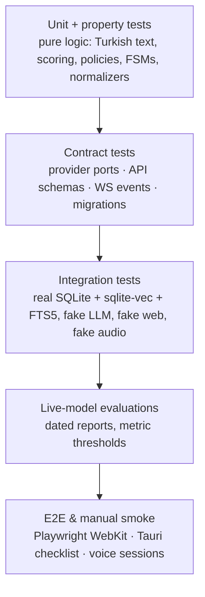

# LAZIS — Testing Strategy

> Status: Phase 0.1 (revised); §11 lists the implemented suites (Phase 1.1) · Last updated: 2026-10-17
> Rule: **no result is reported as passing unless the test was executed.** Phase reports include the exact commands and outputs.
> Benchmark protocols and gates: [BENCHMARK_PLAN.md](BENCHMARK_PLAN.md). Coding and test conventions: [ENGINEERING_STANDARDS.md §9](ENGINEERING_STANDARDS.md).

## 1. Test pyramid

| Layer | Deterministic? | Runs | Tools |
|---|---|---|---|
| Unit / property | yes | every commit (pre-commit + CI) | pytest, hypothesis, vitest, cargo test, XCTest |
| Contract | yes | every commit | pytest (provider suite against Fake + live opt-in), schema-drift check (OpenAPI → TS) |
| Integration | yes | every commit | pytest with temp DBs, `FakeLLMProvider`, local fake HTTP servers, fake audio source |
| Live-model eval | no (stochastic) | on demand, before each gate, after any model/prompt change | `evals/runners/*`, reports in `evals/reports/` |
| Performance | mostly | before gates; nightly when active | bench harness, perf tests (synthetic 50k DB), render perf run |
| E2E / manual | partly | before gates/releases | Playwright (WebKit), scripted manual checklists |

## 2. Deterministic testing of LLM-dependent code

- **`FakeLLMProvider`** implements `LLMProvider` with scripted responses, streaming simulation (token timing), tool calls, schema-invalid outputs (for repair paths), errors, timeouts and cancellations.
- **Recorded fixtures:** live responses can be recorded (`--record`) to JSON fixtures with prompt hashes. Tests replay them. A prompt change invalidates its fixtures, which forces a conscious re-record.
- Business logic around the LLM (validation, evidence verification, ER, policies) is tested with crafted candidate outputs, independent of any model.

## 3. Evaluation suites (live, Turkish)

All eval data uses **fictional personas** (e.g., "Deniz Yılmaz" and family). The user's real data, including their voice recordings, never enters the repository: it is kept in the encrypted data directory, and only metrics are committed.

| Suite | Size (initial) | Key metrics | Phase |
|---|---|---|---|
| Model bake-off (naturalness, instruction following, pushback, JSON, tools, drift, cache, memory) | ~350 items + bench scenarios | gates G1–G8, weighted score | P2 |
| Persona | ≥ 300 prompts + blind pairs | banned-phrase rate, emotion-claim rate, pushback rate, distinct-opener ratio, user preference | P5, P10 |
| Adaptation-vs-policy probes | ≥ 40 | 0 overrides of L0 or facts | P5, P10 |
| False-memory probes | ≥ 100 (incl. leading questions) | fabricated personal facts (must be 0), unsupported memory claims | P6 → every gate |
| Memory commands | 200 utterances | intent accuracy, argument accuracy | P6 |
| Retrieval | ≈ 300 query→memory pairs | recall@10, nDCG@10, diacritic robustness | P2 (embeddings), P6, P7 |
| Learning policy | table tests for every matrix cell, risk factor and override | exact level decisions | P6, P9 |
| Extraction gold | 100 dialogues, annotated claims | precision, recall, evidence validity, sensitivity labels | P2 (JSON), P9 |
| Calibration | extraction gold + held-out conversations | per-bucket precision vs. label (reliability diagram) | P9 |
| Entity resolution | ≥ 150 cases (incl. the Ahmet/Mehmet scenario) | name-only false links (must be 0), clarification routing, correct links | P7 |
| Relational questions | 60 questions | correct answers, listed/clarified multiples, fabricated no-path answers (must be 0) | P7 |
| Correction propagation | 40 scenarios | grounded items updated (100%), unrelated items changed (must be 0) | P7, P9 |
| Contradiction / dedupe / corroboration | 80 scenarios | correct action rate, silent overwrites (must be 0), independence rule | P9 |
| Provisional lifecycle | property tests | retrieval never promotes; promotion only on new evidence | P9 |
| Document ingestion | fictional document fixtures per source class | trust-cap violations (must be 0), citations, sync correctness | P11 |
| Research classification + permissions | ≥ 300 requests; mode × class × rule tables | private auto-sent (must be 0), public recall | P12 |
| Research injection | ≥ 100 adversarial pages | 0 tool calls/writes/setting changes; ≥ 95% instructions ignored | P12 |
| STT | ≈ 230 utterances in 11 categories (BENCHMARK_PLAN §7.2) | WER, CER per category, names, numbers, hallucinations | P13 |
| TTS | 64 sentences in 11 categories + 3-min passage (§7.1) | CER, blind MOS dimensions, stability, latency, resources | P13 |
| Turn-taking + barge-in | hesitation, continuation, backchannel sets + echo harness | cut-offs, endpoint latency, duck/flush latency, false barge-ins | P13 |

**LLM-as-judge** (a local model) is allowed only as a *screening aid* for large sets. Gates rely on deterministic checks or the user's own ratings. Judge outputs are spot-checked by hand (≥ 10% sample).

Eval reports record: date, git commit, model ID and digest, quantization, prompt/config hashes, hardware and power state, raw outputs (for audit), and metrics with confidence intervals where sample sizes allow.

## 4. Data and storage tests

- **Migrations:** `test_migrate_from_empty` and `test_migrate_from_vN` for every N (with fixture DBs generated at each schema version and committed). Checksum mismatch detection. Pre-migration backup verified.
- **Invariants** (run after integration tests): every memory and relationship has evidence and a creating change set; every history row belongs to a change set; no active knowledge references a merged or deleted entity; FTS and vector rows exist for every active or provisional memory; no pending item is used in retrieval; no orphan rows (including cross-database chunk references, checked by the reconciler).
- **Deletion completeness:** the content is grep-checked across all tables and indexes after forget.
- **Backup/restore round trip:** logical equality via row counts and per-table checksums.
- **Encryption:** encrypted DB unreadable with a plain driver; correct key opens; wrong key fails cleanly.

## 5. Turkish text processing tests
Table-driven cases (İ/ı casing, apostrophe and non-apostrophe suffixes, folding, stemming edge cases, relative dates around month and year boundaries, holidays) plus **hypothesis** properties: idempotence of normalization; `fold(norm(x)) == fold(x)`; suffix stripping never shortens a known alias below its root.

## 6. Voice tests
- Normalizer (≥ 300 cases: currency, dates, times, ordinals, percentages, abbreviations), chunker (abbreviations, decimals, clause rules).
- **Synthetic echo harness:** play LAZIS speech through the real output path while injecting pre-recorded user speech at known offsets. This measures barge-in detection latency, precision and recall per echo mode.
- Latency traces per turn; 2 h soak (memory growth, stability).
- Swift helper: XCTest for the framing protocol, resampling, and device-change handling (with simulated notifications).

## 7. Security tests
Injection corpora (web pages and documents); socket guard (only the egress gateway may connect); SSRF/DNS-rebinding against fake servers; research permission-matrix tables; path-traversal fuzzing; sandboxed-parser fault injection; tool permission-matrix tests; auth token and Origin checks; log redaction with seeded secrets; audit completeness; restricted-data detectors (TC Kimlik checksum, Luhn, IBAN mod-97); encryption tests (plain-driver open fails, key never exposed, recovery-code restore, rotation with old backups); model hash and pickle refusal.

## 8. UI tests
Vitest units (stores, WS client turn filtering, state-visual mapping); component tests; Playwright **WebKit** E2E against the dev server and a fake-LLM backend; deterministic-time screenshot tests of the Neural Core; render-performance run; a manual Tauri smoke checklist (because `tauri-driver` does not support macOS).

## 9. Performance testing
- **Bench harness** (P2 onward): the B1–B10 protocols of [BENCHMARK_PLAN.md](BENCHMARK_PLAN.md). Always on AC power, after a thermal settle, with other heavy apps closed, and with the environment manifest recorded.
- Retrieval perf with a synthetic 50k-memory DB, **plain and SQLCipher-encrypted**.
- Background-load test: foreground latency and cache reuse while extraction or ingestion jobs run.
- Ingestion throughput on a synthetic 10k-file folder (P11).
- Soak tests: 300-turn text session (P3); 2 h voice (P13); 7-day app run (P15).

## 10. Tooling and workflow
- `just test` (unit + contract + integration), `just eval <suite>`, `just bench`, `just e2e`, `just lint`.
- Pre-commit: ruff, pyright/mypy (changed files), eslint, vue-tsc, cargo fmt/clippy, secret scan.
- CI: local-first (the `just ci` target). GitHub Actions on macOS runners is optional if the repository is hosted. Live evals are never part of blocking CI (they need the GPU and real models).
- **Reporting template** per phase: commands run, pass/fail counts, failures with explanations, skipped tests with reasons, eval metrics vs. thresholds, known issues.

## 11. Implemented suites (Phase 1 + 1.1)

`make check` runs everything below except the opt-in Keychain test. Counts are from the Phase 1.1 run ([PHASE_1_1_REPORT.md](PHASE_1_1_REPORT.md) §J).

| Suite | Command | Count | What it proves |
|---|---|---|---|
| Backend unit | `make test-core` (`core/tests/unit`) | part of 146 | config layering and locked values, redaction, LZR1 codec vs shared vectors, data-directory lock |
| Backend integration | `core/tests/integration` | part of 146 | encryption six ways, migrations, change sets, backup/restore incl. SEC-05 logical equality (row counts + checksums of every table), **restore failure injection** (`test_restore_safety.py`: bad backups, wrong key, injected failures and real `os._exit` crashes at every step, read-only directory, open-database refusal), API endpoints + OpenAPI drift, real backend processes (lifeline, signals, duplicates, secrets) |
| Backend security | `core/tests/security` | part of 146 | API guard (token, Host, Origin, preflight, body/rate limits, WebSocket refusal, error hygiene, audit), application network/process guard, **OS sandbox** (`test_os_sandbox.py`: native `libc` connect, child process, UDP and DNS refused by the kernel; backend refuses to start without the sandbox) |
| UI unit | `make test-ui` | 21 | store phases, API client errors, Turkish strings cover every backend code, privacy card (sandbox, FileVault), recovery code only on request and never in the store |
| UI integration | `make test-ui-integration` | 3 | the TypeScript client against a real backend process |
| Shell unit | `make test-shell` (lib) | 19 | Rust LZR1 codec vs the Python vectors, key resolution, profiles, state file, handshake parsing, FileVault probe |
| Shell lifecycle | `make test-shell` (`tests/lifecycle.rs`) | 7 | the real backend under the real sandbox: first run → restart → lost key → malformed/corrupted/wrong-database codes (database bytes unchanged) → recovery; wrong key; crash detection + retry; missing runtime; drop-safety; duplicates; secrets absent from argv/env (kernel) and logs |
| Keychain (opt-in) | `make test-keychain` | 1 | write/read/delete of a dedicated test item in the real login Keychain |

Rules that apply to these suites: synthetic data only; no test contacts another host (refused targets are TEST-NET-1 `192.0.2.1`, `2001:db8::/32` and the reserved `.invalid` TLD); destructive tests run only in temporary directories, never against a real profile.

