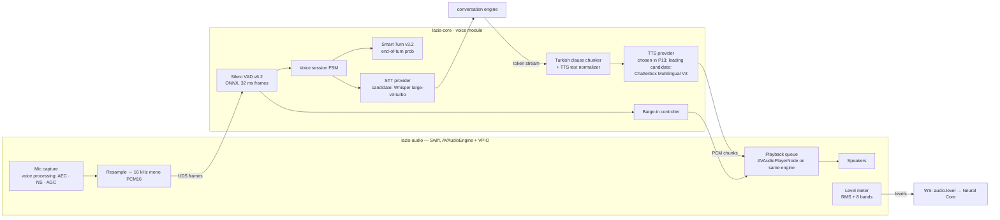
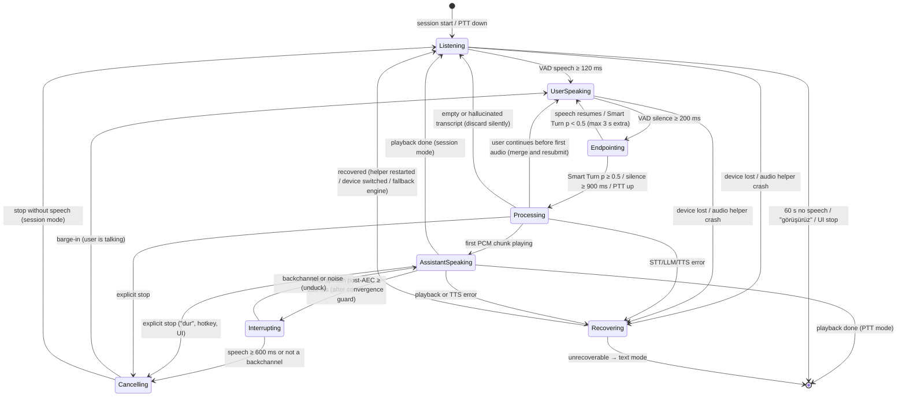
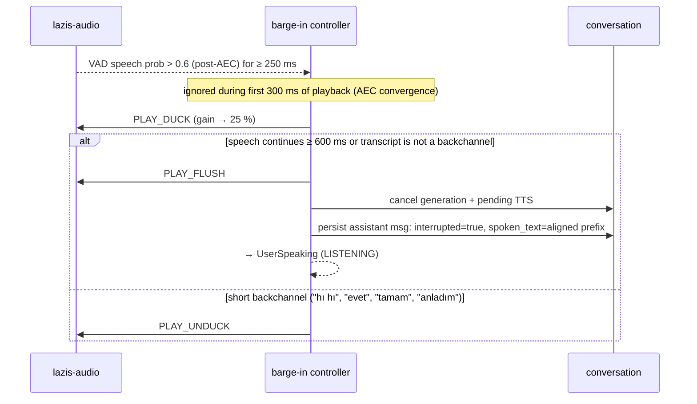

# LAZIS — Voice Architecture

> Status: Phase 0.1 (revised) · Last updated: 2026-10-17 · Delivered in **P13**. A feasibility smoke test (memory + RTF only) runs in P2 (SPK-07)
> Technology rationale: [TECHNOLOGY_DECISIONS.md §6](TECHNOLOGY_DECISIONS.md) · Evaluation suites, gates and decision rules: [BENCHMARK_PLAN.md §7](BENCHMARK_PLAN.md)
> **No voice component has been measured on the target machine.** STT and TTS engines are *candidates* until the P13 tests choose them.
> P1 status: no audio code exists. The config type-locks `voice.enabled = false` and `voice.microphone_always_on = false` (other values fail validation), and the app bundle declares no `NSMicrophoneUsageDescription`, so macOS cannot grant microphone access to this build at all. The microphone must never stay open while voice is disabled; in P13 it opens only for push-to-talk or an explicit hands-free session.

## 1. Goals and targets

**Target voice:** male, slightly deep, warm, natural, expressive, comfortable for long conversations, with clear Turkish pronunciation.

| Priority | Goal | Target † *(provisional; validated or revised in P13)* |
|---|---|---|
| 1 | Correct Turkish pronunciation | CER of TTS output (ASR round-trip) ≤ 5%; user pronunciation rating ≥ 4/5 |
| 2 | Natural male voice matching the target profile | user blind MOS ≥ 4/5 for naturalness and voice suitability; consented or synthetic voice only |
| 3 | Low latency | per-stage budgets (§13); end of speech → first audio p50 ≤ 1.8 s, p95 ≤ 3.0 s |
| 4 | Stable offline operation | 2 h soak without crash, leak or drift |
| 5 | Streaming | first audio before the LLM finishes; clause-level chunks |
| 6 | Apple Silicon efficiency | voice models ≤ 3.5 GB resident; idle CPU < 3% |

## 2. Components

Why the audio I/O lives in a Swift helper: macOS **Voice-Processing I/O** performs acoustic echo cancellation using the playback signal of the *same* audio unit as its reference. Capture and playback must therefore share one `AVAudioEngine` with voice processing enabled before start. Real-time audio callbacks also must not run Python code (GIL and GC pauses cause glitches). The helper is about 600–1,000 lines of Swift with no ML in it.

## 3. IPC protocol (lazis-audio ↔ lazis-core)

Transport: Unix domain socket at `$DATA/run/audio.sock` (0600). Frames are binary: `u8 type · u32 length · payload`.

| Type | Direction | Payload |
|---|---|---|
| `HELLO` | both | protocol version, sample rates, capabilities |
| `MIC_FRAME` | audio → core | 20 ms PCM16 mono 16 kHz (640 bytes) + monotonic timestamp |
| `LEVEL` | audio → core | source (mic/tts), RMS, 8 band energies (30 Hz) |
| `PLAY_CHUNK` | core → audio | chunk ID, sample rate (24 kHz), PCM16 samples |
| `PLAY_MARK` | audio → core | chunk ID, samples played so far (for spoken-text alignment) |
| `PLAY_DUCK` / `PLAY_UNDUCK` | core → audio | gain ramp (for soft barge-in) |
| `PLAY_FLUSH` | core → audio | stop immediately and drop the queue (≤ 20 ms) |
| `CONFIG` | core → audio | input/output device, headphone mode, AEC on/off |
| `DEVICES` / `DEVICE_CHANGED` | audio → core | device list, route changes |
| `ERROR` | audio → core | code, message |

The Swift side handles `AVAudioEngineConfigurationChange` (device hot-plug) by rebuilding the engine with voice processing re-enabled, then announces `DEVICE_CHANGED`.

## 4. Turn-taking pipeline

### 4.1 Voice session FSM (inside the voice module; drives the global assistant state)

| Voice state | Global assistant state (UI color) | Notes |
|---|---|---|
| `Listening` | LISTENING (purple, calm) | microphone open, waiting for speech |
| `UserSpeaking` · `Endpointing` | LISTENING (purple, mic-reactive) | speculative STT starts on `Endpointing` entry |
| `Processing` | THINKING (yellow) | STT → retrieval → LLM until the first audio |
| `AssistantSpeaking` | SPEAKING (green, TTS-reactive) | |
| `Interrupting` | SPEAKING (ducked visual) | playback ducked to 25% while deciding |
| `Cancelling` | transient (≤ 100 ms) | flush playback, abort LLM/TTS, persist only `spoken_text` |
| `Recovering` | ERROR.recoverable (red, steady) | short spoken notice through the fallback voice when possible |

- **Max utterance:** 30 s (Whisper window). Longer speech is committed at the next pause.
- **Speculative STT:** transcription starts on entry to `Endpointing`, in parallel with Smart Turn. If the turn continues, the result is discarded. This can hide STT latency in the common case *(effect measured in P13)*.
- **Continuation:** if the user starts speaking again during `Processing` *before* any audio is played, the in-flight LLM request is cancelled, the transcripts are concatenated, and the turn is resubmitted. Nothing is lost and no stale answer is spoken.
- **Cancellation semantics:** every cancel carries the `turn_id`. LLM streaming, pending TTS chunks and queued playback for that turn are all dropped. The assistant message is stored with `interrupted=true` and only the text that was actually played.
- **Recovery:** helper crash → restart (≤ 3 times per minute); device loss → switch to the default device; TTS failure → fallback voice for the remaining chunks; STT failure → "Seni duyamadım, tekrar eder misin?" via TTS, or a text prompt. After repeated failures, voice mode turns off with a clear message, and text mode continues.

### 4.2 Speech recognition
- Whisper large-v3-turbo (provisional), `language="tr"`, `temperature=0`, beam size per bake-off.
- **Proper-noun priming:** `initial_prompt` built from the 30 most relevant entity names and terms (knowledge graph + recent topics) improves names like "Elif", "Kaan" and place names.
- **Hallucination filters:** drop segments with high `no_speech_prob` together with low `avg_logprob`, or with a compression ratio above 2.4. Known Whisper silence hallucinations are blocklisted (e.g., "Altyazı M.K.", "İzlediğiniz için teşekkürler").
- **Output normalization:** keep the user's words verbatim for memory evidence and apply light punctuation. No rewriting.

## 5. Response streaming and synthesis

### 5.1 Turkish clause chunker
- Split the token stream at sentence ends (`. ! ? …`) and, **for the first chunk only**, at a clause boundary (`,` `;` `:` or a conjunction such as "ama", "çünkü", "ve") once ≥ 4 words have accumulated. This brings the first audio forward.
- Abbreviation-safe: `Dr. Prof. Doç. vb. vs. bkz. örn. yy. A.Ş. T.C. No.`, decimal numbers, times.
- Each subsequent chunk is 1–2 sentences, so prosody stays natural.

### 5.2 TTS text normalization (Turkish)

| Input | Spoken form |
|---|---|
| `1.250,50 TL` | "bin iki yüz elli lira elli kuruş" |
| `14:30` | "on dört otuz" |
| `3.` (ordinal) | "üçüncü" |
| `%15` | "yüzde on beş" |
| `17.10.2026` | "on yedi Ekim iki bin yirmi altı" |
| `km`, `kg`, `vb.` | "kilometre", "kilogram", "ve benzeri" |
| Markdown, emoji, URLs | stripped / "bağlantı" |
| English or brand words (`iPhone`, `GitHub`) | user-editable pronunciation lexicon (`telaffuz sözlüğü`) |

The normalizer is a pure function with a table-driven test suite (≥ 300 cases).

### 5.3 Synthesis pipeline
- The TTS worker synthesizes chunk *n+1* while chunk *n* plays, with a bounded queue (2 chunks ahead).
- Voice profile: reference clip + language `tr` + parameters (Chatterbox `exaggeration≈0.5`, `cfg≈0.5`; `cfg=0` if the reference clip is not Turkish, to avoid accent transfer, per the model card).
- **Fallback chain:** primary TTS → Piper `tr_TR` (fast, CPU) → text-only. Any switch is surfaced in the System view.

## 6. Barge-in and interruption handling

- **Spoken-text alignment:** `PLAY_MARK` gives the samples played per chunk. Within a chunk, the cut point is estimated proportionally by character offset. History records only what the user actually heard, so LAZIS never "remembers" saying things it never said.
- **Explicit stop:** hotkey or "dur", "tamam yeter" → immediate flush.

## 7. Echo management modes

| Mode | When | Behavior |
|---|---|---|
| **AEC (default)** | built-in or external speakers | VPIO echo cancellation; barge-in enabled after convergence |
| **Headphones** | output route is headphones (auto-detected) | AEC optional; lowest false barge-ins |
| **Half-duplex (safe fallback)** | AEC quality insufficient (spike SPK-09) or user choice | Mic frames ignored while SPEAKING; barge-in only via hotkey or explicit stop |

## 8. Interaction modes
- **Push-to-talk:** global hotkey (Tauri global-shortcut; default `⌥ Space`, configurable). Hold to talk, or tap to toggle.
- **Conversation session:** hands-free turn-taking until a farewell phrase, 60 s of silence, or the UI button.
- **Wake word** *(could, later)*: a custom "Lazis" model (e.g., openWakeWord-style training on synthetic plus user samples). Requires a false-accept evaluation before enabling, and runs only when the user enables it.

## 9. Voice identity (natural male voice)
1. **Design:** generate candidate male voices with VoxCPM2's text-described voice design, offline (one time; slow is fine). Example description: *"Otuzlu yaşlarda, hafif tok, sıcak ve sakin bir erkek sesi; net diksiyon, İstanbul Türkçesi."*
2. **Select:** the user rates the candidates blind, using the TTS suite sentences ([BENCHMARK_PLAN.md §7.1](BENCHMARK_PLAN.md)), for male-voice suitability, warmth, naturalness and long-listening comfort.
3. **Reference:** the chosen 10–20 s clip becomes the reference for whichever cloning engine wins the bake-off (`voices/lazis-v1.wav` + metadata: source = synthetic, created date, model). The engine is selected with the same reference across candidates, so voice and engine are not confounded.
4. **Alternative:** a consenting human speaker's recording, with consent recorded in the voice metadata. **Never** clone public figures or people without consent.
5. Chatterbox embeds the Perth imperceptible watermark in output. This is acceptable, and it is good practice.

## 10. Resource management
- STT and TTS load on the first voice session and stay resident while voice is in use. They are unloaded after 15 min without voice (configurable; frees ~3 GB). Warm-up runs a 1-word synthesis and a silent transcription so the first real turn is not cold.
- Under memory pressure (`memory_pressure` notifications / free memory < 2 GB), unload the TTS first and switch to the Piper fallback, then warn.

## 11. Privacy
- Audio is processed in memory and **not stored** by default. A debug option keeps the last 24 h of utterance audio (encrypted, auto-purged), clearly indicated in the UI.
- The microphone is captured only during an active voice session or PTT. Outside those, the Swift engine is stopped. The UI shows a persistent recording indicator while capture is active.
- macOS TCC: the helper is embedded in the app bundle, so the microphone permission is attributed to LAZIS (`NSMicrophoneUsageDescription` in Turkish).

## 12. Instrumentation and tests
- Per-turn voice trace: `t_speech_end`, `t_turn_commit`, `t_stt_done`, `t_request_sent`, `t_first_token`, `t_first_clause`, `t_first_pcm`, `t_playback_started`, plus barge-in events (`t_barge_detected`, `t_ducked`, `t_flushed`). Stored in metrics; per-stage p50/p95 shown in the diagnostics panel.
- **Evaluation suites:** TTS (64 sentences + a 3-min passage across 11 categories), STT (≈ 230 utterances across 11 categories, including fast, quiet, noisy, informal, names, interrupted and long), turn-taking (hesitation, continuation and backchannel sets) and the synthetic echo harness. All are defined in [BENCHMARK_PLAN.md §7](BENCHMARK_PLAN.md). The user's recordings are stored privately, never in the repository.
- Unit tables: normalizer (≥ 300 cases), chunker; FSM transition tests including continuation, cancellation and recovery; a 2 h soak test.
- **Future option:** Gemma 4 12B accepts audio input directly. It could be evaluated later for speech understanding, but a transcript is still required for memory evidence, so STT remains in the pipeline.

## 13. Latency budget (planning only; not measured)

| Stage | Budget *(est.)* |
|---|---|
| Speech endpoint detection | 250–400 ms |
| STT processing (5 s utterance) | 250–500 ms (partly hidden by speculative STT) |
| Retrieval + prompt assembly | 50–100 ms |
| LLM time-to-first-token (warm prefix) | 400–1,200 ms |
| First clause generation | 300–600 ms |
| TTS time-to-first-audio | 200–600 ms |
| Audio playback startup | 20–80 ms |
| **Sum** | ≈ 1.5–3.5 s |

The derivation is in [TECHNOLOGY_DECISIONS.md §8.3](TECHNOLOGY_DECISIONS.md). These budgets size the design. They are **not** results, and the end-to-end latency is reported as verified only after the P13 per-stage measurements.
